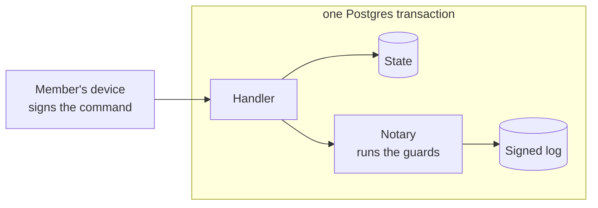

<p align="center">
  <picture>
    <source media="(prefers-color-scheme: dark)" srcset="apps/site/public/email/lockup-dark.png">
    
  </picture>
</p>

<p align="center">
  <strong>The cooperative workspace.</strong><br>
  <a href="https://app.cella.coop">Try the demo</a> ·
  <a href="https://cella.coop">cella.coop</a> ·
  <a href="_corpus/doc/architecture.md">Architecture</a> ·
  <a href="LICENSE">MPL-2.0</a>
</p>

Cella is a digital workspace for coops and other democratic
organizations: governance, work and finance in one place. Members
organize into circles, decide by motion, and grant mandates that the
system enforces. Nobody acts without a mandate, and every decision is
signed into a log the members can audit.

Cella is an early prototype. It is free and open source, and will stay
that way.

<!--
  SCREENSHOT: drop a screenshot of the app here, e.g. Lanterne's Inbox or
  a motion's page from https://app.cella.coop, saved under docs/ or
  packages/brand/, then replace this comment with:
  <p align="center"></p>
-->

## Why cella

When democracy lives in a separate app, tracking and enforcing
decisions is a mess. A vote happens in one tool, the money moves in
another, and nothing connects the two. Cella puts them together:

- **Circles, motions and mandates.** Organize into open or closed
  circles, from a small workgroup to the general assembly. Propose and
  vote on motions with the procedure your circle chose. An adopted
  motion grants a mandate, and the mandate is what lets someone act.
- **Rules the system keeps.** Every write is checked against the coop's
  own adopted policies before it takes effect. If you hold no mandate to
  pay a supplier, the payment is refused, and the refusal says what
  would fix it.
- **A signed log.** Each member signs their actions on their own
  device. A notary inside the coop's database runs the checks and
  appends every accepted action to a hash-chained, signed log. Fold the
  log into an empty database and you get the coop's records back, row
  for row, all but the personal data, which stays out of the log.
- **One server per coop.** Cella is single-tenant: no server holds two
  coops' data. Coops will join each other later by signed events, never
  by pooling their data.
- **Work and money too.** Projects, tasks and timesheets; invoices,
  bills and expenses on double-entry books; member capital, patronage
  returns and payslips; documents, meetings and files.

Our first focus is small worker coops in professional services, five
to ten members, in France, Italy, Spain and the UK. We want to support
any democratically governed organization eventually.

## Try it

The quickest way is the [live demo](https://app.cella.coop). It runs
Lanterne, a made-up creative agency run as a worker coop by its ten
members. You get a copy of your own and can sign in as any member.
Every name and number in it is invented.

## Run it locally

You need Linux (x86_64 or aarch64) and [Nix](https://nixos.org/download)
with flakes enabled. Nix brings everything else: Rust, Node and pnpm,
Postgres 18, DuckDB and the browsers the tests drive.

```sh
git clone https://github.com/cella-coop/cella
cd cella
nix develop                      # the toolchain, with `cella` on the path
pnpm install                     # the npm workspace, once
cella db start                   # builds the notary extension, starts Postgres in .data/
cella db reset --seed lanterne   # a fresh database holding Lanterne
cella serve                      # http://localhost:5173
```

The first run compiles the CLI and the Postgres extension, so give it a
while. In development the sign-in page lists Lanterne's members: pick
one and the browser signs as them with a test-only key. `cella db stop`
stops the database.

`cella` is the one entry point for every task. [The CLI's
doc](apps/org/rs/index.md) lists them all.

## How it works

Every change to the records is a command. The member's device signs
it, the server's handler runs it, and the notary, a Postgres extension
written in Rust, checks it and logs it in the same transaction as the
change itself.



Each command is labelled by how it contends with others: **confluent**
(merges in any order, like an edit or a vote cast), **bounded** (spends
a right granted in advance, like an invoice number) or **ordered**
(waits for the notary's verdict, like admitting a member). Today
everything goes through the server. The labels are there so later
versions can move confluent and bounded work to the members' devices
without a rewrite. [Trust](_corpus/doc/trust.md) explains the notary,
the keys, personal data, and what the prototype does not yet protect
against.

## How it's built

The code follows the **Graft Architecture**: an app is a tree of
nodes, each a core that cannot be removed, the optional **feats** on it,
and the **grafts** that own the relationships between feats. Six
axioms hold it together, most of them enforced by checks:

1. **Nesting.** An app is a tree of nodes; a graft sits in the lowest
   node holding all the feats it joins.
2. **Ancestry.** A feat depends only on the cores above it, never on
   another feat.
3. **Grafting.** A relationship between feats lives in the graft that
   joins them, which may build on smaller grafts.
4. **Ownership.** A slice owns its Postgres schema, who may read it and
   every write to it; every write goes through the notary.
5. **Layering.** A slice's layers import inward only; other slices use
   its contract, never its internals.
6. **Modularity.** Each coop chooses the modules its tree is made of.
   (Ruled, not built yet.)

[Architecture](_corpus/doc/architecture.md) states each axiom with the
check that enforces it.

The tree:

| Path | What |
|---|---|
| `apps/org/core/` | what every coop has: circles, people, policies, the notary, crypto, the log and the UI kit |
| `apps/org/feats/` | the optional feats: motions, membership, accounts, invoices, projects, documents and more |
| `apps/org/grafts/` | the grafts joining them, named by their feats, such as `invoice-project` |
| `apps/org/rs/` | `cella`, the CLI |
| `apps/org/ts/` | the web shell, a SvelteKit app that mounts every slice |
| `apps/org/fixtures/lanterne/` | Lanterne, the mock coop |
| `apps/site/` | the landing site at [cella.coop](https://cella.coop), built with Astro |
| `packages/brand/` | the house style: tokens, fonts, mark and wordmark |
| `packages/diagrams/` | the diagrams the site draws |
| `tools/` | the checks, migrations and seeds `cella` runs |
| `research/` | spikes: the Postgres extension, rule engines, the block editor |
| `_corpus/doc/` | the design docs |

The stack: Rust for the CLI, the crypto and the notary (as a Postgres
18 extension built with pgrx); TypeScript and Svelte 5 for the shell and
the slices; Loro for documents; DuckDB for reports; Nix for builds and
hosting.

Two commands keep it honest:

```sh
cella check   # the feat and SQL checks, types, svelte-check, cargo check and clippy
cella test    # Rust and tool tests, each slice's tests, then the end-to-end scenarios
```

`cella test` needs the database running (`cella db start`).

## Docs

- [Architecture](_corpus/doc/architecture.md): the axioms, feats,
  grafts, guards and the shell.
- [Trust](_corpus/doc/trust.md): the three kinds of command, the notary
  and the log, keys, personal data, current limits.
- [Ratchet](_corpus/doc/ratchet.md): the path from a hosted pilot to
  zero trust.
- [Operations](_corpus/doc/operations.md): running a coop's server,
  keys, backups and upgrades.
- [Users](_corpus/doc/users.md): who cella is for, starting with worker
  coops.
- [Legal forms](_corpus/doc/forms.md): the legal forms cella models,
  starting with the French SCOP.
- [Glossary](_corpus/doc/glossary.md): cella's terms and the coop terms
  it uses.

Each feat documents itself in its own `index.md`, next to its code.

## Status and roadmap

Cella is a prototype. It runs the demo, and we are looking for small
worker coops to pilot it in 2027. It is not ready to hold a real coop's
books yet. Expect breaking changes: until launch, database migrations
are rewritten in place.

It grows by a ratchet: each step adds a guarantee and never undoes the
one before.

1. **Pilot.** Hosted and online; double-entry books, the signed log,
   democratic roles, members signing on their own devices.
2. **Offline.** Members keep working without signal.
3. **Books of record.** VAT, statutory exports and e-invoicing, so cella
   replaces the accounting tool.
4. **Native client.** Signing in an app the host does not serve, so the
   host cannot forge a vote.
5. **Federation.** Signed events between coops, so they can trust each
   other's records.
6. **Witnesses.** Peers cosign each log, so no host can rewrite it or
   hold a coop hostage.
7. **Local-first.** The server becomes one more peer.

[Ratchet](_corpus/doc/ratchet.md) has the details.

## Contributing

Feedback is the most useful thing right now. Open an issue to report a
bug, ask a question or propose a change, and please talk to us before
a large pull request.

If you send code:

- Read [AGENTS.md](AGENTS.md). It holds the rules for every change,
  whoever writes it.
- Keep `cella check` green, and run the tests your change reaches.
- When you change a feat, update its `index.md` too. Docs say what the
  code is, in the present tense.
- Make small commits by path, such as `feat(invoice): …` or
  `graft(invoice-project): …`.

We build cella with the help of AI agents, under the same rules.

To report a security problem, please write to us privately through
[the contact page](https://cella.coop/contact) rather than opening an
issue.

## Contact

Write to us through [cella.coop](https://cella.coop/contact), or sign
up there for the newsletter and the pilot program.

## License

Cella is licensed under the [Mozilla Public License 2.0](LICENSE). The
site's photos come from Unsplash, under the
[Unsplash License](https://unsplash.com/license), credited beside each
one in `apps/site/src/photos/`.
