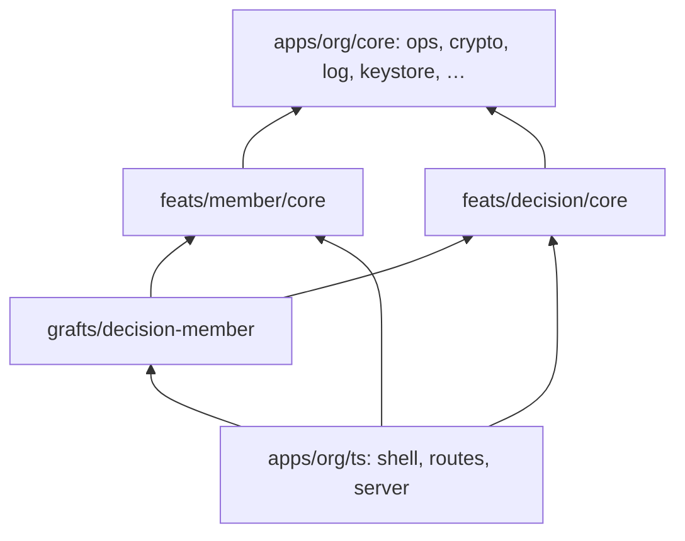

+++
title = "Architecture"
updated = 2026-10-24
+++

# Architecture

Cella is built as a tree of **feats**. The root feats of the repository are
its **apps**; apps hold feats, feats hold feats, and **grafts** join feats.
Each feat's **core** holds the libraries its feats inherit. The rules are
corpus's composable architecture as ruled on 2026-10-17, with seedling's
layers inside each package and the write labels and feat rulings of
2026-10-24.

## The tree



A node is a directory with a `feat.toml`. It holds:

- `core/` — what the feat is, and the libraries its children and grafts
  build on, one package each (`core/<lib>/rs`, `core/<lib>/ts`). The app's
  core is its shared library layer: `ops` (labels, permissions, outcomes),
  `crypto`, `log`, `keystore`, and later `db`, `auth`, `ui`. A leaf feat's
  core is all of it.
- `feats/` — its child feats, the same shape.
- `grafts/` — the joins between its child feats.
- `rs/`, `ts/` — the node's root, which assembles it. Only a node that links
  its feats into a binary or a shell has one.

Every package is an ordinary package in its ecosystem: a crate in `rs/`, an
npm package in `ts/`, one to a directory. The workspaces find them by glob
(`apps/**/ts`, `apps/**/rs`), so cargo, pnpm and editors work unchanged.

## Feats

A feat is a collection of things and is named for the collection it holds:
`member`, `decision`, `invoice`. `account` holds the chart of accounts,
members' capital accounts, reserves and funds, and their periods and
balances; `transaction` holds the journal's entries, a collection in its own
right. A federation-facing name more specific than these may come later.

What is a top-level feat is decided case by case, and org's feats are all
top-level: they sit flat under `apps/org/feats/`. A feat nests under another
only when it is a genuine sub-feature of that one feat. What everything
grafts onto belongs in the parent's core, not in a feat.

The notary is a feat of org like any other. Its Rust root builds its
binary, so the libraries it shares with the app stay in org's core.

## What may depend on what

| A package in | may depend on |
|---|---|
| a feat's core | the other packages of its own core; its ancestors' cores |
| a graft | the cores of the feats it joins; its node's and their ancestors' cores |
| a node's root | its own and its ancestors' cores, its feats' cores and roots, its own grafts |

Nothing is ambient: no global module, no library outside the tree, no
re-export that reaches around it. Third-party crates and npm packages are
the only dependencies from outside. When two apps need the same library, the
repository's root becomes the top node and the library moves into its core.

`tools/feat-check.mjs` reads each `package.json` and `cargo metadata`, the
manifests cargo and pnpm read, and not the lockfile, so it runs before an
install. It places each package by its path and refuses any other edge. It
also checks that every graft is declared, that its name is in order, and
that every feat it names is a feat of its node.

## Grafts

A graft owns a relationship between feats: its model, its junction table
with keys into each, and the handlers that react on either side. It is
named by the feats it joins, hyphenated in alphabetical order
(`decision-member`), so a feat's name has no hyphen. Most grafts join two
feats; a graft may join more where the relationship needs it, but avoid it
where two-way grafts will do. The feat that extends the others declares it
in its `feat.toml`. A graft has no pages of its own.

No foreign key crosses a feat boundary. A feat handles an unlinked entity
gracefully: an invoice without a client is unbilled, not invalid. The graft
adds the link.

## Rules

A rule lives at the lowest level that owns it: in a feat if it concerns
only that feat's collection, in a graft if it concerns a relationship, and
in a node's core only if it spans everything below that node.

- Payments on an invoice never exceed its total: the invoice feat's rule,
  since the payments are part of its collection.
- Nothing posts into a closed period: the `account-transaction` graft's.
  The period is an account's and the entry a transaction's; neither feat
  sees both, and the graft that resolves an entry's lines to accounts does.
- A surplus split adds up to the surplus: the account feat's. That the
  members approved it is the `account-decision` graft's.

The notary checks an ordered write against the rules of the feat and the
grafts it touches; it holds no rules of its own.

## Inside a package

Seedling's layers, innermost first; imports point inward only.

- Server: `models` (types, schemas, invariants, `permissions`, `ops.ts`) →
  `interfaces` (repository contracts) → `handlers` (`(input, deps) → Result`,
  jobs) → `drivers` (Postgres schema and repositories) → `api` (remotes,
  endpoints, events, subscriptions).
- Client: `hooks` → `components` → `bindings` (sockets, plugs) → `app`
  (pages, views, panes, blocks).
- Tests in `_tests/`.

A package's `exports` name its public surface: `./models`, `./api` and
`./bindings`. Nothing else is importable from outside it.

## Writes

Every write is `POST /api/<feat>/<op>` and maps to one permission,
`<feat>:<entity>:<op>`, declared in the feat's `models/ops.ts` with its label:

```ts
export const ops = {
  'member:member:invite': confluent(),
  'member:member:admit': ordered({ decide: 'consent' }),
} satisfies Ops
```

The label is part of the type: an ordered write returns `Pending` until its
verdict. The labels and the path each takes are in [trust](trust.md).

Every critical rule is enforced twice: the handler checks the permission and
Postgres row-level security backs it up. An ordered write is checked a third
time by the notary, in a way anyone can replay from the log.

## Feat flags

A feat's `feat.toml` names it, its group (governance, work, finance,
platform), whether it is built in, the rung it arrives at and the grafts it
declares. Groups are for navigation only; they are a field, not
directories. A co-op enables the feats it uses; a disabled feat's pages are
not served and its jobs and subscriptions go inert. Built-in feats are
always on.
