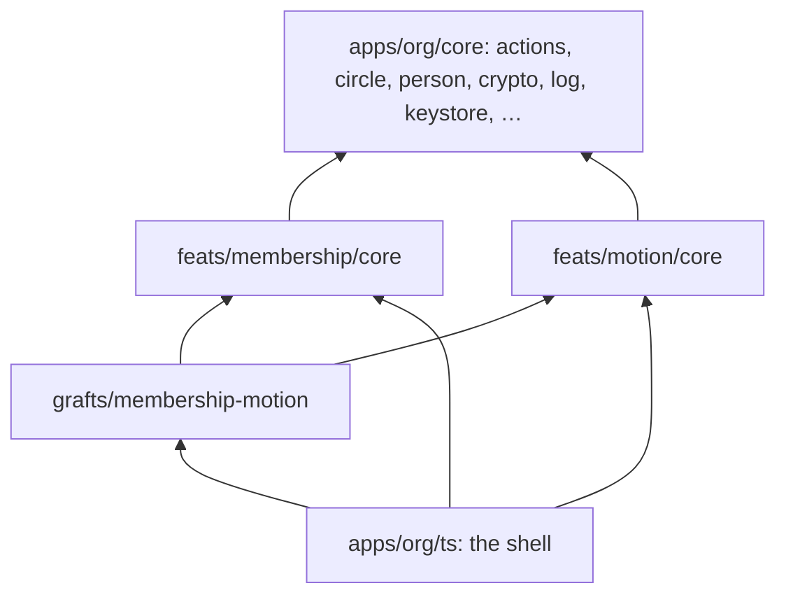

+++
title = "Architecture"
updated = 2026-11-13
+++

# Architecture

Cella is built by the **Graft Architecture**: an app is a tree of
**nodes**, each a **core** that cannot be removed, the optional
**feats** on it and the **grafts** that own the relationships between
them. It is six axioms, Nesting, Ancestry, Grafting, Ownership, Layering
and Modularity, the corollaries that follow from them, and the
definitions they use. Every clause says what holds it: a check that
refuses a violation, review, or a ruling not yet built. The operator
settled it on 9 November 2026; the design is the claude.ai page
`TGBfX9TgH7Ypv7eDq6uwic`, version 65, its text in the workshop's
`_corpus/graft-architecture.article.md`, and Astra's review of it
against main, [the review](26-11-09-graft-architecture-review.md), is
the reference for its findings.

The sections after [Open](#open) say how each axiom is built today, in
the code's own names. This page calls a call that writes a
**command**; the code and those sections still call it an **action**
(`models/actions.ts`, `cella:<feat>:<verb>` permissions, `## Actions`
below), until the layout stream renames them. The tree they describe
is the current one; [the target tree](#the-target-tree) maps each of
its paths to where the axioms put it.

## Definitions

**Tree**

- **node**: a core, with the feats and grafts on it. An app is the root
  node. A node is logical: its directory holds `core/`, `feats/` and
  `grafts/`, and a feat that is no node, a **leaf**, holds none of them.
- **lineage** of a slice or a lib: its node and that node's ancestors. A
  leaf feat's lineage is the node it sits on and that node's ancestors,
  the base case; a feat that is a node is in its own lineage's next
  link only for what sits on it.
- **core**: a node's libs, core feats and core grafts; never removed.
- **lib**: shared code with no data.

**Slices**

- **feat**: one domain. A feat may itself be a node.
- **graft**: the relationship between the feats it joins.
- **slice**: a feat or a graft, in core or not; each owns a schema.

**Interface**

- **call**: a query or a command a slice offers. A **query** reads.
- **command**: a call that writes; the notary logs it, with a power and
  a fold.
- **api**: a slice's calls.
- **contract**: what other slices may use of a slice: its models, its
  calls, its bindings and its published keys.
- **shell**: an entry point outside the tree that imports every slice
  and serves its calls.

**Shipping**

- **module**: a manifest and the nodes, feats and grafts it ships.

## Labels

Every clause below carries one label:

- **enforced**: a tool refuses a violation. The label names the check
  and its scope: one of the five `cella check feats` runs
  (`tools/feat-check.mjs` and, through it, `tools/sql-check.mjs`,
  `tools/writes.mjs`, `tools/powers.mjs`; `tools/ui-check.mjs`), or
  where it says so `cella migrate`, `cella check pruned`, the shell's
  registry as it loads, or the notary at run time. Each has its
  negative tests in `tools/_tests/`, which `cella test tools` runs.
- **convention**: review holds it; no tool sees it.
- **accepted**: ruled, and not yet built; the docs say it, the code does
  not yet.
- **proposed**: not yet ruled.

A check holds no more than its scope: what it cannot see is said beside
it, as SQL built at run time is beside `writes`.

## The axioms

### 1. Nesting

**An app is a tree of nodes. A graft sits in a node holding all its
feats.**

- *enforced* (`feat-check`, placing each package by its path,
  `tools/_tests/tree.test.mjs`): apps hold feats, feats hold feats, to
  any depth; a node's core is inherited by its descendants.
- *enforced* (`feat-check`'s edges for `packages/brand`,
  `packages/diagrams` and `apps/site`): the brand, the diagrams and the
  site sit outside the tree; the brand depends on no package of the
  repository, the diagrams on the brand alone, the site on the brand and
  the diagrams, and only the site depends on the diagrams.
- *enforced* (`feat-check`, `tree.test.mjs`; `sql-check` deriving the
  schema): a feat's name is unique in its app, at any depth, and
  unhyphenated, and its schema is its name, a graft's its name with
  underscores ([feats](#feats)). The check compares feats with feats,
  not with core's feats.
- *accepted*: a feat's name is unique among the installed modules; its
  schema derives from its module and its name.
- *proposed*: core holds libs, feats and grafts, `core/libs/`,
  `core/feats/`, `core/grafts/`; core feats are feats that cannot be
  removed. Today core's libraries and core feats sit side by side in
  `core/`, told apart by whether the directory holds a `sql/`, and its
  grafts in `core/grafts/` ([core grafts](#core-grafts)).
- *proposed*: a leaf feat's folders are its layers; `core/` appears only
  where a feat is also a node.
- *proposed*: the manifest names the role: `app.toml` at an app,
  `feat.toml` on every feat.

### 2. Ancestry

**A slice or a lib depends only on the cores of its lineage.**

- *enforced*: imports, SQL references and UI extensions reach only the
  cores of the lineage, or from a graft to what it joins. Imports:
  `feat-check` reads each `package.json` and `cargo metadata` and
  refuses any edge [the table](#what-may-depend-on-what) does not give,
  and a relative import leaving its package (`tree.test.mjs`); a bare
  import it does not read, the manifest being the edge. SQL:
  `sql-check` refuses a reference outside [the schemas a slice may
  name](#sql) (`reads.test.mjs`). UI: the shell's registry refuses, as
  it loads, a slice extending a collection it may not
  (`apps/org/ts/src/lib/server/slices.ts`); its reach takes in a
  slice's joined feats, their ancestors and core's collections.
- *enforced* (`sql-check`, every foreign key out of a schema): a key
  never crosses a feat; the keys out of a slice's schema are its
  record's owning circle, `circle.circle`, a grantee, `circle.grantee`,
  and core's people, `person.person`, for a feat, a graft and core
  alike, so a graft's key into a feat it joins is refused too
  (`powers.test.mjs`). The check reads the keys a `CREATE TABLE`
  makes; one an `ALTER TABLE` adds it does not.
- *proposed*: a key may point into any core feat, as an author's into
  the people.
- *enforced* (`feat-check` on core's packages, `tree.test.mjs`;
  `sql-check` on core's SQL, `core.test.mjs`; the shell's registry on
  core's slices): within a core, as on a node, no feat depends on
  another: a core feat uses its core's libs and its ancestors' cores,
  and a core graft joins core feats, as `circle-policy` does. Ruled by
  the operator on 9 November: "sideways core deps should not be
  allowed, its a bug that it ever was".

### 3. Grafting

**A graft also depends on the feats it joins and on the grafts joining
a proper subset of them.**

- *enforced* (`feat-check`'s graft edges, `sql-check`'s graft schemas,
  `tree.test.mjs`, `reads.test.mjs`): a graft reads the feats it joins,
  the cores below them and the lower-order grafts at or below its node,
  never a graft of equal or higher order ([graft order](#graft-order)).
- *proposed*: a nested node's core feats can be joined by a graft from
  above. Today no feat's graft joins a core feat, and `feat-check`
  refuses one that joins `circle` or `person`.

#### 3.1 Placement

**A graft sits in the lowest node holding all its feats.** It follows
from 1 and 3: a graft depends on every feat it joins, and the lowest
node holding them all is the one place each is in reach and no child
holds the relationship.

- *enforced* (`feat-check`, `tree.test.mjs`): it sits where no child of
  its node holds all its feats; it is named by its feats in alphabetical
  order and declared in the `feat.toml` of a feat it joins. The check
  sees that a joined feat declares it, not which feat extends.
- *proposed*: it has one owning module.
- *convention*: prefer pairs; three or more feats only when a concept
  needs them all.

#### 3.2 Migration

**Migrations run in tree order: core, feats, then grafts by the number
of feats they join.** It follows from 2 and 3: every dependency points
to a core of the lineage, a joined feat or a lower-order graft, each of
which this order applies first.

- *enforced* (`cella migrate`, `tools/migrate.mjs` and
  `tools/migrations.mjs`, `migrate.test.mjs` and
  `migrations.test.mjs`): it walks the tree in that order, the notary
  first, and refuses a database that applied a file since edited or
  gone. Until launch the files are rewritten in place and every
  database rebuilt ([migrations](#migrations)); the hashes hold each
  database to the files it applied, not the repository to its history.
- *accepted*: from launch an applied file is never edited: an app's
  `migrations.lock` keeps every migration's hash and `cella check`
  refuses a locked file edited or gone. No app holds a lock yet.

#### 3.3 Removal

**Removing a feat outside core removes only its subtree and the grafts
that join it.** It follows from 2 and 3: nothing depends on a feat but
what sits on it and the grafts joining it.

- *enforced* (`cella check pruned` and `cella test pruned`,
  `tools/prune.mjs` and `tools/pruned.mjs`, `prune.test.mjs`): no core
  package depends on a non-core slice, checked by building with every
  optional slice pruned, migrating core alone and signing in to it
  ([removing a feat](#removing-a-feat)).
- *convention*: who may act is core: seats, tenures and the authority
  check, held by core's `circle` and its graft `circle-person`, which
  registers the scope's one authority, `cella.authority` holding one
  row ([circles are core](#circles-are-core)). The pruned build proves
  core's authority answers with every feat pruned; no check refuses a
  feat's registering the authority.
- *proposed*: a motion's roll is core's too. Today it is the motion
  feat's, which reads core's seats ([graft order](#graft-order)).
- *proposed*: a module never adds to the app's core.
- *convention*: nest only for a removable subtree.
- *convention*: an unlinked record is valid: an invoice with no contact
  is unbilled, not invalid.

### 4. Ownership

**A slice owns its schema: who reads its rows, and every write to them.
Every write is a command; only migrations and erasure bypass the
notary.**

- *enforced* (`sql-check`, `reads.test.mjs`, `core.test.mjs`): a slice
  creates, alters, indexes, drops and grants only in its own schema; a
  core graft alters a table of a core feat it joins only to put it under
  the circles' row-level policies, and only the notary is exempt. Roles,
  event triggers, extensions, rules and default privileges the check
  does not read.
- *enforced* (`writes` on every package's TypeScript and the shell's,
  `sql-check` on every `sql/` file, `writes.test.mjs`): writes stay
  home: a graft changes a feat through its published write, reacts
  through `on`, refuses through a guard; no slice writes, or puts a
  trigger on, a table outside its schema, nor `cella.*` but to register,
  and only `@cella/org-db` calls `cella.begin`, `cella.submit` and
  `cella.follow` ([writes stay home](#writes-stay-home)). The check
  reads static SQL; SQL built at run time and a target named without
  its schema are left to review.
- *enforced* (at run time, by the notary's event trigger binding every
  table a migration makes, `core/notary/sql/007-notarised.sql`): every
  table refuses a row written outside a notary transaction. A migration
  writes with `cella.unbound` set, which only a superuser may set;
  erasure writes as the vault redacts; the `cella`, `vault` and
  `migration` schemas are not bound. Its tests are e2e,
  `apps/org/ts/_e2e/notarised.test.ts` ([trust](trust.md#current-limits)).
- *enforced* (`powers`, `powers.test.mjs`): every command names a power
  its SQL registers in `cella.power`, granted by a mandate, a collective
  mandate or a right in the fixtures, and a fold, `cella.lets_fold`,
  that replays its entry; the log's first entry declares `first`
  instead ([actions](#actions), [folds](#folds)). The check sees a fold
  registered; that it replays its entry row for row is proved by the e2e
  scenarios' re-fold ([tests](#tests)).
- *enforced* (`sql-check`'s row-level policies, `reads.test.mjs`;
  `cella migrate`'s `circle.unsecured`; `cella test e2e denial`): who
  may read a row is held by row-level security, the mechanism chosen,
  every table's enabled and forced and every reading policy of a known
  pattern ([reading](#reading)). It holds against a reader, not a
  hostile host ([trust](trust.md#current-limits)).
- *accepted*: migrations change schemas outside the notary, under the
  module set a motion or a policy activated; they are not entries.
- *accepted*: erasure removes a personal value from the vault by the
  person's right; the entry stays.
- *enforced* (`writes`, the notary's package alone writing `cella.*`;
  `sql-check`, `DROP EXTENSION cella` in every `sql/`): the notary is a
  layer under every slice, its own package,
  `apps/org/core/notary/rs`, and the `cella` database extension.
- *proposed*: a setting every slice reads is owned by a circle and
  offered by a core feat.

#### 4.1 Guards

**A guard lives in the SQL of the slice that owns what it guards, or of
the graft joining the slices it spans.** It follows from 4 and 3: a
guard refuses a write, every write is to rows a slice owns, and what
spans slices is a graft's.

- *enforced* (`sql-check`, every `sql/` file but the notary's,
  `core.test.mjs`, `policy.test.mjs`): a guard never reads the clock or
  randomness, since the log must replay, nor a policy's wording
  ([policies](#policies)); the register's own SQL and the core graft
  securing it read the wording. The check reads static SQL, and a `DO`
  block it refuses only outside core; TypeScript it does not read.
- *convention*: the handler checks the permission; the guard is never
  repeated in TypeScript.
- *convention*: a guard refuses as early as it can and says what would
  fix it ([early and actionable](#early-and-actionable)).

### 5. Layering

**A slice's layers import only inward. Other slices use only its
contract; only shells import its app.**

- *enforced* (`feat-check`, `tree.test.mjs`): a file in a layer imports
  only its own layer and the layers inside it, by the layer each path
  names ([inside a package](#inside-a-package)).
- *enforced* (`feat-check`'s exports, `tree.test.mjs`): a slice's
  package exports only `./models`, `./api`, `./bindings` and `./app`, a
  core lib's `.`, each export's target inside the layer its key names,
  `./api`'s in `src/api/`, a lib's `.` anywhere inside its package.
- *enforced* (`feat-check`, `tree.test.mjs`): nothing re-exports around
  the tree. No module re-exports a module of another package of the
  tree, by `export … from` or by exporting a name it imported, so a
  slice is reached only through the package that owns it, by the edge
  its manifest declares. The check resolves each import to the package
  it names, through a dependency's alias and the package's `imports`.
- *enforced* (`feat-check`, `tree.test.mjs`): **only a shell imports a
  slice's app.** A feat's, a graft's or a core feat's `./app` is
  imported by a node's root alone; another slice uses its contract, and
  a card it draws elsewhere or a word it says the same way everywhere
  sits in its `./bindings`. A lib holds no data and is no slice, so its
  subpaths stay open to every package its edges allow.
- *enforced* (`ui-check`, `ui.test.mjs`; the shell's registry): a
  slice's UI is its own, mounted through `./api` and `./app`; client
  code imports no server layer.
- *accepted*: a slice's api is its calls. A call is a query or a
  command, framework-free and validated by a Standard Schema. Built for
  every read the web shell makes, which `ui-check` holds by refusing a
  route's `load` (`ui.test.mjs`; [remote functions](#remote-functions)).
- *enforced* (`sql-check`, `views.test.mjs`; the shell's registry): a
  query may be written in SQL, as a view in its slice's own schema that
  reads as its reader; the slice declares it as a call, and the web
  shell serves it as any query ([queries in SQL](#queries-in-sql)).
- *proposed*: a slice declares sockets, named and typed slots, in its
  bindings; a graft or another module fills one with a plug from its own
  app. A graft shows itself only so, never with pages of its own.
- *proposed*: a slice's folders are its layers; inside one, files are
  named by language, and a driver may hold a folder per system, such as
  `postgres/`.
- *proposed*: a slice's SQL follows its layers: tables in models, guards
  and folds in handlers, SQL queries in api.

#### 5.1 Composition

**Only shells compose: they serve every slice's calls and match every
plug to its socket.** It follows from 5 and 2: only a shell imports a
slice's app, and no slice reaches a sibling to compose it.

- *accepted*: the web shell serves calls as remote functions and REST,
  the cli shell as commands, the analytics shell reads the SQL queries;
  a new transport touches one shell. Ruled by the operator on 9
  November (the review's finding 3).
- *enforced* (`feat-check`, `tree.test.mjs`): no slice imports another
  slice's app ([5. Layering](#5-layering)).
- *proposed*: an unmatched plug fails the build.
- *proposed*: a shell is a kit in core and a root at the app.

#### 5.2 Evolution

**A change keeps a slice's contract, adds to it, or removes what nothing
uses, never changing it in place; so a contract changes by expand,
migrate, contract, and its dependents change in parallel.** It follows
from 5 and 3: only the contract is reachable, and its dependents are
known.

- *proposed*: the checker fingerprints every contract and refuses a
  change that alters or removes a member a dependent still uses.
- *proposed*: a contract change is planned as an expand, one migration
  per dependent, each its own lane, and a contract once all have
  landed; the graft graph is the schedule.
- *convention*: a core's contract is the costliest to change, since its
  whole subtree depends on it; keep core small.
- *accepted*: after launch, data changes the same way: add, backfill,
  drop. Until launch, migrations are rewritten in place.

### 6. Modularity

**Each co-op chooses the modules its tree is composed of.**

- *accepted*: a module is a manifest and its contributions, named in
  reverse-DNS by its publisher's domain, which lists the signing key;
  each part belongs to exactly one.
- *accepted*: tables are private to their module: everything outside
  it reaches a slice only through its calls and its published keys.
- *accepted*: it is installed by motion and upgraded by a policy
  adopted by motion.
- *accepted*: hard requirements form a DAG; a graft onto another
  module's feat is conditional on that module.
- *accepted*: two installed feats sharing a name are aliased at
  install; an unresolved collision is refused.

#### 6.1 Retirement

**A module is retired, never erased; the log keeps replaying its
entries.** It follows from 6 and 4: every command's entry folds, and
the log replays from its first entry.

- *accepted*: retiring is refused while a hard requirement depends on
  it; conditional grafts onto it retire with it.
- *accepted*: folds are versioned per release; an entry folds with the
  release that wrote it.
- *accepted*: a retired module's tables freeze; its queries stay
  readable for export, its commands are refused; only vault values are
  erased.
- *accepted*: a retired module may be reinstated by motion, at its
  release or a later one; the log continues.
- *accepted*: a set of modules is activated by a log entry citing the
  motion or policy behind it.

## Principles

- **Autonomy.** A feat is one domain: its models, logic, schema and UI.
  It imports no other feat and holds no foreign key into one.
- **Composition.** Where two feats meet, a graft owns the meeting. It
  depends on the feats; they never know it.
- **Optionality.** Every feat outside core can be removed. What cannot
  be removed without breaking the platform is a feat in core.
- **Recursion.** A feat can be a node with its own core, feats and
  grafts. The rules hold at every level.
- **Code shared, data home.** Shared behaviour is a core lib; the data
  it works on lives in each slice's own tables.
- **Subsidiarity.** A rule, guard or relationship lives at the lowest
  level that owns it.
- **Parallel work.** Lanes meet only at contracts. A change inside a
  slice touches nothing else; a contract changes by expand, migrate,
  contract, so its dependents move in parallel.
- **Redundancy.** The handler checks the permission and SQL holds the
  guard; an ordered command is checked a third time by the notary.
- **Enforced by tooling.** A rule a tool can see is checked, with a
  negative test. A rule no tool can see says so.

## The target tree

The axioms place the tree as below; today's paths differ, and this
table maps each one the target moves. The moves are the layout
stream's and their own streams', each landing its row; until then the
sections after [Open](#open) and the checks describe today's paths.

```
apps/org/
  app.toml            the app, its scopes and its shells
  core/
    notary/           the database extension under every slice
    libs/             pure code, no schema: ui, blocks, files, crypto, db, …
    feats/            not optional: log, circle, person, motion, policy
    grafts/           where two core feats meet: circle-person, circle-policy, …
  feats/
    task/             a leaf: feat.toml, index.md, package.json and its layers,
                      app/ bindings/ components/ hooks/ api/ drivers/
                      handlers/ interfaces/ models/ _tests/
    finance/          a nested node: feat.toml, core/feats/{account,transaction},
                      feats/{invoice,bill,expense,payslip}, grafts/
  grafts/             at the lowest node holding all their feats
  shells/
    web/              remote functions and REST; mounts every app
    cli/              the calls as commands of the cella CLI
    analytics/        reads every slice's SQL queries, read-only
```

| Today | Target |
|---|---|
| `apps/org/feat.toml` | `apps/org/app.toml` |
| `apps/org/core/<lib>/{ts,rs}`: `actions`, `body`, `crypto`, `db`, `guards`, `keystore`, `log`, `pdf`, `sign`, `ui`, `vat` | `apps/org/core/libs/<lib>/`, its layers as folders; `body` as `blocks`, and the log a core feat, `core/feats/log/` |
| `apps/org/core/notary/{rs,sql}` | `apps/org/core/notary/` |
| `apps/org/core/<feat>/{ts,sql}`: `circle`, `person`, `policy`, `analytics` | `apps/org/core/feats/<feat>/`; `analytics` the analytics shell's kit |
| `apps/org/core/grafts/<graft>/{ts,sql}` | `apps/org/core/grafts/<graft>/`, its layers as folders |
| `apps/org/feats/motion/` | `apps/org/core/feats/motion/`, and its graft with the register `core/grafts/motion-policy/` |
| a leaf's `feats/<feat>/core/ts/src/<layer>/` and `core/sql/` | `feats/<feat>/<layer>/`, its SQL in the layer it belongs to: tables in `models/`, guards and folds in `handlers/`, queries in `api/` |
| a graft's `grafts/<graft>/{ts,sql}` | `grafts/<graft>/<layer>/`, as a leaf's |
| `apps/org/feats/{account,transaction}/` | `apps/org/feats/finance/core/feats/{account,transaction}/` |
| `apps/org/feats/{invoice,bill,expense,payslip}/` | `apps/org/feats/finance/feats/<feat>/`, their grafts among themselves in `finance/grafts/` |
| `apps/org/ts/` | `apps/org/shells/web/` |
| `apps/org/rs/` | `apps/org/shells/cli/` |
| the analytics shell, run by `cella analytics` | `apps/org/shells/analytics/` |

Finance nested, motion and the log promoted into core, and a body as
`blocks` are the design's picture, not yet ruled clauses: each lands
by its own stream, and the axioms hold whichever way it goes.

## Open

Unplanned, and answered by no clause yet:

- **Declaring calls and keys for other modules**: how a slice marks the
  calls and keys other modules may use, how they are versioned with the
  module, and how the checker knows which module owns what.
- **Upgrades**: after launch migrations are append-only; how a module
  version declares what it migrates, and what a co-op sees before its
  policy applies it.
- **Listing and vetting**: where modules are listed, and how a co-op
  vets one before its motion.
- **Per-co-op builds**: shells generated from each co-op's modules mean
  a build per co-op, which a signed native client has to accommodate.
- **Grafting into a nested core**: adopted in the design, so a root
  feat's graft can join a nested node's core feat; whether it erodes
  the nested node's encapsulation is watched.
- **Manifests**: `app.toml` and `feat.toml`, or one `node.toml`.
- **Two CLIs**: the `cella` dev tool and a co-op's runtime cli shell
  are different things.

## The tree

The tree as it is today and as the checks read it; [the target
tree](#the-target-tree) maps each path the axioms move.



A node is a directory with a `feat.toml`. It holds:

- `core/` — what the feat is, and the libraries its children and grafts
  build on, one package each (`core/<lib>/rs`, `core/<lib>/ts`). The app's
  core is its shared layer, of two kinds. Its **libraries** own no schema:
  `actions` (labels, permissions, outcomes), `crypto`, `log`, `keystore`,
  `guards` (the pure guard primitives), `body` (a record's free-form
  content as a Loro tree of blocks, and the block editor,
  [body](../../apps/org/core/body/index.md)), `notary` (the `cella`
  Postgres extension over them), `db` (an action's transaction), `sign` (a device's
  signature on an action), `vat` (a document's lines, their amounts and
  VAT, which invoices and bills share), `pdf`, `ui` (the shell's tokens
  and components) and later `auth`. Its **core feats** each own a schema,
  as a feat does: `circle` (the circles, their roles, tenures, seats and
  mandates, [circles are core](#circles-are-core)), `person` (the people,
  their devices, the keyring and the inbox, [people are
  core](#people-are-core)), `policy` (the register of the policies
  circles adopt by motion, [policies](#policies)) and `analytics` (the
  port reports are read through). Core feats that use one another are
  joined by **core grafts**, in `core/grafts/` ([core
  grafts](#core-grafts)). A leaf feat's core is all of it.
- `feats/` — its child feats, the same shape.
- `grafts/` — the joins between the feats below it, at any depth, that no
  child of it holds all of ([grafts](#grafts)).
- `rs/`, `ts/` — the node's root, which assembles it. Only a node that links
  its feats into a binary or a shell has one. Org's `rs/` root is `cella`,
  the CLI that is the repository's one entry point for every development and
  production task ([the CLI](../../apps/org/rs/index.md)); its `ts/` root is
  the shell.

Every package is an ordinary package in its ecosystem: a crate in `rs/`, an
npm package in `ts/`, one to a directory. The workspaces find them by glob
(`apps/**/ts`, `apps/**/rs`, `packages/*` for the brand and `apps/site`
for the site), so cargo, pnpm and editors work unchanged.

Two packages stand outside the tree. The brand, `packages/brand`
(`@cella/brand`), is the house style the app, a docs shell and the site
all wear ([its doc](../../packages/brand/index.md)). It holds no feat,
writes no SQL and imports no framework; its tokens, fonts, mark and
wordmark are generated by `cella brand` from its `house.json` and
committed. The site, `apps/site` (`@cella/site`), is the landing site,
an Astro site that wears the brand ([its doc](../../apps/site/index.md));
it holds no feat and writes no SQL either, and depends only on the brand
and the diagrams ([their doc](../../packages/diagrams/index.md)) among the
repository's packages. The diagrams depend only on the brand.

## Feats

A feat is a collection of things and is named for the collection it holds:
`person`, `motion`, `invoice`. `account` holds the chart of accounts,
members' capital accounts, reserves and funds, and their periods and
balances; `transaction` holds the journal's entries, a collection in its own
right. A federation-facing name more specific than these may come later.

What is a top-level feat is decided case by case, and every one of org's
feats is top-level today: they sit flat under `apps/org/feats/`. A feat
nests under another only when it is a genuine sub-feature of that one
feat, whose core it inherits. A person is who someone is, their name,
their contact details and their devices, and is core ([people are
core](#people-are-core)); a membership and an employment are what they
may hold, each with its own days, `membership` and `employment` feats of
the app that each read the core person and neither knows the other, and
a person's roles are derived: a member is a person who holds a
membership, a worker one who holds an employment. An agent is a later
feat of the same shape. A contact, an organisation or a
person the co-op deals with, is not one: most contacts are organisations,
so `contact` is a top-level feat of its own, and a person among them is
no person of the co-op. What everything grafts onto belongs in the
parent's core, not in a feat.

A feat's name is unique in its app, at any depth, since it names its
schema and the grafts that join it; `cella check feats` refuses a second
one.

### Circles are core

Circles, roles, tenures and mandates are core, as groups are in standard
RBAC: every feat builds on them, so none is a feat of `feats/`.
`apps/org/core/circle` is a core feat of org's core, with SQL, a shell
slice and actions of its own: the circles and their roles, the grantees, mandates and rights, and
the members of each circle and the tenures of each role, with the seats
read from them. Its tables are in the `circle` schema, which every feat's
and graft's SQL may reference as it references `cella.*`; its actions,
`circle:circle:create`, `circle:seat:add` and `circle:seat:remove` among them, are
named for it and declared in its `models/actions.ts` as a feat's are,
and any slice may guard them. It knows no feat, nor the people: who may
use a power, `circle_person.may`, and the authority every read asks
read the seats and the people both, so they are core's graft
`circle-person`'s, which joins them ([who may
act](../../apps/org/core/grafts/circle-person/index.md#who-may-act)).
Whether a seat counts on a day is core's too, asking what each kind of
person registers bars one: membership, that the assembly's seats are
its active members'. So no feat outside core holds the authority, and
removing one changes no other slice's authorization.
A feat that reads circles reads core, as the motion feat reads a
motion's circle and the meeting feat a meeting's, and a graft that
joined the circles to a feat dissolved into that feat or into the graft
of the feats it joined: no feat's graft joins `circle`. What joins the
circles to another core feat is a core graft, as `circle-policy` joins
them to the register ([core grafts](#core-grafts)).

Circles know no policy. A mandate, a right, open books' disclosure
values, the publication and the co-op's particulars are each copied from a policy as it is
adopted, and the circles keep them in their own tables by the policy's
id; what reads the policy is the core graft joining the circles to the
register, `circle-policy` ([core grafts](#core-grafts)).

### People are core

People are core as circles are: every feat comes to name them, as a
comment's author, a mention, a task's assignee or an expense's claimant,
so none holds them. `apps/org/core/person` is a core feat of org's core
with SQL, a shell slice and actions of its own: the people, their
devices and the keyring that checks every signature, the rights
registry, and the inbox, what waits on the acting person. Its tables are
in the `person` schema, which every feat's and graft's SQL may reference
as it references `circle.*`, a foreign key into `person.person` among
them; its actions are named for it and declared in its
`models/actions.ts`. It knows no feat: membership, employment and contact are
feats of the app whose rows name a core person, as a feat's rows name a
circle, and membership and employment each register the right their
people hold
([person](../../apps/org/core/person/index.md)). No graft joins
`person`, and `cella check feats` refuses one that does
(`tools/_tests/tree.test.mjs`); what joins the people to the circles
is core's graft `circle-person` ([core grafts](#core-grafts)).

The notary is not a feat but a layer under every feat: the `cella`
Postgres extension, a package of org's core (`apps/org/core/notary/rs`),
which every feat's SQL calls and every write passes through. It holds no
collection and has no writes of its own. Moving a scope's notary is moving
its database to another host, which arrives at rung 6
([ratchet](ratchet.md)).

### Core grafts

A core feat uses only its core's libraries and its ancestors' cores,
never another core feat: core feats sit side by side, as a node's feats
do, and what joins two of them is a **core graft**, in its core's
`grafts/` (`apps/org/core/grafts/<graft>/sql`, `…/ts`). It is named by
the core feats it joins, hyphenated in alphabetical order, and owns the
schema named for it, as any graft does. It reads, in code and in SQL,
the core feats it joins and its core's libraries; it writes only its own
schema, and changes a core feat by calling that feat's published write.
Since it is core, every feat and graft below may build on it as on
core's feats. A core library builds on no core feat, so none routes one
core feat to another. Core feats are not ordered among themselves, since
none reads another: core migrates the notary first, then its core feats
in any order, then its grafts, lowest order first
([migrations](#migrations)).

`cella check feats` holds a core to it, the core feats' packages, SQL and
slices alike. A core feat is a core package whose directory holds a
`sql/` of its own, the notary's aside, and a core library one that holds
none. `tools/feat-check.mjs` refuses a core feat's package or a core
library's depending on a core feat's, and a core graft's depending on a
core feat it does not join (`tools/_tests/tree.test.mjs`);
`tools/sql-check.mjs` refuses a core feat's SQL that names another core
feat's schema, whatever its package depends on, and a core graft's that
names a core feat it does not join (`tools/_tests/core.test.mjs`); and
the shell's registry refuses, as the shell loads, a core feat's slice
extending another core feat's collections, which only a core graft
joining both may (`apps/org/ts/src/lib/server/slices.ts`).

Org's core holds two. `circle-policy`
([its doc](../../apps/org/core/grafts/circle-policy/index.md)), joining
the circles to the register. It reads a policy's values from the
register and issues them by the circles' writes as the policy is
adopted (`circle.issue`, `circle.give`, `circle.disclose`,
`circle.publish`) and as it ends or is replaced (`circle.withdraw`), and
folds them; judges a policy's values sound for its kind
(`circle_policy.mandate_flaw` and the rest); holds the guards the motion
feat attaches to a policy's adoption and end (`circle_policy.grants`,
`circle_policy.revokes`, `circle_policy.sovereign`); puts the register's
tables under the circles' row-level policies, which the register,
knowing no circle, cannot; quotes a policy's wording to whoever may read
it (`circle_policy.says`); and gives a mandate's page its policy's
sentence and the motion that adopted it. And `circle-person`
([its doc](../../apps/org/core/grafts/circle-person/index.md)), joining
the circles to the people: it binds each person's and each device's
`circle` to its owning circle, a foreign key into `circle.circle` and
the assembly by default, and puts the people's tables under the
circles' row-level policies, which the people, knowing no circle,
cannot. And it holds **who may act**: whether a seat counts on a day
(`circle_person.counts`, asking what each kind of person registers by
`circle_person.register_standing`), the mandates a person holds by
their seats and the rights they hold as a person (`circle_person.holds`,
`circle_person.rights`), the authority every read asks
(`circle_person.may`, `circle_person.covered`, registered in
`cella.authority`), and the guard on every op with a power
(`circle_person.empowered`). A core graft joining the circles alters a
table of a core feat it joins only so, and `tools/sql-check.mjs`
refuses any other alteration (`tools/_tests/core.test.mjs`).

## What may depend on what

| A package in | may depend on |
|---|---|
| a core library | the other libraries of its core; its ancestors' cores |
| a core feat | its core's libraries; its ancestors' cores; never another core feat ([core grafts](#core-grafts)) |
| a core graft | its core's libraries; the core feats it joins; its ancestors' cores |
| a feat's core | the other packages of its own core; its ancestors' cores, a nested feat's parent's among them, and so org's core's circles |
| a graft | the cores of the feats it joins and of their ancestors, its node's among them; the grafts at or below its node that join a proper subset of its feats ([graft order](#graft-order)) |
| a node's root | its own and its ancestors' cores, the cores and roots of the feats below it, the grafts at or below it |
| the brand, `packages/brand` | no package of the repository; and any package may depend on it |
| the diagrams, `packages/diagrams` | the brand alone; and only the site depends on them |
| the site, `apps/site` | the brand and the diagrams; and no package depends on it |

Nothing is ambient: no global module, no library outside the tree but the
brand, which depends on nothing in it, and the diagrams, which depend on
the brand alone; no re-export that reaches around it, which
`cella check feats` refuses ([5. Layering](#5-layering)). Third-party crates and npm packages are the only other dependencies
from outside. When two apps need the same library, the
repository's root becomes the top node and the library moves into its core.

Architecture rules are enforced by tooling wherever a tool can see them.
`tools/feat-check.mjs` (`cella check feats`) reads each `package.json` and
`cargo metadata`, the manifests cargo and pnpm read, and not the lockfile.
It places each package by its path and refuses any other edge, as the
table above gives them: the brand, `packages/brand`, sits outside the
tree, may be depended on by any, and depends on no package of the
repository; the diagrams, `packages/diagrams`, sit outside it too,
depend on the brand alone, and only the site depends on them; the site,
`apps/site`, sits outside it as well, depends on the brand and the
diagrams alone, and no package depends on it. It also
checks that every graft is declared by a feat it joins, that its name is
in order, that every feat it names is below its node and that no child of
its node holds them all, that it joins no feat with one nested in it, that
a feat's name is unique in its app, that a package's relative imports stay
inside it, that its exports' targets sit in the layers they name, that no
module re-exports another package of the tree, that only a node's root
imports a slice's `./app`, and that a feat's or graft's actions are named for it and
declared in its `models/actions.ts` alone. Through
`tools/sql-check.mjs` it checks every `sql/` file (see [SQL](#sql)), and
through `tools/powers.mjs` that the power each action's label names in
`actions.ts` is the one its SQL registers in `cella.power`, and that an
action with no power declares a check its SQL backs
([actions](#actions)), and
through `tools/writes.mjs` that no feat or graft writes a table it does
not own, with no exceptions ([writes stay
home](#writes-stay-home)). It places a node's core packages too, and
refuses a core feat's depending on another core feat
([core grafts](#core-grafts)).
`cella test tools` holds their negative tests. [Enforcement](enforcement.md)
lists every rule with the check that refuses it and its negative test,
or says that no tool can see it, as the section stating it says too.

### Removing a feat

Every feat outside core can be removed, and removing one removes exactly
the grafts that join it and what it registers: its schema and rows, its
collections and what it adds to others', its reactions, importers and
invitations, and the rights, powers and folds its SQL registers, each in
its own packages and its own `sql/`. Nothing below it names it: core
depends on no feat, in code or in SQL, and stands with nothing a feat
registers; the shell imports the slices above core only in its
composition root's `feats/` modules ([the shell](#the-shell)); and no
other feat depends on it, but the grafts that join it ([what may depend
on what](#what-may-depend-on-what)).

Removing every one at once is the case that proves it, and it is
enforced. `cella check pruned` copies the app with every feat and graft
left out, the shell's composition root above core emptied and every
manifest's dependency on them dropped (`tools/prune.mjs`), refusing a
package it keeps whose source still imports one, then installs,
svelte-checks and builds that tree. `cella test pruned` migrates a fresh
database with that tree's migrate, which finds core's SQL alone, enrols
one person and their device below the notary, since a scope's founding
is a graft's write, starts the built server and signs in by the device's
answer to its challenge, and the Inbox, the people and the circles must
answer (`tools/pruned.mjs`). A core package or the shell that depends on
a slice above core, by an import, in SQL, or by a registration or an
effect only a feat makes, fails one or the other; `tools/_tests/prune.test.mjs`
holds the negative tests, a core package and the shell each importing a
feat.

## Grafts

A graft owns a relationship between feats: its model, its junction table
with keys into each, and the handlers that react on either side. It is
named by the feats it joins, hyphenated in alphabetical order
(`membership-motion`), so a feat's name has no hyphen. Most grafts join two
feats; a graft may join more where the relationship needs it, but avoid it
where two-way grafts will do. The feat that extends the others declares it
in its `feat.toml`. A graft has no pages of its own.

A graft sits at the lowest node that holds every feat it joins: under that
node's `grafts/`, where no child of the node holds them all. A graft
joining two of org's feats sits in `apps/org/grafts/`, and so does one
joining a nested feat to another of org's, as `membership-motion` joins
`motion` and `membership`, and as `employment-membership`, a worker's
candidacy for membership, joins `employment` and `membership`; one
joining two children of a feat would sit in that feat's `grafts/`. A
graft names the feats it joins whatever their depth, and never a feat
with one nested in it: a child already reads its parent. A graft that
joins a nested feat reads its parent's core too, as the feat does. No
graft joins a core feat, which every slice reads already:
`membership-motion` reads the member's name from core's `person`, as it
reads their seats from core's `circle`.

No foreign key crosses a feat boundary. A feat handles an unlinked entity
gracefully: an invoice without a contact is unbilled, not invalid. The graft
adds the link.

A graft may also own actions on the relationship it holds, such as who
holds a seat: its permission is `<graft>:<entity>:<verb>`, served as
`POST /api/<graft>/<verb>`, the same pattern as a feat's.

### Graft order

A graft's order is the number of feats it joins. A graft that joins N
feats may read, in code and in SQL, the feats it joins, the cores below
them, and the grafts at or below its node that join a proper subset of its
feats, as `employment-membership-motion` reads `person`'s
`employment-membership`.
Nothing else: no graft of equal or higher order, and no graft that joins a
feat it does not. Relationships compose upward, so a higher graft builds on
lower ones and no lower graft ever depends on one above it. Migrations run
a node's grafts lowest order first, after every node below it, so a lower
graft at a nested node is in before the graft above that reads it.

A relationship that needs another graft's data therefore lives in the
graft that joins all the feats involved. A motion's roll needs seats
and whether each counts, both core's, and the motion, so it is the
motion feat's, and so is everything that counts the roll: no graft
computes it. A lower graft that needs what a
higher one decides declares it through a feat they share: a graft that
cites a motion lists its action in `motion.cites`, and the graft that
counts the roll attaches its guard to every action listed, so neither reads the
other.

### Writes stay home

A feat's rows change only through its own code: its handlers, and its
SQL on its own tables. A graft reads the feats it joins and its
lower-order grafts, and writes only its own schema. It changes a feat
only by calling that feat's published write from its handler, inside
the one `write`, as `invoice-transaction` calls `record()` from
`@cella/org-transaction/api`. It reacts to a feat's write through its
server slice's `on`, inside that write's transaction, and it refuses a feat's action by a guard
on it in `cella.guard`, which the notary runs. It never uses a
trigger on the feat's table for either. What a graft would only copy
from a feat's row it reads by a view in its own schema, as
`document_motion.adoption` reads what each action to adopt names. A nested feat changes its
parent's rows the same way, through the parent's write. No SQL of a
feat or a graft inserts, updates, deletes, merges or truncates a table
outside its own schema, or makes a trigger on one; it writes `cella.*`
only to register ([SQL](#sql)). A node's core library is held to the
same: its code changes only its own schema's rows, never another core
library's, and it writes `cella.*` only to register. The notary alone
writes the log, and `write` in `@cella/org-db` alone calls it to:
`cella.begin`, `cella.submit` and `cella.follow`.

What follows a passed motion is its carried actions, never a trigger.
Each is its owner's published action, run in the close's transaction as
an effect citing the close and the action's number, its actor whoever
closed the motion, and judged by its own guards: `membership-motion` carries out a suspension or an
exclusion through the membership feat's, and the graft that knows what
follows an admission or an exit reacts to it through `on`.
`account-membership` freezes a departed member's capital accounts
through the account feat's `freeze`; `account-membership-transaction`
subscribes a member admitted, their account opened by the account
feat's `holding` and their shares called through `record()`, an effect
the admission requires, and withdraws a departed associate's capital. A member who withdraws by
their own right cites no motion: what follows their withdrawal is
signed by them and is theirs by the same right, so the account feat
publishes its freeze and its capital's withdrawal twice, once citing
the motion that excluded a member and once as the member's own
(`account:own:freeze`, `account:own:withdraw`). A distribution approved citing
the assembly's motion is followed the same way: `patronage-transaction`
posts it through `distribute`, and
`account-membership-patronage-transaction` credits each associate the
shares their part buys through `employ`, posted through `record()` and
added to what they hold by the membership feat's `crediting`, each an
effect of the approval, its actor whoever signed it. `write` runs the
reactions to each write a reaction makes in the same transaction, five
deep at most, so a close carries an exit and the exit its freeze and
withdrawal, and an approval its posting and the posting its credits,
each an effect citing what it follows (`cella.follow`), and the member
signs only the decision. Each effect runs in a savepoint: a refused one
is rolled back and recorded as forgone, and the close and every other
effect stand ([trust](trust.md#three-kinds-of-action)). An effect its
cause requires, refused, forgoes its cause with it, each recorded with
its reason, as a refused subscription forgoes the admission it follows
([required effects](../../apps/org/core/notary/index.md#required-effects)).
The whole commits or none of it does, so nothing is left half done and
nothing waits to be retried. The slice that carries or reacts registers
each op it lets follow another in `cella.follows`, from its migration,
as it registers its guards, and marks it `required` where its cause
stands only with it.

A feat that keeps a register its extenders fill owns it the same way.
The extenders register through a function the feat publishes, and that
function, the feat's own code, writes the row: a graft's migration calls
it and never inserts the row itself. `membership-motion` registers
`admit`, an action a motion can carry, with the action that carries it
out, by `motion.register_carries`, and its admission's action, which
cites the motion that passed, with the power its collective mandate
grants, by `motion.register_cite`. The register is how the feat finds
what its extenders bring, and it knows none of them by name. A guard
that covers every action listed is registered by
`motion.register_cite_guard`, which attaches it to every action listed
so far, and `motion.register_cite` attaches each guard so registered to
the action it lists, whichever migrated first, so no graft puts a
trigger on the register: the motion feat's own, that the motion
passed on its roll and that the motion's circle holds a collective
mandate for the action's power. The journal's line
checks are registered the same way: `account-transaction` registers
that a line's account exists and its period is open by
`transaction.register_line_check`, and the transaction feat's own
trigger runs every check registered before each line is inserted, so
no graft puts a trigger on the journal. `cella check feats` reads each
call's literal action and power as it reads a literal row. A register
holds each function as a `regprocedure`, its name and its arguments'
types, and calls it by its schema-qualified name with each argument
cast to the type it was registered with, so a function overloaded
under its name runs the overload registered and never another: the
journal's line checks, patronage's divisions, a payslip posting's
withholdings, the rights and the notary's authority are all called so.

`cella check feats` checks this. `tools/sql-check.mjs` collects every
such write and trigger that the owner's migrations leave standing. A
later file that drops the trigger, or drops or replaces the function,
takes it away, and a slice may drop its own trigger on another's table.
It collects a core library's the same way, the notary's aside.
`tools/writes.mjs` reads each feat's, graft's and core library's
TypeScript, its tests aside, as Postgres would: every string and template literal that holds
SQL is parsed with libpg_query, as `sql-check.mjs` parses migrations,
each interpolation standing in as a parameter and literals joined by
`+` read as one, and every statement that writes a table outside its
schema, by `INSERT`, `UPDATE`, `DELETE`, `MERGE`, `TRUNCATE` or
`COPY ... FROM`, or puts a trigger on one, is found whatever its
spelling: in capitals or not, its names quoted or not, inside a
`WITH`. A literal that does not parse whole, as one whose `SET`,
`VALUES` or column list is interpolated, is not passed: it is read
token by token with Postgres's scanner, and a write verb followed by a
qualified target is found there just the same. A write or a trigger
on a table of `cella.*` is found the same way in every package but the
notary's, since a slice and a core library register there from their
migrations alone, and so is a call of `cella.begin`, `cella.submit` or
`cella.follow` in every package but `@cella/org-db`, read from the
literal's parse tree, or its tokens where it does not parse whole, so
the name in prose or a message is no call. The shell's TypeScript,
`@cella/org`'s `src`, is read the same way: the shell owns no schema
and writes no SQL, so every write and trigger found there is refused,
of a slice's table or of `cella.*`, and so is every call of the
notary's functions; its tests aside, as every package's are, and its
`_e2e` scenarios, which write as a superuser to prove a refusal. A
negative test in `tools/_tests/writes.test.mjs` puts a `cella.submit`
and an `INSERT INTO cella.entry` in the shell's `src` and sees each
refused. The check refuses every such write, trigger and call; there are no exceptions, the last of those
that predated the rule having moved to their owners' registers and
published writes. A write no tool can see is left to review: SQL built
at run time (`EXECUTE`, or a statement whose verb or table is itself
an interpolation or a variable), and a target named without its
schema, which the connection's search path resolves.

### Reading

Reading follows the mandates ([SQL](#sql)), and every table a slice
makes is held to it by tooling, never by hand:

- **Every table is under row-level security, enabled and forced, as it
  is made.** Core's circles do it (`circle.scoped`): a table that names
  its owning circle takes the policy `circle`; a registry, which names
  none and holds the same rows in every scope, takes `registry`, which
  every reader reads; the guards role reads the whole of each. A slice
  never disables nor unforces it.
- **Every policy a slice makes that reads is of a known pattern.** A
  permissive policy for `SELECT` or `ALL`, but the guards role's, is an
  OR of terms that each open no more than a mandate, the reader's own
  row or a graft's reach does: a write's transaction, `(SELECT
  cella.sees('<feat>'))`, or on a secret ballot `(SELECT
  cella.writing())`; the circles a power its feats name covers,
  `circle = ANY ((SELECT cella.circles('<feat>'))::text[])`, or those
  the reader reads in, `circle.reads('{<feat>}')`; the reader's own row,
  `<column> = cella.reader()` or `cella.reader() IN (<column>, …)`; a
  graft's reach, `cella.reaches('<feat>', <column>)`; or a row of a
  table of its own, `EXISTS (SELECT FROM <its table> …)`, read under
  that table's policy, as a journal entry reads wherever one of its lines
  does. Each `<feat>` is the slice's own or, a graft's, a feat it joins,
  and an AND reads no more than any of its parts, so it is known where
  one part is. The personal row's pattern ([SQL](#sql)) is the commonest.
  A table that drops `circle` reads by a policy of its own.
- **A policy that opens rows to every reader is declared,** commented
  `'shared: why'`, as the keyring's is: a device's key checks a
  signature before anyone reads, so `person.device` is every reader's.
- **Core's structure is its members'.** Core's circles, roles,
  mandates, rights, members and tenures and the register of policies
  are under row-level security, enabled and forced, by core's own
  policies: a member of the scope, who holds the member role seated in
  the assembly, reads every row, and anyone else signed in only their
  own seats, the circles and roles they name and the mandates on those
  roles
  ([circle](../../apps/org/core/circle/index.md#who-reads-the-structure)),
  and the parts of it the co-op publishes by a rule of the assembly,
  as open books' values are set: its circles, roles, mandates, seats or
  register, which core copies into its own rows at adoption and its
  policies read by a function, never the rule's wording
  ([what the co-op publishes](../../apps/org/core/circle/index.md#what-the-co-op-publishes)).
  A slice's policy, view or invoker function that reads core reads it
  as its reader; a guard reads it whole, as the guards role, and so
  does a write's transaction. What a reader needs of core before a
  write, as a candidate the assembly they apply to, core gives through
  a function of its own, never by a wider policy, and the authority
  reads the mandates as its owner.
- **A `SECURITY DEFINER` function that returns rows is declared,** or
  reads as its invoker. One that returns a table, a set, a record or a
  composite reads as its owner, past every policy, so its comment says
  who it is for, in the form a view's does: `'audience: shared by
  <columns>: why'`, the columns its rows are grouped by, or `'audience:
  shared: why'`. A declared one keeps the shared-total rules in one of
  two ways. It **sums**: what it returns shows, outside a sum or a
  count, no column that says whose a row is nor one that is personal,
  and groups by none, each column it names one it returns or takes, as
  the federation's figures of a distributed year are the co-op's. Or it
  **filters**: a share that needs the whole to divide, or a figure of
  one record, keeps only the rows its reader may read by its query's own
  test, of the known pattern above, as `patronage_payslip.division`
  keeps a worker's part for the worker, their circle's readers and a
  write. In a definer function `cella.sees` answers for the owner, a
  superuser, and a table of its own reads past its policy, so its test
  reads `(SELECT circle.whole())` in their place, which asks the
  role the session set, or else its login. A function its caller reaches only by a secret it
  holds, before anyone is signed in, is `'audience: keyed by <argument>:
  why'`, and matches its rows by that argument's digest, as an
  invitation's link does: each arm of its query compares, in its
  `WHERE`, a column of a table it reads with `sha256(<argument>)`, so
  a row answers only the secret whose digest it holds; a digest
  compared with itself, with another expression or with another
  argument's matches no row by its own and returns them all. A definer function that returns a scalar, as
  a capital account's `holds` does, says no more than whether and takes
  no declaration; a guard is never a definer ([trust](trust.md#guards)).

`cella check feats` refuses each statically: `tools/sql-check.mjs`
reads every policy a slice's migrations leave standing, and refuses a
table that disables or unforces row-level security, one that drops
`circle` for no policy of its own, and a policy of no known pattern not
declared shared; and a definer function that returns rows and is not
declared, one declared shared that neither sums nor filters, and one
declared keyed that compares no column of its rows with its argument's
digest; and
a view a slice's migrations leave reading as its owner that is not
declared shared, or one declared shared that neither sums by the
columns it names, and by none that says whose a row is, nor filters
its rows by its reader's test (`unshared`). What a declared share
shows, a view's or a definer function's, the check reads through the
query that makes it: a `*` shows every column of what it reads, and a
column of a `WITH` query or of a subquery in its `FROM` shows the
columns that query shows, down to the tables they come from, so a
column that says whose a row is or is personal is refused behind a
`*` or a `WITH` as it is where it is named.
`cella migrate` reads the database it migrated and
fails a run that leaves a slice's table, or core's circles' or register's, not enabled and forced, or with
no policy the app role reads it by (`circle.unsecured`). And `cella test
e2e denial` reads every feat and graft, and core's structure, as no one, generated for each
with no file of its own ([tests](#tests)): what the check reads in the
SQL, it proves on rows.

Forcing binds a table's owner only when the owner is no superuser:
Postgres exempts a superuser from every row-level policy, forced or not,
and the migrations run as the cluster's superuser, which owns every
table, view and function they make. So a view that reads as its owner
and a `SECURITY DEFINER` function read every row, past these policies:
they are the owner-rights paths, each declared or reading as its reader
([trust](trust.md#current-limits)).

What no tool checks, and review does: that a declared share's why is
true, a definer function's as a view's; that the powers a feat names in `cella.reading`, which its
policies ask through `cella.circles`, are the ones that should read its
rows; that a graft's `cella.reach` opens no more than it says; SQL built
at run time; and a server that reads past the port, since the host sets
the reader ([trust](trust.md#current-limits)).

## Guards

A guard lives at the lowest level that owns it: in a feat if it concerns
only that feat's collection, in a graft if it concerns a relationship, and
in a node's core only if it spans everything below that node.
`cella check feats` refuses a graft's guard on an op of a feat it does
not join; whether a guard sits at the lowest level that owns it no tool
can see, and review holds it.

- A payment beyond an invoice's total leaves a credit owed to the client,
  rather than being refused: the invoice feat's guard, since the payments
  are part of its collection.
- Nothing posts into a closed period: the `account-transaction` graft's.
  The period is an account's and the entry a transaction's; neither feat
  sees both, and the graft that resolves an entry's lines to accounts does.
- A surplus split adds up to the surplus: the patronage feat's. That the
  members approved it is the `motion-patronage` graft's, and that the
  year's books are closed `account-patronage`'s.
- An actor holds a power by a mandate covering the record's owning
  circle: one guard on every action with a power, core's graft
  `circle-person`'s (`circle_person.empowered`), since who may act is
  core's to say ([circles are core](#circles-are-core)); whether a
  scope covers a circle is core's rule (`circle.covers`), and no slice
  checks a scope again ([actions](#actions)).

A guard is SQL in its owner's schema (see [SQL](#sql)). The notary runs
every guard that attaches to an ordered write, those of the feat and of the
grafts it touches; it holds no guards of its own beyond the primitives. How
guards are composed and adopted is in [trust](trust.md#guards).

### Early and actionable

Consistency is enforced always: no write commits a state a guard would
refuse. And a guard protects members from a failure as early as it can,
and tells them how to mitigate it:

- **As early as its terms are known.** Where what a write will need is
  known before it is made, the guard that judges it runs then too, by
  the same SQL function, never a copy, and again when the write is made:
  a motion's terms are checked when it is proposed and again at its
  close, so a member learns at the proposal what the close would refuse.
- **Actionable.** A refusal's reason says what is wrong and what would
  fix it, with the values it read: the statutes' minimum and the shares
  asked, or the closed month and the first open one; never only that
  the write was refused. A reason the log keeps names no person.

No tool can see whether a guard runs as early as its terms are known,
says what would fix it or names a person; review holds all three.

## SQL

Each feat and each graft owns a Postgres schema and the SQL in it: tables,
row-level policies, triggers and composed guards, which are plain
`LANGUAGE sql` functions over the `cella.*` primitives. The SQL sits in a
`sql/` directory beside the core package: `feats/<feat>/core/sql/`,
`grafts/<graft>/sql/`. `feat-check` refuses a `sql/` directory anywhere
else, but an extension's beside its control file, and a `.sql` file
outside one, which no check would read. A schema takes its owner's name;
a graft's hyphens become underscores, so `contact-invoice` owns the schema
`contact_invoice`.

A co-op's customisations are custom feats: a feat of its own, with its own
schema, SQL and grafts, built on the same primitives and enabled by
motion. Custom feats are how cella is extended.

| SQL in | may reference |
|---|---|
| a node's core | `cella.*`; the notary's `vault.*`; the catalog; a core feat's own schema, named for it (`analytics`, `policy`, `circle`, `person`); a core graft's own, named for it (`circle_policy`, `circle_person`), and those of the core feats it joins |
| a feat's schema | its own schema; the schemas of the feats it nests in; `cella.*`; core's circles, `circle.*`; core's people, `person.*`; the policy register but its wording; core's grafts, `circle_policy.*`; the catalog |
| a graft's schema | its own schema; the schemas of the feats it joins and of the feats they nest in; the schemas of its lower-order grafts, at or below its node; `cella.*`; core's circles, `circle.*`; core's people, `person.*`; the policy register but its wording; core's grafts, `circle_policy.*`; the catalog |

Every record names its **owning circle**: each table of a feat or a graft
has a `circle` column, text, never null, a foreign key into core's
circle table, `circle text NOT NULL DEFAULT circle.assembly() REFERENCES
circle.circle`. Data is scoped by circle, as in an ERP: a record that is
a circle's work names that circle, as a project names the circle that
runs it and an expense the one it was spent for, and a record that is
the whole co-op's, the books, pay, membership, invoices and contacts and
every record no circle runs, is the root's, the assembly's, which a
write naming no circle names. An unknown circle is impossible, since the
key refuses it, and so is a record of no circle. Ownership grants
nothing by itself: it is the label a permission's scope is read against,
and a seat in the circle gives no access to its records. A record's
parts within its feat, a project's milestones, a meeting's agenda, a
motion's stances, actions and messages, a document's updates, versions,
comments and adoptions and a bill's lines, are in its circle: the feat's
trigger copies it into each as it is made. A graft's row is the root's
unless its write names a circle. No circle is read live from another
feat's record or from an author's seats. A table its migrations fill,
the same in every scope, such as `motion.cites` or `account.rubric`, is
a registry and names none: it is commented `'registry: why'`.
`feat-check` refuses a table that is neither.

A graft's schema holds the junction, with keys into each feat's tables; no
foreign key crosses a feat, and the keys out of a schema are a
record's owning circle and a grantee, into core's `circle.grantee`, as a
procedure's party and a motion's author are ([motion](../../apps/org/feats/motion/index.md#schema)). `feat-check` enforces these boundaries by
parsing every `sql/` file with libpg_query, Postgres's own parser,
PL/pgSQL bodies statement by statement. Beyond references, it refuses SQL
that creates, alters, indexes, drops or grants outside its own schema;
holds a foreign key out of it but its owning circle's or a grantee's; names no owning
circle in a table that is no registry; reads a policy's wording
(`policy.wording`, [policies](#policies)); writes `cella.*` other than to register,
under its own name, its guards on its own actions, those of the feats it
joins, those of the lower-order grafts it builds on and core's circles', the power each of
its own actions needs as a literal row, the powers that read the rows of its
own feat or of the feats it joins (`cella.reading`), the authority that
says who holds a power (`cella.authority`), a feat only the keyring, or
a graft only what opens a joined feat's rows to more readers
(`cella.reach`), each a literal row; sets
`search_path` other than a function's to the catalog; reads the clock or
randomness; or hides statements in a `DO` block. A row-level policy is
created, and a function altered, only in the owner's own schema, but
core's on every record table, which a slice whose table holds a
person's data drops for its own. It
also refuses a write or a trigger on a table outside the owner's schema
and `cella.*` ([writes stay home](#writes-stay-home)). A slice may drop a
trigger of its own on another's table.

A node's core is held to the same: a core library's SQL creates, alters,
indexes, drops and grants only in its own schema, named for it; never
reads the clock or randomness; never reads a policy's wording, but
the register's own SQL, whose table it is; writes and triggers on no
table outside its own schema; and writes `cella.*` only to register, by
a literal row, its guards, its powers, its personal columns or who
reads. `cella check feats` refuses each by name, the core library's as
a slice's (`tools/sql-check.mjs`, its negative tests in
`tools/_tests/core.test.mjs` and `tools/_tests/writes.test.mjs`). A core
graft is held to the same in its own schema, and puts the core feats it
joins under the circles' row-level policies, which those feats, knowing
no circle, cannot: `circle-policy` puts the register's tables under
them, and nothing else of its SQL acts in another schema. The notary's SQL (`core/notary/sql`) is the one
exemption, as the layer under every slice that writes the log: it
writes the log and makes `cella.*` and the vault, the pure functions every slice calls
beside its own among them, a document's line arithmetic
(`cella.line_amount`, `cella.line_vat`), and stamps what it notarises
from the clock. Beside the notary, only core's circles read the role a
session runs as (`current_user`, `session_user` and the rest), to let a
superuser's session past row-level security (`circle.whole`): `cella
check feats` refuses that read in a slice's SQL and in every other core
library's, and refuses the clock in the circles' as in any, each by a
negative test in `tools/_tests/core.test.mjs`.

Reading follows the mandates. Every record table is under row-level
security for the app role, forced, by its owning circle
([reading](#reading)): core's circles put a
row-level policy, `circle`, on each table of a feat or a graft that
names one, as it is made (`circle.scoped`, `core/circle/sql/009-reads.sql`),
which lets a reader see a row whose circle is among those they read
in, `circle = ANY ((SELECT circle.reads(<feats>))::text[])`, asked once per
query: the circles a mandate of theirs for `read`, the read group's
power, covers, or one for a power the feats whose table it is name as
reading their rows in `cella.reading`, Expense's `approve-expense`
among them, by its scope ([the scope](#actions)). A write's transaction
and the guards role read the whole; ownership grants nothing by itself,
and a seat nothing without a mandate. A record is the same whoever
reads it, and reading passes no notary.

A table holding a person's pay, time, capital, personal files or a
capital account's lines, or a secret ballot's stance, replaces core's
row-level policy with its own, which `read` opens nothing of: the
person reads their own rows; whoever holds a power its feat names in
`cella.reading` reads those of the circles its mandate covers
(`cella.circles`), so Web's lead, approving Web's time, reads Web's and
no other's; a graft that knows more opens a row further through
`cella.reach`; a write's transaction and the guards role read the
whole. The pattern every such row-level policy takes, the power checks
asked once per query:
`USING ((SELECT cella.sees('<feat>')) OR circle = ANY ((SELECT
cella.circles('<feat>'))::text[]) OR member = cella.reader() OR
cella.reaches('<feat>', member))`. Every view a slice's or core's
migrations make reads as its reader (`security_invoker`), unless it is declared
shared in its comment, `'audience: shared by <columns>: why'` or
`'audience: shared: why'`, as a definer function is, and keeps the
same rules: what it shows is a sum every member reads, by the columns
it names and none that says whose a row is, as the statements' spans
and a project's burn are, or a share that needs the whole to divide,
which filters its rows by the same test instead, as a worker's share of
the surplus does. `cella check feats` refuses a view in a slice's or
core's migrations that reads as its owner and is not declared shared, so a
view that joins a record another circle owns, such as an expense's
claim or a document's adoption, reads as its reader and shows of that
record what the reader may read; and so does a sum kept per record, a
bill's VAT or an invoice's standing, which the check cannot tell from a
shared total. Of the views the app role reads, seven read as their
owner, each declared shared: the statements' spans (`account.report`);
a project's spend, invoicing and burn, summed by project
(`expense_project.spent`, `invoice_project.invoiced`,
`project_timesheet.burn`); and a member's capital and a worker's two
shares of the surplus, kept by their reader's test
(`account_membership.capital`, `patronage_payslip.work_share`,
`patronage_timesheet.time_share`). Every other reads as its reader.
The e2e scenario `reading` proves it on the database the migrations
make, whatever made or granted a view: it fails a view the app role
may read that reads as its owner and is not declared shared. It reads
the two views that join another circle's record through the reads the
shell composes, as a reader who may not read what they join: one who
sees a motion but not the document version it adopts reads neither the
version's id nor its hash on the motion's page or from the adoption's
driver, and one who may not read an expense reads neither it nor its
claimant's or decider's name from the claim's driver. A view reading as its reader is read so wherever it is
read from, inside a view that reads as its owner too, so a shared view
and a contract read the tables, never such a view. A stance on a secret ballot is the one row no power opens: its
row-level policy reads `cella.writing()` in place of `sees` and asks no `reaches`,
and a motion's tally sums it as its owner, sealed until the close,
for those who read the motion ([reading](#reading)).

SQL is the source of truth for guards. TypeScript calls them and never
re-implements one; the browser may preview a guard through the primitives
compiled to WASM. No tool can see a guard's logic copied into TypeScript;
review holds it.

### Migrations

Migrations cascade down the feat tree: a node's core first, the
notary's library first, then its core feats by name, in no order of
their own since none reads another, then its core grafts lowest order
first; then its feats, then its grafts, recursively, each versioned. They are plain SQL, and the
TypeScript types are generated from the schema; seedling's Drizzle, where
TypeScript owns the schema, is dropped. The generator is not chosen.

`tools/migrate.mjs` (`cella migrate`) walks the tree in that order and applies
each `sql/` directory's `NNN-*.sql` files, one transaction each, recording
every file by its id and its hash in `migration.applied`. A migration
changes the schema and its registries, a superuser's act and no write,
so it runs with `cella.unbound` set and the notary's trigger lets its
rows through; every table it makes is registered as a state table as it
is made. A migration's id is stable: its app, the feat or graft whose
SQL it is, and its file name, `org:membership/003-seats.sql`, or
`org:core/notary/001-cella.sql` for a core, so a feat that moves in the
tree keeps its ids. Renaming a feat changes its ids and `cella migrate`
maps no old id to a new one, so a rename rebuilds every database, and
from launch a feat a scope has applied is not renamed.

Until launch, migrations are the prototype's to rewrite. No scope is
live, so a change edits the file that makes what it changes, and every
database is rebuilt: `cella migrate` refuses a database that applied a
file since edited, or one the tree no longer has, before it runs any,
saying to reset it, and `cella db reset` drops it, migrates it anew and
seeds it from its fixture. There is no `migrations.lock` until then.

At launch the migrations are squashed into one initial migration for
each core, feat and graft, `001-<name>.sql`, and from then on they are
append-only. Each app's `migrations.lock` keeps every migration's id and
hash: `cella check` fails on a locked file edited or gone and on a file
not locked, and `cella migrate --lock` locks the new ones. A change is a
new file. The notary changes the same way: its upgrade script ships with the
extension, and a migration appended to `core/notary/sql/` runs `ALTER
EXTENSION cella UPDATE` ([the notary](../../apps/org/core/notary/index.md#build)).
It never changes by a drop, which takes the log, its receipts and the
vault with it: `cella check feats` refuses `DROP EXTENSION cella` in
every `sql/` directory, the notary's own with the slices' and core's
(`tools/sql-check.mjs`, its negative test in
`tools/_tests/powers.test.mjs`).

### Analytical contracts

Analytics read the scope apart from everything else: the analytics shell
reads the slices' analytical views through a read-only role, and joins
across slices there and only there. A guard that decides a write stays in
its slice, through the notary; an analytical view only describes.

Each slice that has something to share publishes it in its **analytical
contract**, `sql/analytics.sql` beside its migrations: views in its own
schema, each with the columns it agrees to share, and comments on them.
A view reads what the slice's other SQL may read ([above](#sql)), its
amounts in cents (`cella.cents`), and its columns are plain types any
client reads. A slice that holds only guards or registries publishes
none; a feat's contract shares its collection, and a graft's what it
joins, such as `account_transaction.movements`, the journal by account
and day, which every statement sums. No core publishes one but the
analytics port's, `analytics.head`, the log's head each run of the shell
is stamped with ([the analytics shell](#the-analytics-shell)).

A slice's analytical contract is its SQL queries. Each view it publishes
is one of its calls, declared once in its server slice's `queries`, in
`ts/src/api/contract.ts`, as a query written in SQL is ([queries in
SQL](#queries-in-sql)), and marked published: `{ view:
'<schema>.<view>', published: true, … }`, with every column the view
shares, those of them its contract comments personal, and those its rows
are ordered by. The analytics shell reads the view, and the web shell
serves the same declaration as any query, through the port: a published
view reads as its owner, so neither shell reads it on the reader's
connection. `ask` in `@cella/org-db` refuses a published query, and the
web shell's `ask` runs it as a report of the one view for the session's
reader (`scoped`), its fields the query's columns, its filters the
argument's, its personal columns declared, so a scoped view reads only
the rows of the circles they read it in and their own, and a counted view
only the cells open books shares with them, as on a report's page, at
most `MAX_ROWS` rows. A contributions view, which only the port reads,
is declared by no query, nor is the port's head; nor is a share a
slice's migrations make, which only the app reads.

A contract is no migration: `cella migrate` applies every contract after
the migrations, whenever one ran or a contract changed. It drops the
views published before, so a migration never meets one, applies each
contract whole in tree order, grants `cella_analytics` SELECT on each
view the contract made and USAGE on its schema, then reads every view as
that role and fails the run on a view it cannot read or a column of a
type that is not plain. The role is granted nothing else
([trust](trust.md#the-analytics-role)). A run is one transaction, from
the drop to the last read as the role: a migration or a contract that
fails rolls it all back, so the database keeps the migrations it had and
the views published before, and the role reads them as it did.

A view reads as its owner, so the role needs no grant on a table, and a
view shares what its slice agrees to share and no more:

- a column registered in `cella.personal` only where the view's column is
  commented `personal: why`, or `not personal: why` where its rows hold
  none, as `account.chart` shows only the accounts no one holds. Erasure
  redacts the column in its table, so the view shows it redacted;
- from a table under row-level security, or a view over one, only sums
  over its rows, grouped by no column that says whose a row is (one its
  row-level policy compares with `cella.reader()` or opens by
  `cella.reaches()`) unless that column is shown and declared; or, in a
  scoped view, the rows core's policy `circle` keeps by their circle,
  and of a table whose policy is its own only the rows it opens by their
  circle alone, kept by the view's own `col IS NULL`, as `account.chart`
  keeps the accounts no one holds. So the payroll is
  shared as each month's sums, and a capital account's lines are summed
  into its parent's code.

Every view a contract publishes declares its **audience** in its
comment, one of two:

- **scoped**, `audience: scoped by <column>`: one row per record, each
  carrying in that column the circle that owns it, and, where a row is a
  person's, `and <column>` names the column that says whose. A report
  reads a scoped view only through its reader: the rows of the circles
  their mandates cover for `read` or for a power the slice's feat names
  in `cella.reading`, the row-level policies' own test, and the rows
  that are their own ([the port](../../apps/org/core/analytics/index.md#the-reader)).
  Every view that shows the rows of a record a circle owns is scoped, and
  so is a sum kept per record, as a bill's VAT by rate is.
- **shared**, `audience: shared by <columns>`: only sums and counts,
  grouped by the columns it names and no finer. It is the whole co-op's
  figure, read by every reader, and a report filters it by no field
  below that grain. It sums at its own top level, each key of its
  `GROUP BY` a column it shows and names, as `payslip.months` sums by
  `month`; or it shows the rows of a view that sums so, each key of that
  view's grouping shown and named, as `expense_project.totals` shows
  `expense_project.spent` by `project`; or the rows of a table no circle
  owns, a registry's, by the columns that key them,
  as `account.rubrics` shows the rubrics by `id`. The log's head, one
  row, names none: `audience: shared`.

A report's audience is the strictest of its parts: one that reads a
scoped view is scoped, whatever shared view it joins.

A shared view that sums a person's figure, their pay, time, capital,
work share or expenses, is **counted**: beside it the contract
publishes its contributions, `audience: contributions to <view>, read by
<feat>`, one row for each of the view's cells, each person and each
circle their rows are in, showing the columns the view is shared by,
`person`, commented personal, `circle`, the owning circle of their rows,
and `amount`, what they put into the cell's measure, never below zero.
No report reads a contributions view: the port reads it to withhold a
cell of the view it counts from a reader who could not read every row in
it, where too few people are in the cell or one or two of them make most
of it, by the disclosure values open books holds
([open books](../../apps/org/core/circle/index.md#open-books)). A
withheld cell is left out before any report sums it, so a total over
the view is the sum of the cells it shows, and no difference between
two reports is a withheld cell ([the port](../../apps/org/core/analytics/index.md#what-is-withheld)).
`payslip.months`, `timesheet.months`, `project_timesheet.months` and
`.forecasts`, `patronage.parts`,
`account_membership_patronage_transaction.credits`,
`account_membership_transaction.capital_months` and
`expense_project.totals` are counted. The journal's views,
`account_transaction.movements` and what they sum, are not yet: whether
the members' right to the accounts opens the books whatever open books
says is the operator's to rule.

`cella check feats` enforces this: `tools/sql-check.mjs` refuses in a
contract anything but views in the slice's own schema and comments on
them, a view, but a contributions view, that no `{ view:
'<schema>.<view>', published: true` in its slice's `ts/src/api/`
declares, a `security_invoker` view, a view that declares no audience or
names a column it does not show, a scoped view that sums or whose
circle column is no record's owning circle, a scoped view that shows a
column saying whose a row is and does not name it, a shared view that
shows the rows of a record a circle owns or groups by a column it does
not name, a contributions view that counts no shared view of its
contract, or does not show and group by that view's columns, `person`
and `circle`, and show `amount`, an undeclared personal column, a
secured table's rows beyond
those above, a sum by whose a row is undeclared, a contract in
a core but the port's, and any grant to `cella_analytics` anywhere in the
tree. What a column is carries
through a slice's own views. Whether a shared view's grouping is a
record's own key, so that each of its sums is one record's, the check
cannot see: the slice classes such a view scoped, and review reads it.
Nor can it see whether a shared view sums a person's figure, and so is
counted: review reads that too.
A function a view calls runs as the role,
not as the view's owner, so one that reads a table fails the role and
one that asks who reads sees no one: a contract reads tables and plain
views, never a `security_invoker` view or a function over them, and
`cella migrate`'s read as the role, and the e2e scenario on Lanterne,
catch what the SQL check cannot see. That a declaration's columns are
its view's, it cannot see either: the e2e scenario `analytics-shell`
holds the catalog's views, but the contributions, to exactly the
published queries the shell's slices declare, each with the columns and
the personal columns it declares.

### Tests

SQL logic is tested in the database. pgTAP tests and Lanterne's
conformance suite, its cases and their expected verdicts, are gates
alongside `cella check`; neither is wired in yet. A slice is a feat or a
graft, or for its tests a library of the app's core that has them, as
`circle` does, migrated with the app's core alone; node tests come in
two kinds, placed by where they sit; a test
file anywhere else fails `cella test`:

- a **slice test** tests exactly one slice, from its package's `_tests/`.
  `cella test slice [NAME]` runs each slice's tests on a database migrated
  with the app's core and that slice's part of the tree alone (a feat's
  own tree; a graft's feats, its lower-order grafts and itself), unseeded,
  so a slice test cannot lean on a slice it does not own, and a package
  imports only what its manifest names. Its database is unbound
  (`cella.unbound`), since a slice test writes the rows it needs below
  the notary. A slice's test files run at once on its one database, so a
  test that writes rows another of its tests reads writes them inside a
  transaction it rolls back, and commits none. A slice that publishes an
  analytical contract is migrated so even with no test file, which
  applies its contract on its part alone and reads each view as
  `cella_analytics`.
- an **e2e test** is a scenario across slices, from an app root's `_e2e/`.
  `cella test e2e [NAME]` runs each on a database migrated whole and
  seeded with Lanterne, through the handlers. The `fold` scenario is
  Lanterne's year: from its seed it writes a year through the handlers,
  every action the tree declares at least once, an admission, a close
  carrying its effects and one refusing one, invoices, a payroll, a
  period's close, the year's accounts and an erasure among them; it
  asserts that its log names every op `cella.fold` registers, failing on
  each it misses by name, and folds that log into a fresh database that
  matches every state table row for row. Every other scenario folds and
  compares its own logged writes after it runs, unless its file names
  staged state the log cannot reproduce. A scenario passes on every run
  in every browser it drives, or it is red: it waits on what the page
  shows, never on a guess at how long the page takes, so a timeout that
  passes on a rerun is a fault, fixed in the scenario or in the page
  where it lies, never retried.

Both run on the dev cluster (`cella db start`), on `cella_test`, renewed
for each slice and each scenario.

The fold's **scale tier**, `cella test scale`, is a Rust test no other
target runs, since it takes hours at its size. A TEST-ONLY generator
grows Lanterne to ten thousand members over twenty years, about ten
million entries, written straight into a log the notary verifies,
each payload the one its handler logs: admissions by motion with their
votes and subscriptions, hires, time entries and their months, expenses,
purchases and sales, the payroll and the books' months. The tier folds
it with a checkpoint every ten thousand entries, then re-folds from
its latest checkpoint, ten thousand entries before the head. It says
the entries folded a second, a checkpoint's time from the kept hashes
and the state's hashed from scratch, the fold's peak memory beside the
shared buffers, a tenth of the way and at the end, the re-fold's time
and the log's bytes an entry with its receipt; and it fails where the
peak at the end is more than 64 MB over the peak a tenth of the way,
where the re-fold takes more than thirty seconds, where the hashes the
fold kept differ from its rows hashed from scratch, or where the fold
runs under its floor, a thousand entries a second until a run at full size sets it.
The forge's `scale` flow, `.corpus/flows/scale.toml`, runs the tier each
night over main's head on the box, at a tenth of its size
(`--members 1000`), about a million entries, which the box's disk holds;
its bounds are the same at either size. A run at full size needs about
45 GB of disk the box lacks: it runs by hand where a host has it, and the
nightly flow grows to it once the box has.
The fold test plants a receipt no verdict names, once before a
checkpoint's receipts and once after them, and one keeping an entry
past the head, as a log cut short leaves it; the verification resumed
from that checkpoint refuses each, and verifies again once they are
gone. The scale tier plants them in its re-folded scope, from its
latest checkpoint, and the notary's own tests on a log of two entries,
each a checkpoint.

Every feat and graft has a denial test, generated, which no slice opts
into or out of (`cella test e2e denial`, run by every `cella test`): on
the database migrated whole and seeded with Lanterne, so each table has
rows to deny, a person signed in who holds no mandate and is no member
reads every table, view and row-returning `SECURITY DEFINER` function
each slice makes, and sees no row but those it declares shared
([reading](#reading)): a registry's, a policy's commented `shared`, a
view's or a function's declared `audience: shared`, and a view's that
reads as its reader through one of those, which the test names. A
function keyed by a secret is called with one no one holds and returns
nothing; one that runs as its owner and is declared neither fails. The
slices are read from the tree and their objects from the database, so a
slice added later is read with no file of its own, and the test fails a
slice whose schema the database lacks, unless its migrations drop it, a
retired graft's, and a schema no slice owns but the notary's, the
migrations' and core's. The analytics port's schema is read as a
slice's, and so are core's circles and its register of policies, which
show the person with no mandate no row, since they sit nowhere, but the
forms and their defaults, registries; and read as a member of the
scope, core's show every row
([circle](../../apps/org/core/circle/index.md#who-reads-the-structure)). A table or a view Lanterne leaves
empty denies nothing, and the test names it unproven rather than
passing it.

Two scenarios prove that a write waiting on its signer keeps no one
else waiting ([the shell](#the-shell)), through the built shell as
`cella serve` runs it, its sign-in page offering the fixture members
(`cella test e2e crowd`): ten people start a signed
write at once and sign it through their devices only once all ten
wait, and every one settles while another person keeps loading
collection pages, each answered within three seconds; and a member
starts three writes and abandons them unsigned, while other people's
writes settle and their pages load within the same bound, the
abandoned runs fail as their patience runs out, leaving nothing
written, and the member's places are free again. The scenarios drive
the shell's server as a device does, posting what the browser posts;
in each of the three browsers in turn, one of the ten instead renames
themselves on their own page, signed by the browser's own key, and
their write settles while the other nine wait, and the abandoning
member, once their three runs wait, starts a fourth on their page,
which shows it failed with the cap's reason, as any failed write
shows.

One scenario proves that a write commits whole, its decision with all
its effects or none of them (`cella test e2e effects`), through the
built shell, started with a TEST-ONLY preload the scenario alone loads
(`_e2e/crash.ts`, by `node --import`, never by `cella serve`), which
kills the server the moment the notary answers an entry of the op it
names: between a passing close's verdict and the actions it carries,
and between an admission and the subscription it requires. After each,
the log verifies and holds neither the close nor any effect of it, the
motion is still open, and closing it again commits the close with every
effect, its closer's browser asked for one signature. A carried
suspension of a member already suspended is forgone with its reason
while the close and the motion's other effect stand; an admission whose
subscription the terms adopted since its proposal refuse is forgone
with it, both listed as forgone under the close in the outcome its post
returns, and no one is left admitted without their capital. The
notary's half runs as the app's role (`cella test e2e notarised`): an
effect citing no entry, an entry another transaction appended, or an
entry `cella.follows` does not let its op follow, or appended with no
write begun, is refused, nothing committed and no number used.

## Inside a package

Seedling's layers, innermost first; imports point inward only, and
`cella check feats` refuses a file that imports a layer outside its own,
by the layer each path names.

- Server: `models` (types, schemas, invariants, `permissions`, `actions.ts`) →
  `interfaces` (repository contracts) → `handlers` (`(input, deps) → Result`,
  jobs) → `drivers` (repositories over the feat's schema) → `api` (remotes,
  endpoints, events, subscriptions).
- Client: `hooks` → `components` → `bindings` (sockets, plugs, what other
  slices' clients share) → `app`
  (pages, views, panes, blocks).
- Tests in `_tests/` beside `src/`, a feat's or graft's slice tests; an app
  root's e2e tests in `_e2e/`.

A package's `exports` name its public surface: a core library's `.`, and a
slice's `./models`, `./api` (its writes, its reads and its server slice),
`./bindings` (what another slice's client may use of it: a card it draws
elsewhere, a word it says the same way everywhere) and `./app` (its client
slice, which only a shell imports). Nothing else is importable from outside
it, and `cella check feats` refuses any other export, an export whose
target lies outside the layer its key names, a module that re-exports
another package of the tree, and an import of a slice's `./app` by any
package but a node's root.

### Client state

The client layers follow seedling's hooks: a component holds no state of
its own beyond its props and what it derives from them. State lives in a
**state class**, `hooks/<Name>State.svelte.ts`, with `$state` fields,
`$derived` fields and methods for its actions, and is reached through one
hook, `hooks/use<Name>.ts`: `useName(…)` returns the instance in context
(`createContext`'s `has` and `get`), or creates it, sets it and returns
it. The first component to call it creates it; its descendants share it.
A state class starts from the queries it is handed, each awaited where
it is read ([remote functions](#remote-functions)), so the server and
the browser render the same state and it follows a query when a write
refreshes it; nothing reads data from a component but through a query.
Writes go through `form` remote functions. No client module keeps mutable state at
module level, which the server would share between requests.

### Remote functions

The shell reads through SvelteKit's remote functions and renders with
async Svelte: `vite.config.ts` turns on `experimental.remoteFunctions`
for the kit and `compilerOptions.experimental.async` for Svelte
(SvelteKit 3 reads no `svelte.config.js`). Both are experimental, so
`svelte` and `@sveltejs/kit` are pinned to exact versions in the
shell's `package.json`, and a bump of either is a change of its own that
runs the browser e2e in all three browsers.

A slice's api is its calls, and the shells own the transports. A call
is a query, which reads, or a command, which writes and which the
notary logs with its power and its fold; it is framework-free, a
function over the slice's own layers that imports no SvelteKit, and
its argument is validated by the Standard Schema the call declares, so
nothing reaches a slice unvalidated. The web shell derives its remote
functions from the calls through the slice registry
(`#lib/server/slices.ts`), so no call is written twice and
the shell writes no SQL: the calls over a collection's reads, the
collection, the item and the search's index, are composed once in
`#lib/server/calls.ts`, each with its argument's schema (`texts` in
`@cella/org-db`), and `/search` serves the index's call as JSON too.
Only a shell imports a slice's `./app`.

The web shell's remote functions are one module a route family,
`src/lib/remote/<family>.remote.ts` (`collection`, `item`, `settings`,
`session`), each
serving the calls of the slices its routes mount, and `query`, serving
every query a slice writes in SQL ([queries in SQL](#queries-in-sql)). A
query is served as a `query`: a collection's rows a page at a time
with its counts and its values, its `about`, the search's index; what
the shell around every page reads, the scope, who is signed in, the
people's names, the circles and the lens, and the counted collections'
counts (`shell`, in `session.remote.ts`, the scope alone before a
person signs in); what the sign-in page offers (`signing`) and whom an
invitation's link invites (`invited`), which the server hook opens to a
person not yet signed in with `accept`; and a settings page as its
slice reads it (`page`, in `settings.remote.ts`). No
page asks for one row per thing it lists or shows what changes while
it is open, so none is served by `query.batch` or `query.live`. Each
remote function validates its argument
by its call's schema, and a query runs as the session's person through
`using`, as every read does (`served` in `#lib/remote/serve.ts`), what
is missing or not the reader's thrown as a 404.

A component reads a query by awaiting it, in its markup, in a
`$derived` of its script, as the root layout awaits the shell's so its
`<svelte:head>` has it, or in a `$derived` of a state class, never in
an `$effect`; awaits that do not
depend on each other are started together, so they run in parallel and
never one after the other. Each page's content sits in a
`<svelte:boundary>` whose `failed` snippet, the UI core's `Failed`,
draws the error a query throws, so an error reaches the nearest
boundary and never the whole shell, its status the response's, a 404
for what is not the reader's. The server renders the content with its
queries awaited, so the page it sends holds what it shows: the
`pending` snippet, the UI core's `Skeleton`, static and drawing no
data, is handed to the boundary in the browser alone, where it draws
the page's skeleton while a page it opens reads the first time; a query
the browser holds answers at once. A navigation changes the address as
it starts, before the next page's queries answer, so a page draws its
collection's view and slices as its data names them, never as the
address does. After the first load, a page reading
again, after a write or for another address on its route, keeps the
content it has, its frame busy while a navigation runs (kit's
`navigating`); `settled()` or `tick()` is awaited where a test or a
focus needs the DOM ready. Three bugs of the experimental features are
open and worked around: a cached query's refresh flashes its pending
snippet (sveltejs/kit#17561), so the browser e2e checks that a page
reading again for a new address keeps its content and draws none; `$effect.pending()` read inside a boundary breaks a
keyed `{#each}` when a refreshed query lands (Svelte 5.57.2), so no page
reads it; and a pending snippet
remounts its children (sveltejs/svelte#19107), so a pending snippet
holds no component with state. The browser e2e covers each page's
boundary, its pending skeleton, its content and its failed snippet, in
all three browsers.

A write is served as a `form`, `write`, in `collection.remote.ts` for a
collection's pages and its items' and in `settings.remote.ts` for the
settings pages: each form on a page binds an instance of its own, keyed
by the page's address, the write and the form (`write.for(key)`), and
each of its fields is bound to it by name, as SvelteKit's remote forms
ask, the field's own name spelled in the letters a bound name takes,
under `f`, each a list (`bound` in `@cella/org-ui/models`, which `Field`,
`Grid` and `Hidden` name through). The form is unchecked by SvelteKit,
since a write's fields are its own: the write's reader takes them, and
refuses what it cannot, as a handler's input is read. It runs the
handler as the relay does ([the shell](#the-shell)) and answers with
what to sign or its outcome, Settled, Refused or Pending, with the
guard's reason when refused, and the status a plain HTTP answer would
carry. Posted without JavaScript it is answered at once, failed, since
only the page's script signs. SvelteKit's `command` serves what no form
fits, each with its argument's schema: the proof the browser posts back
to a run that asked for a signature (`prove`, in `session.remote.ts`);
a write a page's script posts, a dropped card's move, an agenda's, a
document's edit, a settings page's saves and the motion it offers
(`send`, beside each `write`); and an invitation's acceptance, started
and proved by the link's holder (`accept`). The page's route names them
to the UI core (`#lib/writes.ts`, `useWrites` in `@cella/org-ui`). A
write's proof asks for the queries the page reads, the collection's rows
and counts, the item and its cards, the search's index and the shell's
counts and theme (`shell`), and the answer
that carries its outcome brings them back refreshed, in the same flight
(`requested(…).refreshAll()` in `#lib/remote/write.ts`), so a page asks
for none of them again after it writes, since the shell's query
refreshed apart, once the proof's have landed, throws inside Svelte's
flush (Svelte 5.57.2); a settings page reads `shell` and its `page`
again after a save that took or reached a verdict, as a theme's save
is no proof, and a page whose write was refused before any signature
reads again, so what a drop moved goes back. An invitation's acceptance
reads nothing again once it settles: the invitee's own page loads
afresh under the new session, so the link's page is never drawn inside
the signed-in shell, whose refresh would remount it to ask for a link
now spent before the browser leaves it.

Every command is served over HTTP too, at `POST /api/<feat>/<verb>`, the
address of its permission `<feat>:<entity>:<verb>` ([actions](#actions)),
for a client with no page (`src/routes/api/[feat]/[verb]/+server.ts`).
It runs the write a page's form runs, through the same relay, as the
session's person and signed by the session's device: a request with no
session is answered 401 by the server hook, as on every route but the
sign-in's. Its body is JSON, validated by its schema (`called` in
`#lib/server/api.ts`) before anything runs: the write's fields by name,
each a text or a list of texts; the item it is on, `id`, as an item's
page names it in its address; and, where more than one collection's form
serves the permission, which one, `form`, the collection and the
write's name (`tasks.create`), a body naming none of them refused with a
400 that lists them (`commands` in `#lib/server/slices.ts`). A run that
asks for a signature is answered 202 with what to sign, the run's id
among it, and the client posts the proof back to the same address,
`{ "run", "proof" }`, each time the run asks. The answer is JSON, the
outcome `done` with its status: Settled 200, Pending 202, Refused 422
with the guard's reason, and a write that reached no verdict 400, or
404 for a command no slice serves, 409 for a run that is over or not
the poster's and 429 past the relay's caps. The endpoint takes
`application/json` alone and answers anything else 415, so a page of
another site cannot post to it as a form with the session's cookie; a
write carrying a file is posted by its page's form, since JSON carries
none. A client signs in as the sign-in page does, by its device's
answer to `/session`'s challenge, and keeps the session's cookie; no
credential for a client with no device is built. The slice registry
refuses two permissions served at one address, so `<feat>/<verb>` names
one command whichever collection's form runs it.

Every collection and every item is read over HTTP too, at `GET
/api/<collection>` and `GET /api/<collection>/<id>`, the same queries
the `collection` and `item` remote functions serve, as JSON
(`src/routes/api/[collection]/+server.ts`, and the item's beside the
command's at `src/routes/api/[feat]/[verb]/+server.ts`, since the two
addresses share a shape and differ by method): a collection's rows a
page at a time with its counts, its values and its about, and an item
with each extension's data on it, its cards' data. Each runs as the
session's person through `using`, as a page's read does, so the
row-level policies decide what a client reads as they decide what a page
shows; a request with no session is answered 401 by the server hook. The
query string takes what the page's address takes, the view, the filter
and the page, and the argument is validated by the query's own schema
before it runs (`fetched` in `#lib/server/api.ts`), a 400 naming what is
wrong; a collection that is not, or an item that is missing or of another
circle's, is a 404, as on a page.

`cella check feats` enforces what it can see (`tools/ui-check.mjs`): of the
tree's packages only the UI core holds CSS, the tokens it wears coming from
the brand outside the tree, no other `.svelte` file has a `<style>` or a
`style` attribute; `$state` appears only in a state class under `hooks/`;
no client module, nor a component's `<script module>`, declares a
top-level `let` or `var`; no `.svelte` file or module under `app/`,
`hooks/` or `components/` imports a server layer: a package's `api`,
`drivers`, `handlers` or `interfaces`, `@cella/*-db` or `pg`; `$effect`
appears only in a state class, so a component derives, attaches
(`{@attach}`) or handles an event instead, and it writes no `$state`
field, which a `$derived` holds instead, or `onMount` or `afterNavigate`
sets where only the browser holds it, its storage or a live document
(the check sees the effect's own body, not a method it calls); no
source uses a legacy
Svelte or SvelteKit form: `on:event`, `<slot>`, `use:`, `{@const}`,
`$$props`, `export let`, `$:`, `createEventDispatcher`, `svelte/store`,
`setContext`, `getContext` or `hasContext` with any key, context being
made by `createContext` alone and reached through a `use<Name>` hook,
`$app/stores`, `$lib`, `$env` or `invalidateAll`, nor `{@html}`; and no
rule of a stylesheet or a `<style>` sets `outline: none` without drawing
`--focus` as its box-shadow. No route of the shell has a
`+page.server.ts` or a `+layout.server.ts`, nor a `load` in a
`+page.ts` or `+layout.ts`: a page reads through queries and writes
through forms, a redirect is the server hook's, and what stays on the
server of a route is a `+server.ts` endpoint (an item's stream and
content, the session's challenge, the search, the theme). Each refusal has a negative test in
`tools/_tests/ui.test.mjs`, a source that holds the form and is refused
by name.

### Queries in SQL

A query may be written in SQL, as a view. It is a view in its slice's
own schema, made by the slice's migrations in its `sql/` directory, that
reads only what the slice's SQL may read ([SQL](#sql)) and reads as its
reader, `WITH (security_invoker = true)`, so the row-level policies of
every table it reads decide its rows as they decide a page's; its
comment says it is one, `'query: <what it reads>'`, and the app role is
granted SELECT on it. The slice declares it among its calls, in its
server slice's `queries` (`Query` in `@cella/org-db`): its name, the
view, the columns its argument names, each a text matched by equality,
the columns of its rows, and those they are ordered by. `ask` in
`@cella/org-db` runs one, framework-free: it validates the argument by
the query's schema, `texts` of the columns it names, and reads `SELECT
<columns> FROM <view> WHERE <column> = $1 … ORDER BY <order>` on the
connection it is lent, so a slice's own read, as a graft's data on an
item, asks it as the shell does.

The web shell serves every declared query as the `query` remote
function `ask`, in `src/lib/remote/query.remote.ts`: its argument names
the slice, the query and the query's own argument, validated first by
the call's schema and then by the query's, and it runs as the session's
person through `using`, as every read does (`ask` in
`#lib/server/calls.ts`); a slice or a query no slice declares is a 404,
and an argument the query's schema refuses a 400. A query a slice
publishes in its analytical contract is declared the same way, marked
`published`, and its view reads as its owner, not as its reader: `ask`
in `@cella/org-db` refuses it, and the web shell's `ask` runs it through
the analytics port as a report for the session's reader, so the web
shell and the analytics shell read the same views
([analytical contracts](#analytical-contracts)).

A project's tasks are read so: `project_task.tasks` joins the graft's
filings to the task feat's tasks and the project feat's milestones, each
task with its milestone's title and its place in its project's list,
open ones first, and the graft's query `tasks` reads it by `project`;
the project's page reads it through `ask`, in the graft's data on the
item ([project-task](../../apps/org/grafts/project-task/index.md#shell)).
A reader reads only the tasks whose circle they read, as on the tasks'
own page.

`cella check feats` refuses what it can see: `tools/sql-check.mjs`
refuses a view commented as a query that reads as its owner, whatever
else it declares (`unshared`), and a query's view that reads past its
slice's reach, as it refuses any of the slice's SQL, each by a negative
test in `tools/_tests/views.test.mjs`. The shell's registry refuses, as
it starts, a query whose view is outside its slice's own schema, or
whose columns are not plain names. That the view a query names is
commented a query, and has the columns it declares, no tool sees before
it is read: `ask` names each column, so one the view lacks fails the
read, and the reading e2e reads every declared query but the published
ones as a person who left, who reads no row through any.

## The shell

The org app's `ts/` root is the shell, a SvelteKit 3 app that mounts every
slice; it holds the routes and no feature of its own. Each slice exports
two halves of one **slice**, matched by name:

- from `./api`, its server side (`Slice` in `@cella/org-db`): the
  collections it owns, each with its reads (`list`, a SQL select of its
  rows as the acting member sees them, `item`, given the page's address
  as a report is given its span, `index` for the command
  menu, `about` for the collection's header), each a query, and its
  commands, each a handler whose argument its schema validates; what it adds to the collections
  of the feats it joins and of the feats they nest in, and a nested feat
  to its parent's (`extends`, with `within` naming the parent): fields
  on each row (`list`, a select of each row's id and its fields), rows
  of its own in a collection that gathers them from the slices that know
  each kind (`rows`, a select too), as core person's inbox gathers
  what waits on a person, data on an item, what it adds to the collection's `about`, such as the
  circles a new motion may be put in, writes, and whether it opens an
  item's bytes its owner keeps closed (`allows`), as a power over
  expenses opens a receipt; and reactions to
  other slices' writes (`on`), each run in the transaction of the write
  it follows as an effect citing it, such as carrying out what a passed
  motion carries in its close's; and the kinds of file
  it imports from other tools (`imports`), each record read as one of its
  own writes, which the root runs as the importing member and records in
  the import feat; and the settings pages it serves (`settings`), each
  what it reads for the acting person and the writes that save it, as
  core person's Account; and how an invitation's link is taken up
  (`joins`), whom it invites and the write that takes it up, which the
  membership feat alone serves.
- from `./app`, its client side (`App` in `@cella/org-ui`): for each
  collection it owns, a view (its columns, its New form, the status
  badge its header shows and its dashboard's widgets) and a page (its title, its Properties, Related and Activity cards, its
  blocks and its header writes); for each collection it extends, columns
  over the fields it adds, cards and blocks over its data on an item,
  and a New form for a write of its own, replacing the owner's, or, where
  several slices offer one, beside the others under its title, as the
  people collection takes membership's invitation and employment's hire;
  and for each settings page it serves, its title, its icon, the group
  of Settings it sits in, Personal or Organization, and the block that
  draws it.

The root lists the slices, server and client: core's in
`lib/server/slices.ts` and `lib/slices.ts`, and every slice above core,
with the root's own, in the `feats/` module beside each, its composition
root above core, which the pruned build empties ([removing a
feat](#removing-a-feat)). No other file of the shell imports a feat. It
mounts them on routes that are the same for every collection: `/[collection]`, the one collection
component, and `/[collection]/[id]`, the one detail view, each reading
through the `collection` and `item` queries and writing through the
`write` form of the collection's slices; `/search` for the command menu;
`/[collection]/[id]/[stream]`, an item's live stream as server-sent
events, which the collection's owner names (`streams`, such as a
document's edits as they settle); `/[collection]/[id]/content`, an item's
bytes, such as a file's, which the collection's owner serves (`content`)
to whom its guard or an extension's `allows` opens them; `/sign-in`,
`/session`, the challenge and the device's answer to it, and
`/sign-out`; `/join/[secret]`, an invitation's link, taken up through
the one slice that serves invitations, membership's `accept` as its slice
serves it (`joins`), and no one's where none does; `/settings/[page]`, a settings page a slice
serves, with its writes and `theme`, which saves the theme as `/theme`
does; `/theme` for the user menu; `/lens` for the co-op selector's circles; `/journal`, the transactions' old address,
which redirects to them; `/specimens/settings`, on the dev server alone, a
settings form of no slice for the browser test to see
([settings](../../apps/org/core/ui/index.md#settings)); and `/`, which lands a member in their Inbox until the co-op has a
first page of its own. A collection's owner is a feat,
or a core library, the log or the circles. A graft extends only a collection of a feat it
joins, or of a feat one of them nests in, and a nested feat its parent's,
as membership and employment extend person's people; any slice extends
core's, which every feat builds on, as the membership feat adds a
circle's seats to its page (`core` on the circles' `Slice`); the root may join
two feats no graft joins, as it puts on the
work collections' cards fields from several grafts, and runs an import across the
slices that read its kind. A package may mount its slice in parts, each
named `<slice>/<part>` and reaching what its slice does, as a feat a
graft of the circles dissolved into keeps what that graft added beside
its own: `motion/circles`, exported as `circles` beside `slice` and
`app`. A form posts its files with its fields, and an
write reads them whole (`Form.file`). The registry refuses a
collection owned twice, an extension of a feat a slice neither joins nor
nests in, and two extensions replacing one write, as the shell loads
(`lib/server/slices.ts`); no check sees them before it runs. An extension's write replaces the
owner's of the same name: `invoice-transaction`'s issue, which posts the
invoice in the same transaction, replaces the invoice feat's.

The shell writes no SQL and re-implements no guard: `tools/writes.mjs`
refuses a write of a table and a call of the notary in its TypeScript,
while a read in SQL or a guard copied there no tool can see, and review
holds them. It reads through each
slice's reads and writes through its handlers, which sign, submit and
return Settled, Refused or Pending. Its pages show each outcome, with
the guard's reason when refused. Every route but the sign-in, its session
and an invitation's link needs a session, a person signed in on one of
their current devices (`hooks.server.ts`, `lib/server/session.ts`): a
page asked for without one goes to the sign-in, and anything else is
refused. Every read is the session's person's: each connection the shell
borrows (`using(actor, …)` in `lib/server/db.ts`, `lending` in
`@cella/org-db`) runs what it is lent for in a transaction of its own,
which sets the app role and `cella.actor` from the session for itself
alone (`set_config(…, true)`) before any query, so both clear themselves
as it commits or rolls back, and the connection goes back to the pool
reading as no one with no query to reset it. The shell holds eight
connections, two of them kept for reading sessions: the session read
`hooks.server.ts` makes first on every request, a proof's post among
them, and the sign-in's challenge and answer (`/session`) borrow from a
pool of two that nothing else takes (`reading` in `lib/server/db.ts`),
and every other borrow from a pool of the other six, so pages and
writes that hold all six keep no one from signing in and no proof from
reaching its run. So the database's
row-level policies, not the shell, decide what a page shows
([trust](trust.md#one-server)): a collection lists the records of the
circles its reader reads in, by their mandates ([SQL](#sql)), and an
item of another circle's is none to them, a 404. A write is signed in the browser by the session's device: the
write runs as a relay (`lib/server/relay.ts`), and each time a handler
signs, the post is answered with what to sign; the browser signs it
(`post` in `@cella/org-ui`) and posts the proof back to the run by
`prove`, which
goes on to its outcome, the decision and its effects committed together:
a reaction asks for no signature
([trust](trust.md#keys-and-addresses)). A run holds no connection while
it waits on a signature: a handler's reads each borrow one for their
statement alone, and `write` asks for the signature with none held, then
borrows one for its transaction (begin, state, submit, its effects,
commit, release). Nothing read before
the signature is trusted at commit: the guards run in SQL inside the
transaction and the notary checks the signature, the keyring and the
nonce under its head lock, so a state changed in between is refused,
never committed stale ([trust](trust.md#one-server)). A run waits
`CELLA_PATIENCE` seconds for each signature, sixty unset, and is
pending from the post that starts it to its outcome. A person has at
most three runs pending, counted by actor across their devices and
sessions, and the server at most `CELLA_PENDING` of everyone's, 64
unset: a post that would start one more is answered with the write
failed, saying to wait for the writes already started or to try again
shortly, as any failed write is, and a run frees its place as it
settles, fails or gives up. The server holds no member's key,
in dev mode or not; dev mode (`cella serve`) only offers the fixture
members on the sign-in page, whose TEST-ONLY keys the browser derives.
A client with no page posts the same writes to `POST
/api/<feat>/<verb>` and signs them the same way ([remote
functions](#remote-functions)).

### Reading at scale

A collection is read in SQL, a page at a time. `@cella/org-db` composes
its owner's select, the selects of the extensions that add rows, and one
join per extension that adds fields into one statement (`src/read.ts`),
each row the JSON of its fields; the member's lens ([the lens](#the-lens)), the view's conditions, its
text filter, the collection's order and the page's limit run in it, so the server
holds a page of rows and Postgres the rest. Which rows its reader reads
is asked once per statement, not once per row: each row-level policy
asks the circles the reader reads in as an uncorrelated subquery,
`(SELECT circle.reads(…))`, which Postgres runs once, and compares each
row's owning circle with that list, so a page costs the same reading
by mandate as reading everything. The same statement counts
the rows each tab keeps and that the sidebar counts, gives each
enumeration's values, and runs a dashboard's widgets as
SQL aggregates. A field is read in SQL as the row holds it under the
column's key, so a slice's select returns what each badge and date
column shows under its key, already derived, such as an invoice's
standing, overdue past its due date; `value` only reads it. The text
filter matches the values under every column's key. The address holds
how many rows are drawn (`n`, a hundred more each time "Show more"
asks) and the text filter, which the page puts there once the typing
pauses; a board and a calendar place every row the view keeps. The
viewer's own views live in their browser, so their tabs' counts are
asked as JSON beside the collection's page (`GET /[collection]`, its
`where` a list of each view's conditions). "Today", for a date's month
or year and for every page, is `cella.verdict_date()`, the day in the
scope's timezone ([the notary](../../apps/org/core/notary/index.md#settings)).

The UI core, `@cella/org-ui`, holds the tokens and every component the
slices compose ([its doc](../../apps/org/core/ui/index.md)); a slice's
blocks style nothing themselves.

### The lens

A member may lens the co-op on one of its circles, from the co-op
selector ([the shell](../../apps/org/core/ui/index.md#components)): the
circles they read, "All circles" first and the default. The lens is
the member's view and never a write: a cookie of the scope's, which
`/lens` writes and the root layout reads, as `/theme` and the drawer's
are, naming one circle the member reads, or none. Nothing of it
enters the log and no row-level policy reads it, so it narrows what a
reader reads and never widens it; a lens naming a circle the member
no longer reads, or one of another scope, is none.

Every collection reads through the lens. An owner's `list`, and each
select that adds rows (`rows`), exposes the circle that owns each row
under `circle`, as nearly every table holds one since circles are core
([circles are core](#circles-are-core)), and where the member has a
lens the composed read keeps only the rows whose `circle` is the
lens's, one condition in the one statement
([reading at scale](#reading-at-scale)): its page, its tabs' counts,
its enumerations' values and its dashboard's widgets all narrow with
it. The lens is one circle and not its subcircles, so a record the
root circle owns, the assembly's, leaves the view while a working
circle is lensed. A collection whose rows name no owning circle, a
registry (the chart of accounts, the periods, the imports, the circles
and the log), reads whole whatever the lens, and says so under its
header; a row that names none, as a report the feat draws itself, is
kept. An item's page,
the command menu and the Inbox, which is what waits on the member,
read whatever the lens.

## The analytics shell

Analytics are read apart from everything else, by the **analytics
shell**: a DuckDB 2.0 server per scope that reads the views the slices
publish in their analytical contracts ([above](#analytical-contracts))
and joins them. Every join across slices for a report happens there and
only there; a guard that decides a write stays in its slice, through the
notary, and the shell only describes.

It is no third root and no package: a node's roots assemble packages
into a binary or a shell, and the analytics shell assembles nothing. It
is DuckDB itself, the flake's DuckDB 2.0 with the extensions it loads,
run by the CLI beside the Postgres cluster as a process with its
settings ([`cella analytics`](../../apps/org/rs/index.md#commands)). Its
one piece of code is the port's implementation, which the org app's
server holds through `core/analytics` ([the port](../../apps/org/core/analytics/index.md)).

The server attaches the scope's database read-only, logging in as
`cella_analytics` (`ATTACH … (TYPE postgres, READ_ONLY)`), with its
filters and its columns pushed down to Postgres and its catalog checked
for a migration's changes before it serves a cached one. It serves over
quack, DuckDB's client-server protocol, on localhost, to whoever holds its
token, `.data/analytics/<port>/token`, made owner-only on first start.
Before it serves, it turns off every access outside: no file read or
written, no other database attached, no extension loaded, and no setting
changed after ([trust](trust.md#the-analytics-role)). DuckDB's remote
pushdown, which ships a whole query to Postgres, is a `CONNECT` to
Postgres and not an attach, so the shell does not use it: the joins
stay in the shell.

A feat or a page reads through **the port**, `core/analytics`: it hands
the port a report, the views it reads, how they join, the fields, the
filters, the groupings and the measures, never SQL. The port checks it
against the catalog, the views the role reads and their columns, refuses
every field, join or value the catalog does not allow, and compiles it
to one statement. The shell's implementation runs it on a connection of
its own in one transaction, which the attach opens as one Postgres
transaction, repeatable read and read-only: it reads the log's head,
which the port publishes as `analytics.head`, the catalog and the report
on one snapshot, and stamps the result with that head. The org app's
server makes the implementation at assembly from what `cella` hands it,
and a feat calls the port it is handed: the `report` feat's server side
is made with it (`reporting(port)`). Where `cella` hands no shell, a run
fails with why and a report's page says so.

In development `cella db start` starts the shell on the dev database at
`CELLA_ANALYTICS_PORT` (54343) after the cluster, `cella db stop` stops
it first, and `cella serve` starts it when it is stopped. A shell serves
the one database it attaches: a start on a port whose shell attaches
another is refused, so no start is answered from another scope's views
and head. A host runs it as a unit of its own beside Postgres
([operations](operations.md#the-analytics-shell)).

## Actions

Every change to the records is an action: one change, voting and closing
included, that an actor signs as an attempt, or that a passed motion
carries, and that passes the guards before it takes effect. Whoever signs
is an actor, by their address (`cella.actor()`): a person, the one kind
built. An agent, an AI, and a service, automation, are actors too, named
and not built: each would hold only limited, termed mandates a motion
can revoke, with someone answerable for it, and no participant role
unless a procedure says so.

Every action is `POST /api/<feat>/<verb>` and maps to one permission, its
id `<feat>:<entity>:<verb>`, declared in the feat's `models/actions.ts`
with its label; core's circles declare theirs the same way, named for
the library (`circle:seat:add`), and `cella check feats` holds them to
the same rules:

```ts
export const actions = {
  'membership:member:invite': confluent({ power: 'invite-member' }),
  'membership:member:admit': ordered({ decide: 'consent', power: 'admit-member' }),
} satisfies Actions
```

The label is part of the type: an ordered action returns `Pending` until its
verdict. The labels and the path each takes are in [trust](trust.md).

A label also names the power the action needs, the developer's label for
what it needs, and the payload field its
amount is in when a mandate's limit caps it:
`confluent({ power: 'pay-supplier', amount: 'amount' })`. The source of
truth is the row the feat's SQL registers in `cella.power`, which the
guard of core's `circle-person` reads, or for an action a motion
carries the row in `motion.cites`, or for a stance the row in
`motion.stance_power`; the label mirrors it for the
TypeScript, and `cella check feats` refuses any difference, and any
action declared outside a `models/actions.ts`. Every action folds, too:
its slice registers how its entry applies to the state before it
([folds](#folds)), and `cella check feats` refuses an action with no
fold, as it refuses one with no power. Every action is signed by
a device of its actor and carries its request
([signatures](signatures.md)).

An action's payload names the owning circle of the record it concerns,
`circle`, as its handler reads it from the record or writes it there:
a project's writes name the project's, a month's approval the month's,
a meeting's the meeting's, and a share or an attendance record the
circle of the project or meeting it is of. One naming none concerns the
root's, the assembly's. Core's guard on every power reads
it, the one guard that reads a permission's scope: the actor holds the
power by a mandate whose scope covers that circle, or by a right, which
reaches the whole co-op (`circle_person.may`, its scope below). No slice
checks a scope again; a slice's own guard still checks what is its own,
as that an approver is not the month's member.

**Every circle has a participant role**, built in, which every seat in
it holds there: a seat brings its own role, if any, and the circle's
participant role besides, and a seat in one circle brings no participant
role in another. The participant's mandates cover proposing and discussing:
`propose`, to propose a motion of the circle and close it, and
`discuss`, to post on a motion's deliberation
and on its meetings' agendas. They are mandates like any other, policies
the assembly adopts, since `participant` is a role every circle has
(`*`). `circle_person.may` finds them on any seat the actor holds,
and the guard of the slice that knows which circle the action concerns
narrows them to a seat in that circle
([circle](../../apps/org/core/circle/index.md#the-participant-role)).

**A mandate is individual or collective.** An individual mandate is on
a role, and whoever holds a seat with that role uses it. A collective
mandate is on a circle as a whole, and is used only by a motion of that
circle: an action a passed motion carries (an admission, an adoption, a
seat) needs the power its collective mandate grants, which
the action's graft registers with it in `motion.cites` by
`motion.register_cite` rather than in `cella.power`, so no seat's
mandate allows it. The motion feat checks it twice: when the motion is
proposed, that its circle holds a collective mandate for the power of
every action it carries (`motion.carries` names the action that carries
out each kind), and on the verdict date of each write citing the motion,
that it still does; an admission, which settles inside the close, is
checked at the proposal alone.

**Circles never nest.** A circle is its members and a decision rule,
the procedure its motions are decided by where nothing they act under
asks another, and it contains no circle: the assembly, marked so
(`circle.circle.assembly`), is one circle beside the others, and no
circle is above or below another. What is under a circle is what it
issued, read from the mandates' provenance below. Whom a circle's
motion may decide about is never where it sits either: the assembly
decides about every circle, and any other circle about every circle but
itself and the assembly, a circle's own seats and powers being
another's to decide, while what it may grant is what it holds to issue
under and what it may revoke what it issued, or what was issued under
that ([motion](../../apps/org/feats/motion/index.md#circles)).

**A mandate's scope is a condition on its permission**: the resources it
covers, never a place in a tree. A mandate policy may mark it, a circle
(`{scope: web}`, Web's projects, meetings and time) or the circle its
holder holds the role in (`{scope: own}`), and one that marks none
covers the whole co-op; it is copied into `circle.mandate.scope` with
the rest. One guard reads it on every action, core's
`circle_person.empowered`, by `circle_person.may(actor, power, cents, about,
day)` against the record's owning circle, `about`, which the write's
payload names, and core's `circle.covers`: Web's lead, whose mandates
are on their own circle, runs Web's projects and approves Web's time
and is refused Brand's, and the manager's, on the whole co-op, cover
every circle's records. Ownership grants nothing by itself, and a seat
in a circle nothing over its records without a mandate
([who may act](../../apps/org/core/grafts/circle-person/index.md#who-may-act)).
Reading reads the same scope: a mandate for `read`, the read group's
power, which no action needs, lets its holder read every record its
scope covers, and one for a power a feat names as reading its rows
those of that feat's, so Web's lead reads Web's time and not Brand's
([SQL](#sql)). Lanterne's participants hold `read` on their own circle
and on the assembly, so a seat in Marketing reads Marketing's records
and the assembly's, the whole co-op's, and not Web's, unless it is a
member's: Lanterne keeps open books, `read` on the member role over
every circle.

**Each mandate is issued under a parent mandate and is narrower than
it.** Its issuer is the circle whose motion adopted its policy, and its
parent a mandate that circle holds as a whole for the same power, so
the mandates form a provenance tree by `parent`: what is under a circle
or a role is what it issued, never where it sits. A mandate is narrower
than its parent, the same power, a cap no wider, a scope no wider (any
under one on the whole co-op, under one on a circle that circle alone),
a term no longer and a procedure no looser;
the assembly holds every power inherently, so what it issues is a root,
the founding motion's first from the legal form. It uses a power by
motion only under a collective mandate of its own, as every circle
does, and always keeps one for `adopt-policy` in force, with no
`until`, which no write ends, so it may grant itself again any power it
ended; one that applies only from a later day keeps nothing until then
(`circle_policy.sovereign`). `circle.narrows`
refuses a grant its issuer holds nothing to issue under, or one wider
than its parent, and an end that leaves a mandate issued under one
that no longer stands
([circle](../../apps/org/core/circle/index.md#authority)), and
`motion.passes_down` one stating a procedure looser than the one
its parent's chain asks ([requirements](#policies)).

**A mandate's grantee is one circle or one role**, by one key: every
circle and every role is a grantee, `circle.grantee`, the supertype in
circle's core that a mandate's `grantee` references, so circles and
roles share one namespace of ids. A person never holds a mandate
directly: they hold a role by a tenure, and the role holds the mandate, so
`circle_policy.mandate_flaw` refuses a mandate policy that names a person
([circle](../../apps/org/core/circle/index.md#entities)). A procedure's
parties, the roles that vote and veto and the circle it consults, are
grantees by the same key, `motion.party`
([motion](../../apps/org/feats/motion/index.md#schema)).

**A right is no mandate**: it is a power the legal form gives every
person, every member or every employee as such (`{right: member}`),
with no seat, never an agent or a service, so it has no grantee, no
issuer and no chain. It is a policy of its own kind, `right`, and its
values are copied into `circle.right` as a mandate's are into
`circle.mandate`. Who holds a right on a day is said by core's
person, which every kind of person is held by: `person.holds(actor, right,
day)` asks the function each kind registers by `person.register_right`,
`person` itself the known people, `membership` the active members by
`membership.active`, `employment` those employed by
`employment.employed`, so core's person knows none of those feats by
name. Core's guard on every op with a power takes a
right, found by `circle_person.entitled`, as it takes a mandate on
the actor's seats, so a person with no seat holds their rights all the
same. A right lets each act on what is their own, and so is never the
authority a read asks (`circle_person.may`): holding `keep-profile`
opens no one else's profile, nor `log-time` another's time. A right is
adopted with the statutes and reaches the whole co-op: no mandate is
issued under it.
What was once the actor's own is a right's power, and the guard that it
is their own stays the feat's: a person keeps their profile and devices
(`keep-profile`, `keep-devices`), uploads a file (`upload-file`), takes
up an invitation (`accept-invitation`), files a record of their own
(`file-record`), marks a text read (`mark-read`) and records an import
(`record-import`); a member withdraws from the co-op
(`withdraw-membership`, worded on every person, since the withdrawal
ends the membership on its own verdict date, and held to their own
membership by the feat), draws on their account (`draw-account`),
spreads what they owe (`spread-capital`), marks their attendance
(`mark-attendance`) and saves a report (`save-report`); an employee
logs, corrects and submits their own time (`log-time`), on a project or
not, and claims their expenses (`claim-expense`)
([circle](../../apps/org/core/circle/index.md#rights)).

**A person holds a role by a tenure, and a role that is a member of a
circle seats whoever holds it.** A circle's members are people and
roles, and a tenure is a person's time in a role, from a day until a
day, no more of them at once in a circle than the role's `holders`;
each holder acts alone under the role's mandates. A seat is read from
the two, never stored (`circle.seat`): a person sits in a
circle as its member, by a tenure of one of its roles, or by a tenure
of a role that is its member (the double link). So a handover, one
tenure ending as the next begins, moves every seat the role brings to
the new holder and ends no mandate
([circle](../../apps/org/core/circle/index.md#seats)).

**Any person may hold a seat.** A seat is a person's place in a circle,
member of the co-op or not, and only the assembly's seats ask an active membership:
`circle_person.counts(person, circle, day)`, core's, says whether a
seat counts on a day: the person is one the co-op knows, and no kind of
person bars the seat by what it registers (`circle_person.standing`),
membership the assembly's but where it says the person is active, and
any other circle's where it has suspended them or let them go. A scope
without membership bars no seat of a person it knows. A worker who is
no member sits in their working circle, by a
motion of a circle holding `seat-member` as any seat is given, and holds that
circle's mandates there, its participant's among them. A seat is how
someone takes part in a circle; what is their own is still a right's,
so a worker logs their time by their employment wherever they sit
([who may act](../../apps/org/core/grafts/circle-person/index.md#who-may-act)).

**Who may vote or veto is the procedure's.** A motion's roll is what
its procedure says: by default the people seated in its circle on the
day it was proposed, never an agent or a service; a procedure may name
the roles whose seats vote (`{voters: lead}`) and those that may veto
(`{veto: lead}`), each a value of its sentence copied into
`motion.party` as a grantee. A seat in one circle carries no vote in another: the roll reads
the seats of the motion's own circle alone. A stance needs `vote`, the
power a procedure gives the seats on the roll and no mandate grants: the
motion feat registers it in `motion.stance_power`, and
the motion feat's guard `motion.on_roll` judges it, the actor on the
roll and their seat counting on the verdict date
(`circle_person.counts`), so a worker who is no member votes in
their working circle and not in the assembly. A stance against, or an
objection, by someone on the roll in a veto role is a veto, and the
motion does not pass whatever the count. Delegates, people chosen to
vote for others at a higher level, are part of a procedure's
configuration and not built
([the roll](../../apps/org/feats/motion/index.md#the-roll)).

No action is allowed by omission: every action declares the power it
needs. The one that cannot is the log's first entry, the founding
(`membership-motion:scope:found`), which founds the co-op once,
before any mandate is adopted: it declares the check `first` instead,
backed by `membership-motion`'s guard registered on it in
`cella.guard`: the log is empty, the form it names is one cella offers
and the one its policies take, and the state it writes is a root that
can decide, one assembly deciding by a procedure a policy in force
there makes, with its signer seated there with a vote
([the first entry](trust.md#one-server)). A stance is no check: it
needs the power its procedure gives the seats on the roll, and `cella
check feats` refuses `check: 'roll'`. What is the actor's own is no
check: it needs the power their right grants, and `cella check feats`
refuses `check: 'self'`. Nor is a seat: what a seat allows is its roles' mandates, the
participant's among them, and `cella check feats` refuses `check:
'seat'`; nor is a passed motion, which allows what its circle's
collective mandates grant, and `cella check feats` refuses `check:
'decided'`. A power is backed by SQL: an individual mandate's or a
right's by a row in `cella.power`; a collective mandate's by a row in
`motion.cites`, to which `motion.register_cite` attaches
the motion feat's guards, that the motion passed on its roll
and that its circle holds the power; and the voting
power by a row in `motion.stance_power`.

`cella check feats` refuses, each with a negative test in
`tools/_tests/powers.test.mjs`: an action that names neither a power
nor `first`, or `first` with no guard on it; a power no SQL registers;
a label and its SQL that name a different power or amount; and a power
that no mandate, collective mandate or right grants among the policies
a fixture's co-op adopts by its closed motions, Lanterne's, but `vote`,
which a procedure gives. So every action someone can take is one a
co-op can grant, and a fixture shows who holds it. That a guard does
what its check or its power says is its owner's and its tests'. An
action not yet built is not declared: recovering a key from guardian
shares comes with the power it needs and the mandate that grants it
([person](../../apps/org/core/person/index.md#powers)).

Every critical invariant is enforced twice: the handler checks the
permission and the feat's row-level policies and triggers back it up. An
ordered action is checked a third time by the notary, in a way anyone can
replay from the log. An action's state lands only inside a transaction
that `cella.begin` opened and `cella.submit` settled: the notary's
trigger on every table a feat or a graft makes refuses a row written
outside one, and a begun transaction commits only with its verdict, so
authorisation and logging hold for every state change but a
superuser's ([trust](trust.md#one-server)). `write` in `@cella/org-db`
begins, writes and submits, and a handler writes through it alone:
`cella check feats` refuses a call of `cella.begin`, `cella.submit` or
`cella.follow` in the TypeScript of any package but `@cella/org-db`,
and a write of `cella.*` in any but the notary's, the shell's among
them ([writes stay home](#writes-stay-home)).

### Folds

Every action says how its entry applies to the state before it: its
**fold**, beside its handler in its slice's `sql/`, a function of the
entry alone, `<schema>.<name>(entry jsonb) RETURNS void`, so the log
folded entry by entry into an empty database rebuilds the scope's
non-personal state ([trust](trust.md#one-server)). The entry is `{n,
op, actor, date, cause, payload}`, its payload as the log keeps it, each
personal value as its commitment, which the fold writes where the
handler wrote the value by `cella.commits`: it keeps the commitment in
`cella.commitment` and writes the column as erasure leaves it,
`redacted` where it is text or JSON and null elsewhere, since a folded
scope opens no commitment; a number a trigger takes no null in, as a
time entry's minutes, as one, the least it holds. A fold writes only its
own slice's schema, as its handler does, and another slice's only by the
fold that slice publishes of the write its handler called, as
`transaction.fold_record` posts the entry `record` posted; it reads
nothing but the entry and what its slice's SQL may read. It takes every
id, day and figure from the entry, never from a sequence, which a write
rolled back leaves a gap in, nor from the clock: `cella.verdict_date()`
reads the entry's date while it folds.
Where it runs its handler's SQL, as core's `circle-policy` runs
`circle_policy.mandate_from` for a mandate policy adopted and the motion feat
`policy.adopt`, it pins the ids the entry names and refuses a result
other than the entry's, naming both; the triggers the handler's writes
fire fire again. What a handler changes its entry carries, a value its
own SQL does not derive from the state before it, such as a device's
label or a close's cutoff, among it: a write that changes more than its
entry says cannot fold, and its handler is fixed rather than its fold
made to guess.

A slice registers the fold of each action that writes its schema, its
own and those of the slices it extends, from its migration by
`cella.lets_fold(op, version, fn, owner)`, each argument a literal, the
owner itself and the function in its own schema, which `cella check
feats` holds as it holds `cella.lets_follow`. An entry's folds run in
one order: the action's own slice's first, then core's and the feats',
then the grafts', a graft joining fewer feats before one joining more,
each by name, as a handler writes its own state before the slices
extending it write theirs and a graft extends the slices it joins. A
forgone entry changed nothing and folds by none. An entry whose payload
erases, as the notary carried out each `$erasure` it keeps, folds it
after its folds (`cella.fold_erasures`): each class it erased of its
subject loses its commitments and its columns are redacted by
`cella.redact`, as the vault loses its keys.

The founding, the log's first entry, carries the state the scope held
before its log: `cella.carry`, read inside its write once its state is
in, gives every registered state table's rows by the table's name, each
row without its generated columns, a decimal and a JSON value as their
text, since a payload holds no float, and each personal value marked, so
the log keeps its commitment and the vault its value; and the value each
sequence of those schemas reached. Before the founding's folds,
`cella.fold_carried` applies them as a replica loads a snapshot, with no
trigger and no key checked, each table's rows in place of what the
migrations wrote there, each personal value by its commitment, a number
that takes no null as one, and each sequence at its value. So a folded
founding holds every row the founding wrote, the roles and circles
Lanterne begins with among them.

A fold is versioned as a guard is: a changed fold is a new version,
registered beside the old, which stays. `cella.fold (op, owner, version,
fn, since)` keeps each, `since` the first entry after it was registered,
and an entry folds by each owner's version in force at its number, the
newest whose `since` it has reached. So an entry written before a fold
changed folds as it was written, and two engines at different versions
fold one log to the same state; an engine lacking a version an entry is
under refuses to fold it.

`cella fold` folds a database's log into a fresh one migrated as the
scope's ([the CLI](../../apps/org/rs/index.md)), one write per
transaction, by `cella.fold_log`, as the superuser under
`cella.unbound`. Every so many entries, at the end of a write, it records
a **checkpoint** in `cella.checkpoint`: the entry, its hash and the
state hash. A row hashes in its canonical form, `cella.state_rows`: its
table's name and the row as JSON text without its generated columns,
which their rows compute, a personal text column null where its value
is null, as one a later write cleared is, whatever the vault or the
fold kept for it before, since a payload keeps a null as null, never as
a commitment, and a fold writes it so; else a personal column as the
newest commitment the vault holds for its field and subject, or in a
folded scope the newest the fold applied, and as its value where
neither holds one, so a column that cannot hold `redacted`, which a
fold leaves null under its commitment, as a payslip's figures, reads
that commitment. The
state hash is **incremental**: each folded table keeps a multiset hash
of its rows in `cella.table_hash`, an LtHash16, 1024 lanes of 16 bits,
2048 bytes, the lane-wise sum modulo 2^16 of each term's BLAKE3 output
extended to that width under a key of its own (`cella.lthash`, the
notary's from 0.12.0), so the hash is independent of the rows' order. A
row's terms are its canonical form with each personal column
`"personal"`, a null text one null, and for each other personal column
`[field, subject, commitment]` where a commitment holds for it, else
`[field, the row's form, its value]`: since every row of a subject reads
its field's newest commitment, a new one changes the hash by the count
of that subject's rows (`cella.slot`) times the difference of two terms,
never by reading them. The fold keeps the hashes as it writes, by a
trigger on every state table that `cella fold` makes
(`cella.keep_hashes`), adding a row's terms where it inserts it,
subtracting them where it deletes it and both where it updates it, and by
one on the commitments it applies; only while it folds, `cella.folding`
on, so a row written around the fold leaves its table's kept hash as it
was. The founding's carried rows, which no trigger sees, are hashed from
scratch once they are in (`cella.rehash`). The state hash is the BLAKE3
of a line for each folded table, by name, its name, a tab and its hash in
hex, and a checkpoint reads it from the kept hashes alone
(`cella.kept_hash`), so it costs what the writes since the last one
changed, never the state's size. `cella.state_hash()` hashes every row
from scratch to the same value; `cella fold --compare` and the scale
tier's end check that the two agree, so a fold whose kept hash drifts
from its rows fails, naming the table. A fold resumes from a checkpoint,
whose kept hashes it checks against the checkpoint's state hash, never
hashing the state again, and verifies the log after it from
the checkpoint's entry (`cella.verify_log(after)`), never from the
first, so a re-fold costs what it folds, not the log's length. Its check
that every receipt names a verdict is bounded the same way: each receipt
keeps the entry that names it, which the notary writes with it as it
appends, so the check reads the receipts keeping an entry after the
checkpoint's, each one a verdict it walks, and still finds a receipt no
verdict names before the checkpoint, which keeps no entry, by the index
of those alone, without reading the receipts or the entries there, so
nothing it reads grows with the log's prefix. A slice is **folded** when every action it
names, among those the scope registers and its log holds, has a fold (`cella.folded()`); the state
hash and the compare read the folded slices and fail naming the others.
Every slice is folded: `cella check feats` refuses an action with no
fold, an action-less graft registers a fold on each op on which it
writes its schema, and a slice whose rows only a founding carries, as
account-membership's terms, folds by the founding's carry, so the
compare reads its rows too. Every write that posts carries its entry as the
journal shows it, its date, its label and its lines (`logged`). A
person's own words, a motion's title and text, a message, a comment,
are personal data of their writer: the log keeps their commitments, the
vault their values, so the fold writes each as `redacted` and the
compare reads its commitment on both sides. A document's content is the
co-op's text, not personal, so an edit's entry carries its update's
bytes and a version's its snapshot, and the fold rebuilds both. `cella
test e2e` folds each scenario's log after it and compares, so a write
whose entry carries less than it changed fails the day it is written. A
scenario that stages state around the notary, as only the host may,
undoes it before it ends; one whose logged writes then build on what it
staged, which no log can rebuild, says why in an `// unfolded:` line,
and is not folded: today editor, which carries its documents in,
notarised, which registers a test's effect, and provenance and
requirements, since no write makes a role yet. The vault's
sweep redacts a restricted class once its clock runs out, on no write,
so the log holds no entry for it, and a swept scope folds to the
commitments the sweep has since redacted.

## Policies

A **policy** is one binding sentence a circle adopted by motion. It is of
one of three kinds: a **mandate**, who may do something; a **rule**, what
else the co-op agreed; a **procedure**, how a circle decides. Its legal
wording is the sentence that binds, each value in it marked once by a
name, `{name: value}`:

```text
Associations and small co-ops pay the solidarity rate, {rate: 20 %} below the rate card
```

The value's type is how it is written: `3 000 €` an amount in cents,
`20 %` a share, `2026-01-01` or `1 January 2026` a day, `10` a number; a
value named `role` or `power`, or ending so, a role's or a power's id;
anything else text. A policy may carry a friendly wording beside the
legal one, in plain words, which never binds and marks no value, so a
value exists once.

A **rule**'s value that is ordered, an amount, a share, a day or a number,
declares which way is stricter after a bar, `| more is stricter` or
`| less is stricter`, so a policy that tightens a rule can be told from
one that loosens it; a text, a role or a power has no order and declares
none. A rule's ordered value with no direction is refused when its
motion is proposed and again when it is adopted. The direction is in the
legal wording and the register (`policy.value.stricter`), never in the
sentence as it reads:

```text
Each associate subscribes at least {account_minimum: 20 | more is stricter} shares
```

A rule may mark no value, and then binds by people's judgement alone: no
guard reads it.

**The register** is org's core library `policy` (`core/policy`), with
its schema `policy` ([its doc](../../apps/org/core/policy/index.md)). It
keeps every policy: its circle and kind, its wordings, its values, the
motion and the action of it that adopted it, by which it is named
(`m-2026-013/1`), the day it applies from, the day it ends, the
policy it replaces, the motion's action that ended it, the procedure
by which alone it is changed, if it names one, and the default policy it
takes, if any; and the legal forms cella offers. It is a
core's, as the notary is, so it knows no feat: a motion is named by its
id, and no foreign key leaves the schema. Unlike the notary, it has rows
written at run time, and two functions write them all, `policy.adopt`
and `policy.end`, which run with their owner's rights and which only the
app may call, inside the write of the action that adopts or ends the
policy; its tables are state tables, so the notary's trigger refuses a
row outside a write. A slice's SQL may read the register's
policies and values, never `policy.wording`, which `cella check feats`
refuses and the guards role is granted nothing on. A guard may quote a
policy in the reason it refuses, by `circle_policy.says(id)`, the
sentence as it reads to whoever may read it, and decides by its own
columns alone.

**Adoption** is an action a motion carries, `policy` in `motion.carries`,
which the motion feat registers itself, since a policy is a sentence a
circle adopts and only its circle's motion may adopt it: proposed with
its kind and wordings, checked sound as the motion is proposed
(`motion.asks`), and carried out once the motion passes as the motion
feat's `motion:policy:adopt`, which cites the motion. The policy is its
motion's circle's, applying from the day the action names or the verdict
date, whichever is later. A policy replacing another of its circle and
kind ends that one the day it applies. **Ending** one is an action too,
`end` in `motion.carries`, carried out as `motion:policy:end`: a motion
of the policy's circle ends it on the verdict date.

**A protected policy** names the procedure by which alone it is replaced
or ended, its adoption's `protected` argument, which the register keeps
by the procedure's name (`policy.policy.protected`). A motion that
replaces or ends it is refused, as it is proposed and again as its action
is carried out, unless it is decided by that procedure or a stricter one,
and its refusal says which it needs. A procedure is at least as strict as
another when every count that passes by it passes by the other too: the
same method and roll, a quorum and a share no lower, and every veto the
other gives (`motion.as_strict`,
[protected policies](../../apps/org/feats/motion/index.md#protected-policies)).
A policy naming a procedure looser than the one its own motion is decided
by would protect it from nothing, and is refused; one stricter, or one
neither stricter nor looser, protects it. Rights, and mandates that hand
out mandates (granting, revoking and seating), start protected: Lanterne's
founding motion adopts them protected by its extraordinary assembly's
procedure, so a motion ending a right is decided by it.

**A motion's requirements are the procedures on its mandate's chain**,
never one the motion chooses. A procedure rides on a mandate, a value of
its policy (`{procedure: ordinary}`), and passes down the chain to every
mandate issued under it: what a mandate's chain asks is the nearest
procedure stated on it, the mandate's own or else what its parent's
chain asks, and a mandate stating one states one at least as strict as
what its parent's chain asks, so the nearest is as strict as every
procedure on the chain. Each action a motion carries acts under the
collective mandate its circle holds for the action's power, the first
standing; a motion's requirements are what the chain of each asks, and
the procedure protecting each policy it replaces or ends. It is decided
by the one of them as strict as all the others, or by its circle's
procedure where none asks one, whatever its proposal names; one whose
requirements no one of them meets, as consent beside a majority, is
refused (`motion.required`,
[motion](../../apps/org/feats/motion/index.md#circles)).
A procedure may consult a circle (`{consult: coordination}`): a motion
decided by it closes only once someone seated in that circle has said
something on its deliberation, where the consulted circle's seats speak
as its own do
([the roll](../../apps/org/feats/motion/index.md#the-roll)).

**A legal form supplies default policies** ([legal forms](forms.md)). A
form, a SCOP SARL in France first, is a set of ready-made policies the
register keeps (`policy.form`, `policy.default`), each with the law it
states, by its article, or none where it is cella's practice, and the
day a co-op lawyer reviewed it, empty for every one until the pilot. A
policy **takes** a default, its adoption's `takes` argument
(`policy.policy.takes`), only worded and protected as the default reads:
the register refuses one that differs, and the motion feat refuses it as
the motion is proposed. A co-op takes its form's defaults at founding,
as Lanterne's founding motion does, and **leaves** one by motion,
replacing the policy that takes it with one that takes none, or ending
it. The register reads each default's standing in a circle,
`policy.standing`: taken, updated (cella has since changed its wording),
left, by the motion's action named, or not taken. A form changes only
with cella, which offers its defaults again (`policy.offer`); an update
changes no policy, so a default taken stands as updated until a motion
takes the new wording, and a default left stays left, never silently
restored. The circle's page, the motion's page and the statutes show
every default the co-op left and by which motion. Cella offers the
forms; it never chooses one.

**Values bind where they are read.** The feat that reads a kind of
policy copies its values into typed rows of its own as the policy is
adopted, on the same verdict date, so a guard reads a real column, never
the sentence: a feat's write the adoption calls, or carries once it
settles, through the graft joining that feat to `motion`. A guard never parses a wording, and reads the
register only to know which policies are in force. So a procedure policy's
method, share, quorum and ballot are copied by the motion feat into
`motion.procedure`, which a motion is counted by
([procedures](../../apps/org/feats/motion/index.md#procedures)); the
procedures a scope starts with, consent, majority, two thirds and
election, are built in, and name the policy that adopts them once their
scope's root does. A mandate policy's grantee, a role or a circle, power, limit
or budget and procedure are copied by core into `circle.mandate`, which
`circle_person.may` reads for a role's and the motion feat for a
circle's, and a right policy's right, power and limit into
`circle.right`, which `circle_person.entitled` reads, through the motion feat, whose adoption
and ending of a policy are the motion feat's with core's copy
in the same write
([mandates](../../apps/org/core/circle/index.md#mandates)). A new
circle's default mandate bundle is read from the same rows: the mandate
policies of the assembly on the roles every circle has (`*`), whose
members read their circle's records and whose roles act on them by
`{scope: own}`, so a co-op changes the template by adopting and ending
such policies, and a circle created by motion holds the bundle in force
that day, which its creation's entry names. Open books is one mandate
policy of the assembly, `read` on the member role with no scope
([the default bundle](../../apps/org/core/circle/index.md#the-default-bundle)),
and one rule of the assembly marking its disclosure values,
`disclosure_contributors`, `disclosure_largest` and `disclosure_two`,
which core copies into `circle.disclosure` in the same write, as it does
a mandate's, and the analytics port reads: what of the totals of
members' figures every member reads, and what is withheld
([open books](../../apps/org/core/circle/index.md#open-books)). No
contract fixes those values; a co-op that adopts no such rule shares no
such total beyond its readers' own rights.

A rule whose values are named for a feat, as `account_minimum`, is that
feat's to read, and marks every value the feat reads of it. The capital's
terms are the account feat's rule (`account_share`, `account_minimum`,
`account_instalments`, `account_delay`, `account_repayments`), copied
into `account.terms`; the work share's terms the patronage feat's
(`patronage_salary`, `patronage_hours`, `patronage_equal`,
`patronage_capital`, `patronage_interest`), copied into
`patronage.terms`. The adoption's own write reaches only the grafts of
the feats that carry it out, so these are copied by a reaction: once the
adoption settles, the graft joining the feat to `motion`
(`account-motion`, `motion-patronage`) carries the feat's own write,
`account:terms:adopt` or `patronage:terms:adopt`, which cites the motion
and copies the values on the same verdict date. So that no rule is
adopted whose values its feat would refuse, the same graft's guard on
the proposal checks them as the feat does (`account.terms_flaw`,
`patronage.terms_flaw`). Terms are replaced by later terms, never ended,
since a co-op always has its terms.

**The statutes are the co-op's policies in order**, generated and never
written. A document may be generated from a circle's policies
(`document.generated`): its template is the fixed text of the co-op's
legal form, with a `policies` block where they read, and each policy of
the circle in force reads there in its legal wording as it reads, a
replacement where the policy it replaces read; a `departures` block
reads, one line each, every default of its form the circle left or
never took, and the motion's action that left it. The statutes are the
assembly's. A policy's adoption or ending writes no document, since
only the grafts of the feats carrying it may extend it; once it settles,
`document-motion` carries the document feat's `document:document:generate`,
which cites the motion, generates the document from the policies in
force on the day the change applies, and saves and adopts it as a new
version in one write, whose log entry commits to the version's hash.
So the statutes are frozen at each adoption, and every earlier version
still reads. The document feat's guard holds the version to the
register: every policy of the circle in force that day reads in it, and
no other of its policies. A generated document is never edited,
versioned or adopted by hand
([generated documents](../../apps/org/feats/document/index.md#generated-documents)).
Minutes, contracts and letters stay ordinary documents, edited and
adopted as their own text.

A circle's page lists its policies in force, each as its legal wording
reads, with the motion that adopted it and its days (the motion feat).
A row-level policy, which says which rows a reader sees
([SQL](#sql)), is always called that, and is never a policy.

## Feat flags

A feat's `feat.toml` names it, its group, the sidebar section it opens in
(home, governance, office, work, payments, ledger, equity, or platform,
which is Settings' own sidebar), whether it is
built in, the rung it arrives at and the grafts it
declares. Groups are for navigation only; they are a field, not
directories. A co-op enables the feats it uses; a disabled feat's pages are
not served and its jobs and subscriptions go inert. Built-in feats are
always on.
