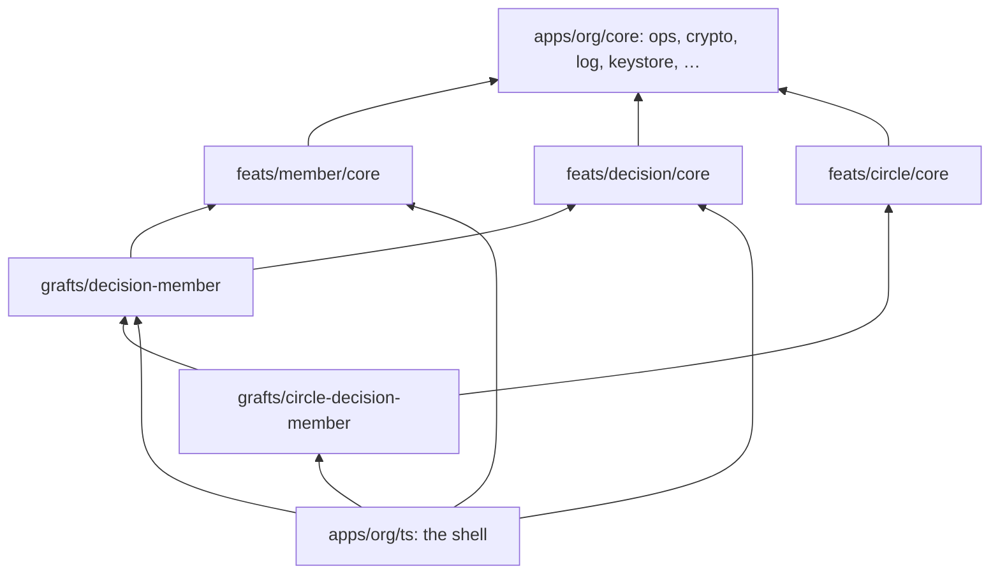

+++
title = "Architecture"
updated = 2026-10-25
+++

# Architecture

Cella is built as a tree of **feats**. The root feats of the repository are
its **apps**; apps hold feats, feats hold feats, and **grafts** join feats.
Each feat's **core** holds the libraries its feats inherit. The rules are
corpus's composable architecture as ruled on 2026-10-17, with seedling's
layers inside each package and the write labels and feat rulings of
2026-10-24.

## The tree



A node is a directory with a `feat.toml`. It holds:

- `core/` — what the feat is, and the libraries its children and grafts
  build on, one package each (`core/<lib>/rs`, `core/<lib>/ts`). The app's
  core is its shared library layer: `ops` (labels, permissions, outcomes),
  `crypto`, `log`, `keystore`, `rules` (the pure rule primitives), `notary`
  (the `cella` Postgres extension over them), `db` (a write's transaction),
  `sign` (a device's signature on a write), `ui` (the shell's tokens and
  components) and later `auth`. A leaf feat's core is all of it.
- `feats/` — its child feats, the same shape.
- `grafts/` — the joins between its child feats.
- `rs/`, `ts/` — the node's root, which assembles it. Only a node that links
  its feats into a binary or a shell has one. Org's `rs/` root is `cella`,
  the CLI that is the repository's one entry point for every development and
  production task ([the CLI](../../apps/org/rs/index.md)); its `ts/` root is
  the shell.

Every package is an ordinary package in its ecosystem: a crate in `rs/`, an
npm package in `ts/`, one to a directory. The workspaces find them by glob
(`apps/**/ts`, `apps/**/rs`), so cargo, pnpm and editors work unchanged.

## Feats

A feat is a collection of things and is named for the collection it holds:
`member`, `decision`, `invoice`. `account` holds the chart of accounts,
members' capital accounts, reserves and funds, and their periods and
balances; `transaction` holds the journal's entries, a collection in its own
right. A federation-facing name more specific than these may come later.

What is a top-level feat is decided case by case, and org's feats are all
top-level: they sit flat under `apps/org/feats/`. A feat nests under another
only when it is a genuine sub-feature of that one feat. What everything
grafts onto belongs in the parent's core, not in a feat.

The notary is not a feat but a layer under every feat: the `cella`
Postgres extension, a package of org's core (`apps/org/core/notary/rs`),
which every feat's SQL calls and every write passes through. It holds no
collection and has no writes of its own. Moving a scope's notary is moving
its database to another host, which arrives at rung 6
([ratchet](ratchet.md)).

## What may depend on what

| A package in | may depend on |
|---|---|
| a feat's core | the other packages of its own core; its ancestors' cores |
| a graft | the cores of the feats it joins; its node's and their ancestors' cores; the grafts of its node that join a proper subset of its feats ([graft order](#graft-order)) |
| a node's root | its own and its ancestors' cores, its feats' cores and roots, its own grafts |

Nothing is ambient: no global module, no library outside the tree, no
re-export that reaches around it. Third-party crates and npm packages are
the only dependencies from outside. When two apps need the same library, the
repository's root becomes the top node and the library moves into its core.

Architecture rules are enforced by tooling wherever a tool can see them.
`tools/feat-check.mjs` (`cella check feats`) reads each `package.json` and
`cargo metadata`, the manifests cargo and pnpm read, and not the lockfile.
It places each package by its path and refuses any other edge. It also
checks that every graft is declared by a feat it joins, that its name is in order, that every feat it
names is a feat of its node, that a package's relative imports stay inside
it, and that a feat's or graft's ops are named for it. Through
`tools/sql-check.mjs` it checks every `sql/` file (see [SQL](#sql)), and
through `tools/powers.mjs` that the power each op's label names in
`ops.ts` is the one its SQL registers in `cella.power`, and that an op
with no power declares a check its SQL backs ([writes](#writes)).
`cella test tools` holds their negative tests.

## Grafts

A graft owns a relationship between feats: its model, its junction table
with keys into each, and the handlers that react on either side. It is
named by the feats it joins, hyphenated in alphabetical order
(`decision-member`), so a feat's name has no hyphen. Most grafts join two
feats; a graft may join more where the relationship needs it, but avoid it
where two-way grafts will do. The feat that extends the others declares it
in its `feat.toml`. A graft has no pages of its own.

No foreign key crosses a feat boundary. A feat handles an unlinked entity
gracefully: an invoice without a client is unbilled, not invalid. The graft
adds the link.

A graft may also own writes on the relationship it holds, such as who
holds a position: its permission is `<graft>:<entity>:<op>`, served as
`POST /api/<graft>/<op>`, the same pattern as a feat's.

### Graft order

A graft's order is the number of feats it joins. A graft that joins N
feats may read, in code and in SQL, the feats it joins, the cores below
them, and the grafts of its node that join a proper subset of its feats:
`circle-decision-member` reads `circle-member` and `decision-member`.
Nothing else: no graft of equal or higher order, and no graft that joins a
feat it does not. Relationships compose upward, so a higher graft builds on
lower ones and no lower graft ever depends on one above it. Migrations run
grafts lowest order first.

A relationship that needs another graft's data therefore lives in the
graft that joins all the feats involved. A decision's roll needs seats
(circle and member) and the decision, so it is `circle-decision-member`'s,
and so is everything that counts the roll. A lower graft that needs what a
higher one decides declares it through a feat they share: a graft that
cites a decision lists its op in `decision.cites`, and the graft that
counts the roll attaches its rule to every op listed, so neither reads the
other.

## Rules

A rule lives at the lowest level that owns it: in a feat if it concerns
only that feat's collection, in a graft if it concerns a relationship, and
in a node's core only if it spans everything below that node.

- A payment beyond an invoice's total leaves a credit owed to the client,
  rather than being refused: the invoice feat's rule, since the payments
  are part of its collection.
- Nothing posts into a closed period: the `account-transaction` graft's.
  The period is an account's and the entry a transaction's; neither feat
  sees both, and the graft that resolves an entry's lines to accounts does.
- A surplus split adds up to the surplus: the account feat's. That the
  members approved it is the `account-decision` graft's.

A rule is SQL in its owner's schema (see [SQL](#sql)). The notary runs
every rule that attaches to an ordered write, those of the feat and of the
grafts it touches; it holds no rules of its own beyond the primitives. How
rules are composed and adopted is in [trust](trust.md#rules).

## SQL

Each feat and each graft owns a Postgres schema and the SQL in it: tables,
row-level policies, triggers and composed rules, which are plain
`LANGUAGE sql` functions over the `cella.*` primitives. The SQL sits in a
`sql/` directory beside the core package: `feats/<feat>/core/sql/`,
`grafts/<graft>/sql/`. A schema takes its owner's name; a graft's hyphens
become underscores, so `client-invoice` owns the schema `client_invoice`.

A co-op's customisations are custom feats: a feat of its own, with its own
schema, SQL and grafts, built on the same primitives and enabled by
decision. Custom feats are how cella is extended.

| SQL in | may reference |
|---|---|
| a node's core | `cella.*`; the catalog |
| a feat's schema | its own schema; `cella.*`; the catalog |
| a graft's schema | its own schema; the schemas of the feats it joins; the schemas of its lower-order grafts; `cella.*`; the catalog |

A graft's schema holds the junction, with keys into each feat's tables; no
foreign key crosses a feat. `feat-check` enforces these boundaries by
parsing every `sql/` file with libpg_query, Postgres's own parser,
PL/pgSQL bodies statement by statement. Beyond references, it refuses SQL
that creates, alters, indexes, drops or grants outside its own schema;
holds a foreign key out of it; writes `cella.*` other than to register,
under its own name, its rules on its own ops, those of the feats it
joins and those of the lower-order grafts it builds on, the power each of
its own ops needs as a literal row, or, a feat only, the keyring; sets
`search_path` other than a function's to the catalog; reads the clock or
randomness; or hides statements in a `DO` block.

SQL is the source of truth for rules. TypeScript calls them and never
re-implements one; the browser may preview a rule through the primitives
compiled to WASM.

### Migrations

Migrations cascade down the feat tree: a node's core first, then its feats,
then its grafts, recursively, each versioned. They are plain SQL, and the
TypeScript types are generated from the schema; seedling's Drizzle, where
TypeScript owns the schema, is dropped. The generator is not chosen.

`tools/migrate.mjs` (`cella migrate`) walks the tree in that order and applies
each `sql/` directory's `NNN-*.sql` files, one transaction each, recording
every file and its hash in `migration.applied`. A file edited after it was
applied is refused; a change is a new file.

### Tests

SQL logic is tested in the database. pgTAP tests and Lanterne's
conformance suite, its cases and their expected verdicts, are gates
alongside `cella check`; neither is wired in yet. A slice is a feat or a
graft, and node tests come in two kinds, placed by where they sit; a test
file anywhere else fails `cella test`:

- a **slice test** tests exactly one slice, from its package's `_tests/`.
  `cella test slice [NAME]` runs each slice's tests on a database migrated
  with the app's core and that slice's part of the tree alone (a feat's
  own tree; a graft's feats, its lower-order grafts and itself), unseeded,
  so a slice test cannot lean on a slice it does not own, and a package
  imports only what its manifest names.
- an **e2e test** is a scenario across slices, from an app root's `_e2e/`.
  `cella test e2e [NAME]` runs each on a database migrated whole and
  seeded with Lanterne, through the handlers.

Both run on the dev cluster (`cella db start`), on `cella_test`, renewed
for each slice and each scenario.

## Inside a package

Seedling's layers, innermost first; imports point inward only.

- Server: `models` (types, schemas, invariants, `permissions`, `ops.ts`) →
  `interfaces` (repository contracts) → `handlers` (`(input, deps) → Result`,
  jobs) → `drivers` (repositories over the feat's schema) → `api` (remotes,
  endpoints, events, subscriptions).
- Client: `hooks` → `components` → `bindings` (sockets, plugs) → `app`
  (pages, views, panes, blocks).
- Tests in `_tests/` beside `src/`, a feat's or graft's slice tests; an app
  root's e2e tests in `_e2e/`.

A package's `exports` name its public surface: a core library's `.`, and a
slice's `./models`, `./api` (its writes, its reads and its server slice),
`./bindings` and `./app` (its client slice). Nothing else is importable
from outside it, and `cella check feats` refuses any other export.

### Client state

The client layers follow seedling's hooks: a component holds no state of
its own beyond its props and what it derives from them. State lives in a
**state class**, `hooks/<Name>State.svelte.ts`, with `$state` fields,
`$derived` fields and methods for its actions, and is reached through one
hook, `hooks/use<Name>.ts`: `useName(…)` returns the instance in context
(`createContext`'s `has` and `get`), or creates it, sets it and returns
it. The first component to call it creates it; its descendants share it.
A state class starts from the page's data, handed in as getters, so the
server and the browser render the same state and it follows the page
when a write refreshes it; nothing loads data from a component. Writes go
through form actions. No client module keeps mutable state at module
level, which the server would share between requests.

`cella check feats` enforces what it can see (`tools/ui-check.mjs`): only
the UI core holds CSS, no other `.svelte` file has a `<style>` or a
`style` attribute; `$state` appears only in a state class under `hooks/`;
no client module, nor a component's `<script module>`, declares a
top-level `let` or `var`; no `.svelte` file or module under `app/`,
`hooks/` or `components/` imports a server layer: a package's `api`,
`drivers`, `handlers` or `interfaces`, `@cella/*-db` or `pg`; `$effect`
appears only in a state class, so a component derives, attaches
(`{@attach}`) or handles an event instead; and no source uses a legacy
Svelte or SvelteKit form: `on:event`, `<slot>`, `use:`, `{@const}`,
`$$props`, `export let`, `$:`, `createEventDispatcher`, string-keyed
`setContext`/`getContext`, `$app/stores`, `$lib`, `$env` or
`invalidateAll`, nor `{@html}`.

## The shell

The org app's `ts/` root is the shell, a SvelteKit 3 app that mounts every
slice; it holds the routes and no feature of its own. Each slice exports
two halves of one **slice**, matched by name:

- from `./api`, its server side (`Slice` in `@cella/org-db`): the
  collections it owns, each with its reads (`list`, as the acting member
  sees it, `item`, `index` for the command menu, `about` for the
  collection's header) and its writes as form actions, each a handler
  over a form; what it adds to the collections of the feats it joins
  (`extends`): fields on each row, rows of its own in a collection that
  gathers them from the slices that know each kind (`rows`), as the
  member feat's inbox gathers what waits on a member, data on an item, what it adds to the collection's `about`, such as the
  circles a new decision may be put in, writes, and whether it opens an
  item's bytes its owner keeps closed (`allows`), as a power over
  expenses opens a receipt; and reactions to
  other slices' settled writes (`on`), such as carrying out what a
  passing decision decides once its close settles; and the kinds of file
  it imports from other tools (`imports`), each record read as one of its
  own writes, which the root runs as the importing member and records in
  the import feat.
- from `./app`, its client side (`App` in `@cella/org-ui`): for each
  collection it owns, a view (its columns, its New form, the status
  badge its header shows and its dashboard's widgets) and a page (its title, its Properties, Related and Activity cards, its
  blocks and its header writes); for each collection it extends, columns
  over the fields it adds, cards and blocks over its data on an item,
  and a New form replacing the owner's when it replaces the write behind
  it, as `key-member`'s invitation carrying a first device does.

The root lists the slices, server and client, and mounts them on
routes that are the same for every collection: `/[collection]`, the one collection
component, and `/[collection]/[id]`, the one detail view, each with the
form actions of the collection's slices; `/search` for the command menu;
`/[collection]/[id]/[stream]`, an item's live stream as server-sent
events, which the collection's owner names (`streams`, such as a
document's edits as they settle); `/[collection]/[id]/content`, an item's
bytes, such as a file's, which the collection's owner serves (`content`)
to whom its rule or an extension's `allows` opens them; `/act` and
`/theme` for the user menu; `/journal`, the transactions' old address,
which redirects to them; and `/`, the co-op's home, a dashboard of widgets pinned from many
collections. A collection's owner is a feat,
or the log, a core library. A graft extends only a collection of a feat it
joins; the root may join two feats no graft joins, as it puts on the
work collections' cards fields from several grafts, pins the home's
widgets until a viewer pins their own, and runs an import across the
slices that read its kind. A form posts its files with its fields, and an
action reads them whole (`Form.file`). The registry refuses a
collection owned twice, an extension of a feat a graft does not join, and
two extensions replacing one write. An extension's write replaces the
owner's of the same name: `invoice-transaction`'s issue, which posts the
invoice in the same transaction, replaces the invoice feat's.

The shell writes no SQL and re-implements no rule: it reads through each
slice's reads and writes through its handlers, which sign, submit and
return Settled, Refused or Pending. Its pages show each outcome, with
the rule's reason when refused. A write is signed by a device of the
acting member: until a member's device signs in the browser, the dev
server (`cella serve`, dev mode only) signs with the member's TEST-ONLY
fixture key, and only when it is the key enrolled under that device's
label and not revoked; outside dev mode the server signs for no one.
Until `POST /api/<feat>/<op>` is served, these form actions are the
writes' only HTTP path.

The UI core, `@cella/org-ui`, holds the tokens and every component the
slices compose ([its doc](../../apps/org/core/ui/index.md)); a slice's
blocks style nothing themselves.

## Writes

Every write is `POST /api/<feat>/<op>` and maps to one permission,
`<feat>:<entity>:<op>`, declared in the feat's `models/ops.ts` with its label:

```ts
export const ops = {
  'member:member:invite': confluent({ power: 'invite-member' }),
  'member:member:admit': ordered({ decide: 'consent', check: 'decided' }),
} satisfies Ops
```

The label is part of the type: an ordered write returns `Pending` until its
verdict. The labels and the path each takes are in [trust](trust.md).

A label also names the power the write needs, and the payload field its
amount is in when a mandate's limit caps it:
`confluent({ power: 'pay-supplier', amount: 'amount' })`. The source of
truth is the row the feat's SQL registers in `cella.power`, which the
`circle-member` graft's rule reads; the label mirrors it for the
TypeScript, and `cella check feats` refuses any difference. Every write
is signed by a device of its actor and carries its request
([signatures](signatures.md)).

No write is allowed by omission. An op with no power declares the check
that allows it instead: `self`, the actor's own (a profile, a device);
`roll`, a member on the roll of the decision it names (a stance);
`seat`, a member seated in the circle it concerns (proposing or closing
a decision, a circle's message); or `decided`, the decision it cites
carried (an admission, an adoption, a seat):
`confluent({ check: 'seat' })`. A check is backed by SQL: a rule
registered on the op in `cella.rule`, or for `decided` a row in
`decision.cites`, to which `circle-decision-member` attaches its rule.
`cella check feats` refuses an op that names neither a power nor a
check, and a check no literal row backs; that the rule does what the
check says is its owner's and its tests'. A write not yet decided as it
should be, such as granting a mandate before a graft ties the decision
to it, needs a power no mandate grants until then.

Every critical rule is enforced twice: the handler checks the permission and
the feat's row-level policies and triggers back it up. An ordered write is
checked a third time by the notary, in a way anyone can replay from the log.

## Feat flags

A feat's `feat.toml` names it, its group (governance, work, finance,
platform), whether it is built in, the rung it arrives at and the grafts it
declares. Groups are for navigation only; they are a field, not
directories. A co-op enables the feats it uses; a disabled feat's pages are
not served and its jobs and subscriptions go inert. Built-in feats are
always on.
