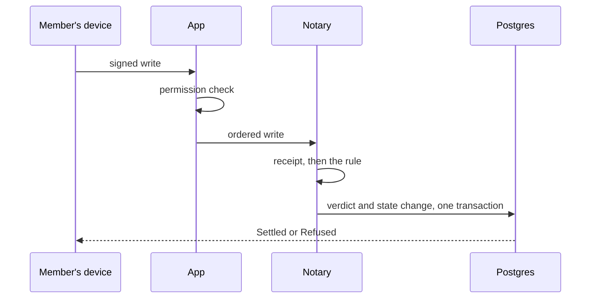

+++
title = "Trust"
updated = 2026-10-24
+++

# Trust

Each scope — a co-op, a joint circle of co-ops, or a federation — runs its
own server, with its own Postgres database, log and notary. Every piece of
data has exactly one owning scope; anything shared gets a scope of its own.
There is no consensus between servers and nothing to resolve: other scopes
keep signed copies of what concerns them.

## Three kinds of write

| Label | Path | Examples |
|---|---|---|
| confluent | merges in any order; never waits | edits, comments, votes cast, deposits, time entries |
| bounded | spends a right granted in advance; waits only when the right runs out | budget shares, invoice series, draws |
| ordered | waits for the notary's verdict, and shows Pending until it comes | admissions, adoptions, voids, closing a period |

Until rung 2 every write goes through the server. The label is in the type
from the start, so that later rungs move confluent and bounded writes to the
clients without a rewrite.

## One server

- **The member signs on their device** (WebCrypto Ed25519). Votes and
  approvals carry the member's own signature, and the governed record cites
  them.
- **The notary is the only code path that appends to the log.** It signs a
  receipt when a write arrives, then a numbered verdict; a verdict out of
  receipt order is proof against it. It never decides an outcome: an outcome
  is computed from the signed votes, and anyone holding the log can compute
  it again.
- **The verdict and its state change commit in one transaction.** The log is
  hash-chained with a deterministic fold, so the state can always be rebuilt
  from it and checked. A Merkle tree over the log (RFC 9162) gives inclusion
  and consistency proofs.
- **Confluent writes skip the rule check** and are logged in signed batches.

Until the native client (rung 4) the host serves the signing code. The pilot
guards against outsiders and later tampering, not against the host, and
makes no claim that the host cannot forge a vote.

## Keys and addresses

- Members have device keys from day one. A key is enrolled by the member's
  current key; rotating keys keeps the address.
- Each scope has a server key and stable addresses (`ana@coop-a`), so
  federation adds to the design rather than changing it.
- Signatures are Ed25519 on devices and ML-DSA-44 at the root; encryption is
  hybrid X25519 + ML-KEM-768 (org's `core/crypto`).
- Every signed artifact names its binding (parent, sequence, audience or
  freshness), and each signed type is domain-separated.
- Thresholds are signed policy in the log, never flags or unsigned config.
  No one holds a group's key alone.
- Lost keys are recovered from guardian shares.

## Personal data

Personal data stays out of the log. Each entry holds commitments, each with
a fresh salt; the data and its salt sit in a vault, encrypted per member,
retention class and year. Erasure deletes the row and its salt, destroys the
keys that expired, and writes an erasure entry; the log still verifies and
folds the gap to `redacted`. Books and payroll are restricted rather than
erased until their legal clock runs out.

## Open

- The rules language: TypeScript in the app, with the notary in the same
  transaction, or shared Rust that devices and auditors can run too.
- Whether personal data enters the log only for ordered writes.
- The late-write rules for offline writes (rung 2).
