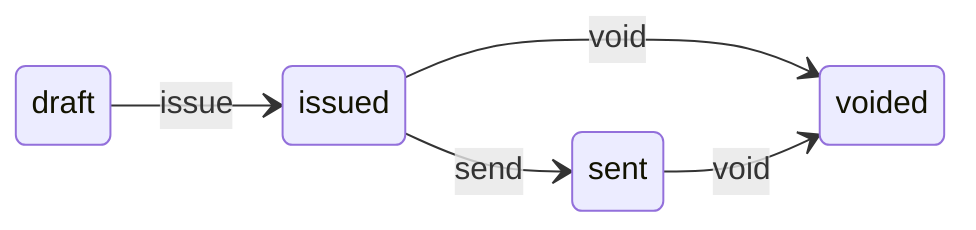

+++
title = "Invoice"
updated = 2026-11-16
+++

What the co-op bills: issue an invoice, send it, record what is paid
against it, and void it when it is wrong. An invoice carries everything
that must appear on it as issued, including the name and address it bills,
as text; the link to a contact record is the `contact-invoice` graft's, the
project whose work it bills the `invoice-project` graft's, and the entries
it posts are the `invoice-transaction` graft's.

## Entities

| Entity | Fields | Notes |
|---|---|---|
| invoice | `id`, `issued`, `due`, `bill_to`, `bill_address?`, `seller`, `label`, `lines[]`, `net`, `vat`, `total`, `voided?`, `reason?` | `id` is the series and its number, four digits or more, `F-2026-0056`, and `F-2026-10000` after `F-2026-9999`, in every list too, which orders ids by their number, never as text |
| line | `description`, `quantity`, `unit_price`, `amount`, `vat_rate` | `amount` = quantity × unit price |
| payment | `at`, `amount`, `method`, `reference` | many per invoice; `reference` is the bank's |
| series | `name`, `next` | one per year at rung 1; a device's own at rung 2 |

## Lifecycle

`unpaid`, `partial`, `paid` and `overdue` are not states: they are read
from the payments, the total and `due`. A draft has no
number; issuing gives it the next one and freezes it. A voided invoice
keeps its number, and the void posts a credit note.

## Actions

| Action | Label | Why |
|---|---|---|
| `POST /api/invoice/issue` | bounded | numbered in a series; the server's own until rung 2 gives devices theirs |
| `POST /api/invoice/send` | confluent | to a client, or to a peer co-op |
| `POST /api/invoice/payment` | confluent | payments add up |
| `POST /api/invoice/void` | ordered | ordered against the payments |

- **issue** spends a number from a series granted in advance. Until rung 2
  the server holds the only series, so numbers are gapless and
  chronological as French law requires; at rung 2 each device receives a
  series of its own and issues offline.
- **send** delivers the issued invoice, by email or as a signed event to a
  peer co-op at rung 5. Sending twice does no harm.
- **payment** records money received. Payments are facts from the bank;
  they add up in any order, and the same bank reference recorded twice
  merges into one payment. An invoice paid beyond its total is not
  refused: the excess shows as a credit owed to the client, refunded or
  applied elsewhere.
- **void** is ordered against the payments: it settles only if no payment
  was received before it, and posts the credit note.

## Powers

| Action | Power | Lanterne |
|---|---|---|
| issue | `issue-invoice` | Julien, as finance |
| send | `issue-invoice` | Julien |
| payment | `record-receipt` | Julien |
| void | `issue-invoice` | Julien |

`002-powers.sql` registers each in `cella.power`; the membership
feat's guard refuses a write by anyone not holding the power on the
verdict date. Leads quote up to 15 000 € with `send-quote`; a quote is not an invoice,
and quoting is not built.

## Invariants

The invoice feat owns the guards about its own collection:

- `total` = `net` + `vat`, and `net` is the sum of the lines;
- an issued invoice never changes; a correction is a void and a reissue;
- numbers in a series are unique, gapless and in date order;
- a payment beyond the total is not refused: it leaves a credit owed to
  the client, not an overpaid invoice; the same bank reference recorded
  twice merges into one payment;
- a voided invoice takes no payment and is not sent again.

What it does not own:

- whom the invoice bills as a contact record: `contact-invoice`;
- that issue, payment and void post balanced entries into an open period:
  `invoice-transaction` and `account-transaction`.

## What it does not know

Invoice knows no contacts, transactions, accounts, projects or timesheets.
Which project an invoice bills is `invoice-project`'s; generating lines
from billable time or milestones belongs to later grafts with `timesheet`
and `project`; e-invoicing through an approved platform
arrives at rung 3.

## Schema

`invoice` (`core/sql/`):

- `invoice.series`: a series, its `next` number and `until`, the last
  number its right covers. At rung 1 the server holds the only right,
  granted without end (`until` is NULL), so it never runs out; a device's
  right at rung 2 ends, and a number past it needs a fresh grant, which
  is ordered.
- `invoice.invoice`: as issued, the name billed (`bill_to`) and its
  address (`bill_address`, its lines separated by newlines, never
  empty), the seller's mentions (`seller`,
  kept as `invoice.seller()` reads them when it issues), `net`, `vat`
  and `total` as `cella.amount` (a NULL `vat` is an invoice without
  VAT), unique by series and number; `sent`, `voided` and `reason` are
  set once. The name and address billed, which may be a person's, and
  the reason, free text, are personal data of class `books`, kept ten
  years as the books keep a mention, their subject the invoice itself,
  since no column says whose they are (`009-billed.sql`); their clock
  running out redacts them, the one change an issued invoice takes.
- `invoice.line`: description, quantity (exact decimal), unit price,
  amount (quantity × unit price, rounded to the cent) and VAT rate, a
  percent with two decimals (5,50).
- `invoice.seller()`: the seller as the co-op's particulars in force on
  the verdict date name it (`circle.particulars()`: its legal name, form,
  capital, SIREN, registry, VAT number and seat), each null where they
  mark none; `seller`'s default, so an invoice keeps what the
  particulars said the moment it issued, and a motion replacing them
  changes the invoices issued once it applies and no invoice issued
  before ([the co-op's particulars](../../core/circle/index.md#the-co-ops-particulars)).
- `invoice.payment`: received `at`, amount, method and the bank's
  reference, with a receipt; unique by invoice and reference.
- `invoice.spend(series)`: the bounded write's spend. It takes the next
  number, refuses one already issued (never reused) and refuses once the
  right has run out.
- `invoice.standing`: each invoice's total, paid, `owed` and `credit` in
  cents, and its state (`unpaid`, `partial`, `paid`, `overpaid`,
  `voided`). The excess of a payment beyond the total is `credit`, owed
  to the client; on a voided invoice everything paid is. It reads as its reader, so it shows only the records its reader reads.
- `invoice.taxed`: each invoice's VAT by rate, the net of its lines at
  the rate and the tax on it in cents, each line's tax rounded by
  `cella.line_vat` as `issue` rounds it, so the rates add up to the
  invoice's `vat`. It reads as its reader, so it shows only the records its reader reads.

Triggers raise SQLSTATE `09000`: a deferred one checks that the lines add
up to the net; another keeps an issued invoice and its lines unchanged,
sent once, voided once and not sent once voided. The app role may select,
insert, set `sent`, `voided` and `reason`, and spend a series; the guards
role, `cella_guards`, may select.

Every record names its owning circle, `circle`, a foreign key into
core's circles ([owning
circle](../../../../_corpus/doc/architecture.md#sql)): the root's, the
assembly's, unless the write that makes it names another.

## Guards

- `invoice.numbered`, on `invoice:invoice:issue`: the write issued the
  invoice on the verdict date, with the series' last number, the one after
  the number before it (no gap) and not dated before it.
- `invoice.identified`, on `invoice:invoice:issue`: the invoice issued
  names whom it bills and their address, and its seller's legal name,
  form, seat, SIREN and registry, and its VAT number where a line
  carries VAT, none of them blank. A co-op whose particulars lack one
  issues no invoice until a motion of its assembly adopts particulars
  marking it, and the refusal names what is missing and the value that
  marks it; an issued invoice is corrected only by a void, so a missing
  mention is kept out here or not at all.
- `invoice.voids`, on `invoice:invoice:void`: the write voided the invoice
  on the verdict date, and no payment exists; a paid invoice is not voided,
  and the void uses no verdict number.

That issue and void post their entries is the `invoice-transaction`
graft's guard on the same ops.

## Folds

Each action folds by `core/sql/010-folds.sql`
([folds](../../../../_corpus/doc/architecture.md#folds)): an issue
spends the series' next number by the SQL its handler runs,
`invoice.spend`, which must make the invoice its entry names, then
issues it on its day as the entry keeps it: its series, due day, label,
the seller's mentions as they were kept, its amounts and its lines, each
quantity and VAT rate as their text, and the name and address billed as
their commitments. A send marks it sent on the day its entry names,
once, and never a voided one; a payment records the payment under the id
its entry names, with its day, amount, method, the bank's reference and
the receipt of its write, and one that merged adds nothing; a void
voids it on its day, its reason as its commitment. The entry each posts
folds by `invoice-transaction`'s folds.

## Handlers

Each handler is also a write spec (`issuing`, `paying`, `voiding`) that a
graft composes with its own state into one write.

- `issue` (bounded): spends the number and writes the invoice and its
  lines in one statement, amounts and VAT computed in SQL from the lines
  by the [VAT core library](../../core/vat/index.md)'s `priced`, as a
  bill's are; each line's VAT rate comes in hundredths of a percent (550
  for 5,5 %), since a signed request holds integers only; the payload
  holds the number, the amounts and what the fold issues again, the name
  and address billed as their commitments.
- `send` (confluent): sets `sent` once; a voided invoice is left unsent.
- `payment` (confluent): records the payment with a receipt; a reference
  already recorded for the invoice merges and returns `merged`.
- `annul`, the void write (ordered; `void` is a keyword): sets `voided`
  and the reason; the payload holds the reason as its commitment.

Issue and payment can still be refused at rung 1, by a gap or by a closed
period, so their handlers return `Refused` beside `Settled` although their
labels never wait.

## Shell

The `invoices` collection, grouped by standing, overdue first, the
soonest due first, each with whom it bills, its label, what is owed and
its due day; its
dashboard shows what is owed and overdue, what was invoiced this year,
the amounts by month and the invoices by standing, and its calendar
places each on the day it is due; overdue reads the
server's clock, a read no guard depends on. New issues one (`issue`) in a
series the feat offers, to a name and the address billed. An invoice's
page, its header's crumb its number, is titled by what it bills for,
with whom it bills among its properties; it marks it sent (`send`) and
links its PDF, and its Lines tab holds its lines and payments, the data
central to it. `api/forms.ts` reads the shell's forms into the handlers' inputs,
amounts typed in euros and VAT rates in percent (`5,5`), so a graft's writes read the same forms:
`invoice-transaction` replaces issue, payment and void with the writes
that post them. Whom an invoice bills is `contact-invoice`'s.

## The PDF

An issued invoice's bytes, `/invoices/<id>/content`, are its PDF, which
the slice's `content` makes on the server from the invoice as issued
(`printed`, then `pdf`, through [`@cella/org-pdf`](../../core/pdf/index.md))
and whoever reads the invoice may open. It is in English, since the
prototype is not bound to French law (the operator, 2026-10-25): its
amounts read `€1,500.00`, its dates `24 October 2026`, its rates `5.5%`,
and its words "Net amount", "VAT 20% on …", "Total incl. VAT", "Payment
terms". It prints, in English, the mentions a client's accountant
checks: the list is the customs' control sheet of March 2026, which
cites each article (code de commerce L441-9; CGI, annexe II, art. 242
nonies A), and the registry's sheet on business papers (code de commerce
R123-237).

| Mention | Printed from | Law |
|---|---|---|
| seller's legal name, form, seat; capital where it is fixed | `seller`, from the particulars' `particulars_legal_name`, `_form`, `_seat`, `_capital` | L441-9; R123-237; "with variable capital" for a capital that varies |
| SIREN, the trade register ("RCS") and its town | `seller`, from `particulars_siren`, `_rcs` | R123-237; 242 nonies A, I, 2° |
| seller's VAT number | `seller`, from `particulars_vat` | 242 nonies A, I, 2° |
| buyer's name and address | `bill_to`, `bill_address` | L441-9; 242 nonies A, I, 1° |
| number, in one gapless series, and date of issue | `id`, `issued` | 242 nonies A, I, 6° and 7° |
| each line's quantity, description, unit price before tax and VAT rate | `invoice.line` | 242 nonies A, I, 8° bis |
| net, VAT at each rate on its base, total | `net`, `invoice.taxed`, `total` | 242 nonies A, I, 10° bis |
| due date; no discount for paying early; late penalties at the ECB's rate plus ten points; the 40 € recovery indemnity owed by a professional | `due`, and the code's terms | L441-9, I, al. 5; L441-10; D441-5 |

The seller's mentions close every page, with its number; a voided
invoice is marked "VOID" and its date. Payments are not printed: the
PDF is the invoice as issued, its seller too: the mentions are kept with
the invoice when it issues, so a seat that moves later never alters the
PDF of an invoice issued before. Every mention of the seller and the
buyer in the table is on every PDF, since `invoice.identified` issues
no invoice without them; only the capital, printed where it is fixed,
may be absent.

Not printed yet:

- the date of the service, where it differs from the date of issue
  (242 nonies A, I, 10°): an invoice keeps none, and its label says it;
- the buyer's SIREN, the delivery address and whether it bills goods,
  services or both, which the e-invoicing reform asks of an SME's invoices
  from 1 September 2027;
- the ground of a VAT exemption, for a line at 0 %;
- Factur-X and sending through an approved platform, at rung 3.

Légifrance refuses the box this was written on, so the articles are cited
as the customs and the registry quote them; the variable capital
mention's article in the code de commerce (among L231-1 to L231-8) was
not verified.

## Lanterne

- Series F-2026 runs from 0041 to 0055; the next is 0056. Each is the
  circle's whose project it bills, Web's, Brand's or Marketing's.
- Clients owe 57 180 €. Compagnie Mauve Horizon's posters (0044, 7 440 €)
  are three months overdue.
- Vélo Solidaire has paid 1 980 € of 0051's 3 960 €: the invoice is
  partial.
- 0050 was voided the day after issue, before any payment, and reissued as
  0051 at the solidarity rate.
- Every invoice carries its client's address. Lanterne prints as
  Lanterne, a worker co-operative limited company with variable capital
  registered at the Bobigny trade register (RCS), the registry for
  Montreuil; its SIREN and VAT number are placeholders.

## Analytics

Its [analytical contract](../../../../_corpus/doc/architecture.md#analytical-contracts), `core/sql/analytics.sql`, publishes `invoice.invoices`, `invoice.taxes` and `invoice.payments` to the analytics shell: each invoice with its figures and standing, its VAT by rate, and its payments. Whom it is billed to is contact-invoice's. All three are scoped by `circle`, the circle that owns the invoice or the payment. Each of its views is declared a published query, in `core/ts/src/api/contract.ts`, which the web shell serves through the port as the analytics shell reads it.
