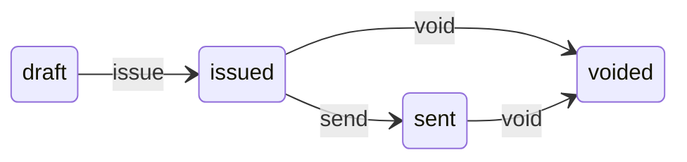

+++
title = "Invoice"
updated = 2026-10-24
+++

What the co-op bills: issue an invoice, send it, record what is paid
against it, and void it when it is wrong. An invoice carries everything
that must appear on it as issued, including the name and address it bills,
as text; the link to a client record is the `client-invoice` graft's, and
the entries it posts are the `invoice-transaction` graft's.

## Entities

| Entity | Fields | Notes |
|---|---|---|
| invoice | `id`, `issued`, `due`, `bill_to`, `label`, `lines[]`, `net`, `vat`, `total`, `voided?`, `reason?` | `id` is the series and its number, `F-2026-0056` |
| line | `description`, `quantity`, `unit_price`, `amount`, `vat_rate` | `amount` = quantity × unit price |
| payment | `at`, `amount`, `method`, `reference` | many per invoice; `reference` is the bank's |
| series | `name`, `next` | one per year at rung 1; a device's own at rung 2 |

## Lifecycle

`unpaid`, `partial`, `paid` and `overdue` are not states: they are read
from the payments, the total and `due`. A draft has no
number; issuing gives it the next one and freezes it. A voided invoice
keeps its number, and the void posts a credit note.

## Writes

| Write | Label | Why |
|---|---|---|
| `POST /api/invoice/issue` | bounded | numbered in a series; the server's own until rung 2 gives devices theirs |
| `POST /api/invoice/send` | confluent | to a client, or to a peer co-op |
| `POST /api/invoice/payment` | confluent | payments add up |
| `POST /api/invoice/void` | ordered | ordered against the payments |

- **issue** spends a number from a series granted in advance. Until rung 2
  the server holds the only series, so numbers are gapless and
  chronological as French law requires; at rung 2 each device receives a
  series of its own and issues offline.
- **send** delivers the issued invoice, by email or as a signed event to a
  peer co-op at rung 5. Sending twice does no harm.
- **payment** records money received. Payments are facts from the bank;
  they add up in any order, and the same bank reference recorded twice
  merges into one payment. An invoice paid beyond its total is not
  refused: the excess shows as a credit owed to the client, refunded or
  applied elsewhere.
- **void** is ordered against the payments: it settles only if no payment
  was received before it, and posts the credit note.

## Powers

| Write | Power | Lanterne |
|---|---|---|
| issue | `issue-invoice` | Julien, as finance |
| send | `issue-invoice` | Julien |
| payment | `record-receipt` | Julien |
| void | `issue-invoice` | Julien |

`002-powers.sql` registers each in `cella.power`; the `circle-member`
graft's rule refuses a write by anyone not holding the power on the
verdict date. Leads quote up to 15 000 € with `send-quote`; a quote is not an invoice
and belongs to the later `project` feat.

## Invariants

The invoice feat owns the rules about its own collection:

- `total` = `net` + `vat`, and `net` is the sum of the lines;
- an issued invoice never changes; a correction is a void and a reissue;
- numbers in a series are unique, gapless and in date order;
- a payment beyond the total is not refused: it leaves a credit owed to
  the client, not an overpaid invoice; the same bank reference recorded
  twice merges into one payment;
- a voided invoice takes no payment and is not sent again.

What it does not own:

- whom the invoice bills as a client record: `client-invoice`;
- that issue, payment and void post balanced entries into an open period:
  `invoice-transaction` and `account-transaction`.

## What it does not know

Invoice knows no clients, transactions, accounts, projects or timesheets.
Generating lines from billable time or milestones belongs to later grafts
with `timesheet` and `project`; e-invoicing through an approved platform
arrives at rung 3.

## Schema

`invoice` (`core/sql/`):

- `invoice.series`: a series, its `next` number and `until`, the last
  number its right covers. At rung 1 the server holds the only right,
  granted without end (`until` is NULL), so it never runs out; a device's
  right at rung 2 ends, and a number past it needs a fresh grant, which
  is ordered.
- `invoice.invoice`: as issued, `net`, `vat` and `total` as
  `cella.amount` (a NULL `vat` is an invoice without VAT), unique by
  series and number; `sent`, `voided` and `reason` are set once.
- `invoice.line`: description, quantity (exact decimal), unit price,
  amount (quantity × unit price, rounded to the cent) and VAT rate.
- `invoice.payment`: received `at`, amount, method and the bank's
  reference, with a receipt; unique by invoice and reference.
- `invoice.spend(series)`: the bounded write's spend. It takes the next
  number, refuses one already issued (never reused) and refuses once the
  right has run out.
- `invoice.standing`: each invoice's total, paid, `owed` and `credit` in
  cents, and its state (`unpaid`, `partial`, `paid`, `overpaid`,
  `voided`). The excess of a payment beyond the total is `credit`, owed
  to the client; on a voided invoice everything paid is.

Triggers raise SQLSTATE `09000`: a deferred one checks that the lines add
up to the net; another keeps an issued invoice and its lines unchanged,
sent once, voided once and not sent once voided. The app role may select,
insert, set `sent`, `voided` and `reason`, and spend a series; the rules
role, `cella_rules`, may select.

## Rules

- `invoice.numbered`, on `invoice:invoice:issue`: the write issued the
  invoice on the verdict date, with the series' last number, the one after
  the number before it (no gap) and not dated before it.
- `invoice.voids`, on `invoice:invoice:void`: the write voided the invoice
  on the verdict date, and no payment exists; a paid invoice is not voided,
  and the void uses no verdict number.

That issue and void post their entries is the `invoice-transaction`
graft's rule on the same ops.

## Handlers

Each handler is also a write spec (`issuing`, `paying`, `voiding`) that a
graft composes with its own state into one write.

- `issue` (bounded): spends the number and writes the invoice and its
  lines in one statement, amounts and VAT computed in SQL from the lines;
  the payload holds the number and amounts, never the name billed.
- `send` (confluent): sets `sent` once; a voided invoice is left unsent.
- `payment` (confluent): records the payment with a receipt; a reference
  already recorded for the invoice merges and returns `merged`.
- `annul`, the void write (ordered; `void` is a keyword): sets `voided`
  and the reason; the reason stays out of the log.

Issue and payment can still be refused at rung 1, by a gap or by a closed
period, so their handlers return `Refused` beside `Settled` although their
labels never wait.

## Shell

The `invoices` collection, the latest first, each with its standing,
with Unpaid and Overdue views; its
dashboard shows what is owed and overdue, what was invoiced this year,
the amounts by month and the invoices by standing;
overdue reads the server's clock, a read no rule depends on. New issues one (`issue`) in a series the feat
offers. An invoice's page shows its lines and payments and marks it sent
(`send`). `api/forms.ts` reads the shell's forms into the handlers'
inputs, amounts typed in euros, so a graft's writes read the same forms:
`invoice-transaction` replaces issue, payment and void with the writes
that post them. Whom an invoice bills is `client-invoice`'s.

## Lanterne

- Series F-2026 runs from 0041 to 0055; the next is 0056.
- Clients owe 57 180 €. Compagnie Mauve Horizon's posters (0044, 7 440 €)
  are three months overdue.
- Vélo Solidaire has paid 1 980 € of 0051's 3 960 €: the invoice is
  partial.
- 0050 was voided the day after issue, before any payment, and reissued as
  0051 at the solidarity rate.
