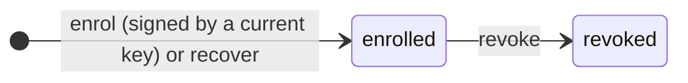

+++
title = "Key"
updated = 2026-10-24
+++

Members' devices and their keys. Every member signs on their own device:
votes, approvals and every other write they make carry the signature of a
device key, and the governed record cites it. A member's address
(`ana@coop-a`) is stable; keys come and go under it. Key is built in, since
nothing else can be signed without it.

## Entities

| Entity | Fields | Notes |
|---|---|---|
| device | `id`, `address`, `label`, `public_key`, `enrolled`, `enrolled_by?`, `revoked?` | `address` is the member's, as text |
| guardian | `address`, `guardian`, `share_commitment` | who holds a share of the member's recovery secret |
| recovery | `address`, `new_key`, `shares[]`, `opened` | a recovery in progress |

Device keys are Ed25519, generated on the device with WebCrypto; the
private key never leaves it. The scope's own key, at the root, is
ML-DSA-44 and read from a file only the database superuser can read. Every
signed artifact names its binding (the parent, a sequence, its audience)
and each signed type is domain-separated, so a signature on one thing never
verifies another.

## Lifecycle

A member's first device is enrolled on admission, through the invitation.
Each later device is enrolled by one of the member's current keys. A
member who has lost every device recovers from their guardians' shares,
which enrols a new key under the same address.

## Writes

| Write | Label | Why |
|---|---|---|
| `POST /api/key/enrol` | ordered | a stolen key must not enrol a device that survives its own revocation |
| `POST /api/key/revoke` | ordered | ordered against that device's writes |
| `POST /api/key/recover` | ordered | guardian shares |

- **enrol** adds a device, signed by a current key of the same member. It
  is ordered against revoke: enrol-then-revoke and revoke-then-enrol must
  not end differently, and without an order a stolen key could plant a
  device the revocation does not reach. Enrolment is rare and cheap to
  order.
- **revoke** ends a device. It is ordered against that device's writes: a
  write signed by the key and received before the revocation stands; one
  received after is refused.
- **recover** enrols a key from a threshold of guardian shares, with the
  secret split by cella's secret app. It is ordered because two recoveries,
  or a recovery and a revocation, must not both stand.

## Powers

| Write | Power | Lanterne |
|---|---|---|
| enrol | the member's own current key | every member, for their own devices |
| revoke | the member's own key; `revoke-key` for anyone else's | Julien, for a lost device reported by phone |
| recover | the guardians' threshold | a threshold the assembly sets |

## Invariants

The key feat owns:

- a device belongs to one address, for good;
- an enrolment is signed by a key of that address that was current at its
  receipt, or by a recovery;
- a revoked key verifies nothing received after its revocation;
- the scope's thresholds are signed policy in the log, never a flag.

What it does not own: whether the member behind an address may act at all
(a suspended or exited member's keys still verify; the permission check
refuses them).

## What it does not know

Key knows no members, only addresses. It does not know a member was
suspended or left. Passkeys for signing in are the session's, not this
feat's. At rung 4 the signing code moves into a native client the host does
not serve; at rung 5 addresses are recognised across scopes.

## Lanterne

- Fourteen live devices for ten members: four have a laptop and a phone.
- Hugo's old laptop was revoked on 12 May 2026; his votes signed on it
  before then still verify.
- Inès enrols her first device when d-2026-012 admits her.
