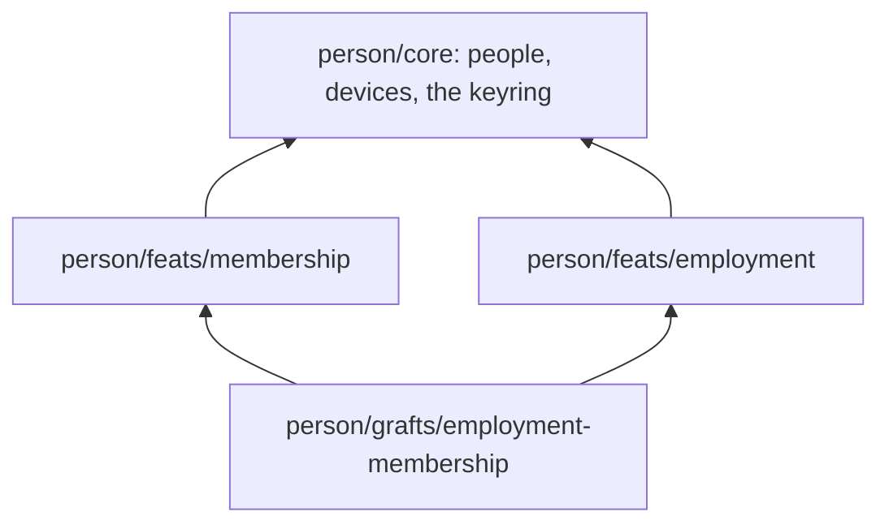
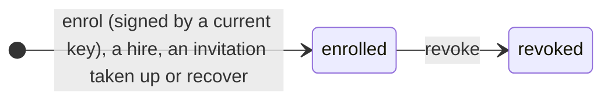

+++
title = "Person"
updated = 2026-11-03
+++

Everyone the co-op knows, by the address they sign with, and their
devices. A person is who someone is, whatever they hold: their name, how
to reach them and the keys that sign their writes. What they hold is the
children's: a membership is `membership`'s and an employment is
`employment`'s, two feats nested in this one. Person is built in, since
nothing can be signed without it.

## Why a node

Members and workers are one person seen two ways. Inès is hired before she
is invited; Paul was a member and a worker and left as both. Kept apart,
the two feats each held a name and joined by address through a graft.
Here the person is the parent, and its core is what the children
inherit: each reads the person and their devices, and neither knows the
other. A person's roles are derived. They are a member if they hold a
membership and a worker if they hold an employment, and a person may hold
both, either or, as a contact one day, neither. A contact and an agent are
later children of the same shape; neither is built.

## Entities

| Entity | Fields | Notes |
|---|---|---|
| person | `address`, `name`, `email?`, `phone?` | the address is the person's for good, the pseudonym every entry names them by |
| device | `key`, `address`, `label`, `enrolled`, `enrolled_by?`, `revoked?` | `key`, the Ed25519 public key, is the device's id; `address` is the person's |
| guardian | `address`, `guardian`, `share_commitment` | who holds a share of the person's recovery secret; not built |
| recovery | `address`, `new_key`, `shares[]`, `opened` | a recovery in progress; not built |

A person comes in through a child's write: an invitation
(`membership`) or a hire (`employment`) names them by address and makes
them a person if no one holds it yet (`entering`, in the child's own
transaction). Someone already known keeps their name, so a worker invited
to join is the same person, not a second one.

Device keys are Ed25519, generated on the device with WebCrypto; the
private key never leaves it. The scope's own key, at the root, is Ed25519
too: the notary signs receipts and log entries with it, read from a file
only the database superuser can read. No signature is post-quantum yet.
Every signed artifact names its binding (the parent, a sequence, its
audience) and each signed type is domain-separated, so a signature on one
thing never verifies another.

## Devices

A person's first device comes with what brings them in. A hire enrols
the worker's at once, so they sign their own time from their first day.
An invitation is taken up by its link: the invitee's browser makes their
first device, which signs the acceptance that enrols it. Either way the
first device names
no device that enrolled it, and so do the devices of people the seed
loads from before the log. Each later device is enrolled by one of the
person's current keys. A person who has lost every device recovers from
their guardians' shares, which enrols a new key under the same address;
recovery is not built.

## Actions

| Action | Label | Why |
|---|---|---|
| `POST /api/person/profile` | confluent | a person's own fields |
| `POST /api/person/forget` | ordered | erasure wins over every update |
| `POST /api/person/enrol` | ordered | a stolen key must not enrol a device that survives its own revocation |
| `POST /api/person/revoke` | ordered | ordered against that device's writes |

- **profile** sets a person's own name, email or phone.
- **forget** erases a person's own contact details.
- **enrol** adds a device, signed by a current key of the same person. It
  is ordered against revoke: enrol-then-revoke and revoke-then-enrol must
  not end differently, and without an order a stolen key could plant a
  device the revocation does not reach. Enrolment is rare and cheap to
  order.
- **revoke** ends a device. It is ordered against that device's writes: a
  write signed by the key and received before the revocation stands; one
  received after is refused. A person revokes a device from another of
  their devices: the keyring reads the write's own state, so a device
  revoking itself is no longer current when the notary checks it.
- **recover** enrols a key from a threshold of guardian shares, with the
  secret split by cella's secret app. It is ordered because two recoveries,
  or a recovery and a revocation, must not both stand. Not built, so
  not declared: `POST /api/person/recover` comes with the guardians, and
  with the power it needs and the mandate that grants it.

Erasing all of one's own personal data, once one has left the co-op, is
every person's right, `erase-own-data`, taken as a membership's write
(`membership:member:erase`); no one erases another, and no motion decides
it. A worker who was never a member is not erased yet.

## Powers

| Action | Power | Lanterne |
|---|---|---|
| profile | `keep-profile`, every person's right: their own | everyone |
| forget | `keep-profile`, every person's right: their own contact details | everyone |
| enrol | `keep-devices`, every person's right: their own current key | everyone, for their own devices |
| revoke | `keep-devices`, every person's right: their own key; `revoke-key` for anyone else's, not built | Julien, for a lost device reported by phone |
| recover | not built, and not declared until it is: the guardians' threshold, with the power it needs and the mandate that grants it | a threshold the assembly sets |

`003-powers.sql` registers each action's power, so none is allowed by
omission: the four a person takes on what is their own need a power
every person's right grants ([rights](../circle/index.md#rights)),
checked by `circle-membership`'s guard, and this feat's guards check
what they keep is theirs.

## Schema

`person` (`core/sql/`):

- `person.person`, one row per address, with the name and the optional
  email and phone. The app role may select, insert and update the name and
  contact details; the guards role, `cella_guards`, may select.
- `person.device`, one row per device by its public key, with its address,
  label, the day it was enrolled, the device that signed its enrolment
  (none for a first device) and the day it was revoked. A trigger keeps a
  device's key, address and enrolment fixed and a revocation standing,
  raising SQLSTATE `09000`. The app role may select, insert and update;
  the guards role may select.
- `person.rights`, who holds each right, one row a right with the
  function `(address, day) → boolean` that says whether an address is
  one of its people on a day: `person.known` for every person, which
  this core registers, and the active members and those employed, which
  `membership` and `employment` register by
  `person.register_right(name, fn, owner)`, so this core knows neither
  by name. `person.holds(actor, right, day)` asks it: only a person the
  co-op knows holds any right, and no one a right nobody registered.
  The app role and the guards role may select it; only the migrations
  register.

The children's SQL reads this schema, as a graft's reads the feats it
joins: membership enrols the device an invitation's acceptance makes, and employment
the one a hire carries.

## Personal data

`004-personal.sql` registers in `cella.personal`, by the person's address:
the name, of class `profile`, and the email and phone, of class `contact`.
The address itself is the pseudonym every entry names the person by,
commented not personal, and so is a device's. A write carrying any of them
marks it, so the log commits to it and the vault keeps it. The register of
the staff keeps a copy of a worker's name, of class `payroll`, which is
employment's.

## Guards

- `person.own_profile`, on `person:person:profile`: the profile is the
  actor's own (`cella.actor()`).
- `person.forgets`, on `person:person:forget`: the actor erased their own
  contact details, and nothing more.
- `person.verifies(actor, device)`, the scope's keyring, registered in
  `cella.keyring`: the device is enrolled, under the actor's address, and
  not revoked. `cella.submit` calls it for every write, after checking the
  signature and before any guard, under the log's head lock.
- `person.enrols`, on `person:device:enrol`: the address is the actor's,
  and the device was enrolled by this write, naming the signing device
  (`cella.device()`) as `enrolled_by`.
- `person.revokes`, on `person:device:revoke`: the device is the actor's,
  and was revoked by this write.

## Handlers

- `profile` (confluent): sets the person's given fields, name, email or
  phone, and submits `{ person, fields, values }`, each value marked
  personal, so the log keeps a commitment to it.
- `forget` (ordered): submits `{ person, erasure }`, the erasure of the
  person's own contact details.
- `enrol` (ordered): inserts the device on the verdict date, enrolled by
  the device that signed the write; submits `{ address, key, enrolled }`,
  leaving the person's label out.
- `revoke` (ordered): sets the device's `revoked` to the verdict date.
- `entering`, no write of its own: what an invitation or a hire runs in
  its transaction to bring a person in, telling the child whether the
  person is new, so its payload commits to their name only then.
- `enrolling`, no write of its own: what a hire or an invitation taken up
  runs in its transaction to enrol the person's first device, on the
  verdict date and by no device, refusing a key enrolled already. A
  child changes the person's rows only through `entering` and
  `enrolling`.

Signing is the client's, `@cella/org-sign` in org's core.

## Invariants

The person feat owns:

- a device belongs to one address, for good;
- an enrolment is signed by a key of that address that was current at its
  receipt, or by a recovery, a hire or an invitation taken up, which the
  device it enrols signs;
- a revoked key verifies nothing received after its revocation;
- the scope's thresholds are signed policy in the log, never a flag.

What it does not own: whether the person behind an address may act at all
(a suspended or exited member's keys still verify; the permission check
refuses them).

## Shell

The `people` collection in Governance: everyone the co-op knows, by name.
Each child adds its chip, a badge column to filter and group by: Member,
the membership's status, and Worker, employed or left. The New form is the
children's: an invitation and a hire, each under its title. A person's
page holds their address and devices, with the profile write on it; the
children add their membership's and employment's properties and tabs
(Joining, Own and decide), and the grafts joining them the rest. The
`devices` collection lists every device, current ones first. On a person's
own page the device their session signs with is marked as this device,
and each other current one has its revoke, signed from this one; with
none, the page says it is their only device. Enrolling a later device
from a current one is not offered yet. The dev server signs as a person with a
device's TEST-ONLY fixture key only when it is the key enrolled under that
label and not revoked.

The `inbox` collection is what waits on the acting person, at the head of
the sidebar with its count, each row linking to where it is done. This
feat keeps it and adds nothing of its own; each slice that knows a kind
adds its rows (`rows`): an invitation to take up (`membership`), a stance
to take on an open motion (`circle-membership-motion`), a mention not
yet answered (`membership-motion`), a meeting to say whether they will
come to (`circle-meeting-membership`), time, expenses and pay runs to
approve or pay (`circle-membership-timesheet`, `circle-expense-membership`,
`circle-membership-payslip`). An ask is a row of its kind, what it says,
what it concerns, since when and by when (`models/inbox.ts`); it leaves
the inbox when what it waits for is done, read again each time, and
nothing of it is stored.

## Lanterne

- Twelve people: ten members, Paul, who left, and Inès, employed and
  invited, not yet a member (`person.toml`).
- Fifteen live devices: four people have a laptop and a phone. Their keys
  are TEST-ONLY, derived from each device's address and label, so the seed
  and the tests hold the same keys.
- Hugo's old laptop was revoked on 12 May 2026: it signs nothing now.
- Inès signs with the laptop her hire enrolled, and with the phone on
  which she took up her invitation on 1 October.

## Analytics

Its [analytical contract](../../../../_corpus/doc/architecture.md#analytical-contracts), `core/sql/analytics.sql`, publishes `person.people` to the analytics shell: each person by address, with their name, which erasure redacts. Contact details are not shared.
